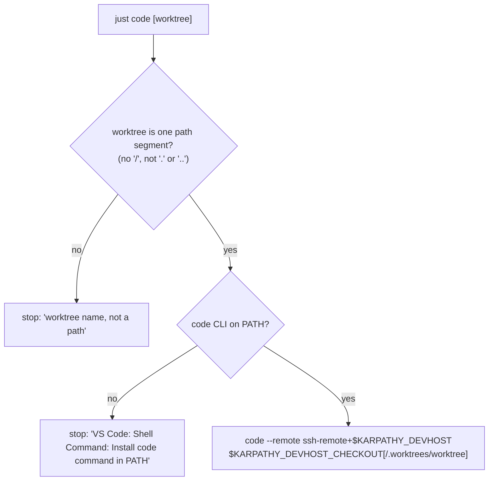

# Architecture: edit code on the dev server from the Mac's VS Code

## Files

| File | Role |
|---|---|
| `.vscode/settings.json` | New, committed. Stack port range 8000–8099 ignored for auto-forwarding. Watcher and search excludes for `.worktrees/`, `tmp/` and the build outputs. Plain JSON (no comments), so `jq` can check it. |
| `.vscode/extensions.json` | New, committed. `recommendations`: `dbaeumer.vscode-eslint`, `ms-playwright.playwright`, `anthropic.claude-code`, `redhat.ansible`, `nefrob.vscode-just-syntax`. |
| `.gitignore` | Unchanged: `.vscode/` isn't ignored today. Personal files VS Code might drop there (`*.code-workspace`) stay untracked by convention. |
| `deploy/ansible/roles/devtools` | New task: `/etc/sysctl.d/60-karpathy-devtools.conf` with `fs.inotify.max_user_instances = 1024` and `fs.inotify.max_user_watches = 1048576`, applied with `sysctl --system` on change (handler). Values in `defaults/main.yml`. |
| `deploy/ansible/dev.test.sh` | Asserts the file and the applied values. |
| `deploy/code.sh` | New, runs on the Mac. `code.sh [worktree]` → `code --remote ssh-remote+<host> <checkout>[/.worktrees/<worktree>]`. Refuses a worktree name that isn't a single path segment (`/`, `..`). Stops with a hint when the `code` CLI is missing. |
| `deploy/code.test.sh` | Tests `code.sh` with a stub `code` on the `PATH` that records its arguments. Part of `just check`. |
| `justfile` | `code worktree=""` → `bash deploy/code.sh {{worktree}}`; `code.test.sh` added to `check`. |
| `docs/dev-server.md` | New section "VS Code". The picture and the table name it next to herdr. |
| `deploy/README.md`, `CLAUDE.md` | One-line pointers. |

## Decisions

### Key decisions

| Decision | Alternatives considered | Why |
|---|---|---|
| VS Code **Remote-SSH** on the Mac, connecting to the existing SSH entry `karpathy-dev` | `code tunnel` (Remote Tunnels via a Microsoft relay and a GitHub/Microsoft login); code-server in the browser; mounting the server's files on the Mac (sshfs, Mutagen) and running VS Code locally | It reuses the Tailscale-only SSH path and the keys we have. Nothing new listens on the server, and there's no second login. Language servers, ESLint and git run next to the files and `node_modules` (arm64 Linux), not on the Mac against a mount. |
| Stack ports 8000–8099 are **never auto-forwarded** (`remote.portsAttributes` `"8000-8099": {"onAutoForward": "ignore"}`). The SSH entry's `LocalForward` stays the one path | Let VS Code forward and drop the `LocalForward` lines; `remote.autoForwardPorts: false` for everything | A stack must open at the same number on the Mac: Caddy's dev site answers on `localhost` and Vite's HMR client dials `HMR_CLIENT_PORT` = 80N0. VS Code would move a taken port to a random one. Ignoring only the range keeps auto-forward for anything else (e.g. a Playwright trace viewer). |
| Workspace settings are **committed** in `.vscode/` | Docs that tell you what to set; a `*.code-workspace` file | Every checkout and worktree gets them with `git worktree add`, and on the Mac too. Only project rules go there, no personal taste. |
| Watcher and search excludes for `**/.worktrees/**`, `**/tmp/**`, `**/node_modules/**`, `**/dist/**`, `**/_site/**`, `**/test-results/**`, `**/playwright-report/**` | Rely on VS Code's defaults (only `node_modules/*/**` and `.git/objects`) | Each worktree has its own window. Without the exclude, the main clone's window would also watch and index every parallel agent's checkout. |
| Raise **inotify limits** in role `devtools`: 1024 instances, 1 048 576 watches | Leave the defaults (128 / ~244 k on `karpathy-dev`); set `files.watcherExclude` only | Several windows × (VS Code watcher + Vite + `tsc` + ESLint server) pass 128 instances. A watch costs at most ~1 KB of kernel memory, so 1 M watches is at most ~1 GB of the 32 GB, and only if used. |
| **`just code [worktree]`** on the Mac via `deploy/code.sh` | Docs only (Connect to Host → path); a VS Code "recent" entry | One command per window, the same shape as `just devhost`. The script is testable with a stub `code`. |
| Host and checkout path from `KARPATHY_DEVHOST` (default `karpathy-dev`) and `KARPATHY_DEVHOST_CHECKOUT` (default `/home/$USER/karpathy.app`) | Hard-code both; put them in `deploy/settings/` | The login user on the server has the Mac's user name (`docs/dev-server.md`), so the default fits. `deploy/settings/` is for what the app's components read, not for Mac-side dev tooling. |
| VS Code Server is installed and updated **by VS Code**, not Ansible | Pre-install it in `devtools` | VS Code pins the server to the Mac client's commit. An Ansible-installed one would be the wrong version after every client update. |
| Long runs stay in **herdr/tmux**; the docs say so | Rely on VS Code's persistent terminals | VS Code restores a terminal only within its reconnection grace time. `claude` and `just e2e` must survive a laptop that slept overnight. |
| No `launch.json`, no dev container | Ship debug configs | Out of scope (proposal). |

### Workspace settings (shape)

```json
{
  "remote.portsAttributes": {
    "8000-8099": { "onAutoForward": "ignore" }
  },
  "files.watcherExclude": {
    "**/.worktrees/**": true, "**/tmp/**": true, "**/node_modules/**": true,
    "**/dist/**": true, "**/_site/**": true, "**/test-results/**": true, "**/playwright-report/**": true
  },
  "search.exclude": { "**/.worktrees": true, "**/tmp": true, "**/_site": true }
}
```

`search.exclude` already inherits `files.exclude` and VS Code's `node_modules` default, so it lists only the rest.
`files.exclude` stays empty: the tree should still show `tmp/` (stack state, logs).

### `deploy/code.sh`



The script doesn't check on the server that the folder exists, which would cost an SSH round trip. VS Code shows a
missing folder clearly.

### First connect

```mermaid
sequenceDiagram
  actor U as Developer
  participant M as Mac: just code
  participant V as VS Code (Mac)
  participant D as karpathy-dev
  U->>M: just code
  M->>V: code --remote ssh-remote+karpathy-dev ~/karpathy.app
  V->>D: ssh karpathy-dev (Tailscale; LocalForward 8010…8090 come along)
  V->>D: install VS Code Server (first time, ~/.vscode-server)
  D-->>V: workspace open, .vscode/ read
  V->>U: "install recommended extensions?" (on the remote side)
  U->>V: terminal: just dev up
  D-->>V: port 8010 listening → ignored (8000–8099)
  U->>U: Mac browser https://localhost:8010 (SSH entry's forward)
```

## Integration points

- **SSH entry** (`deploy/README.md`): unchanged. VS Code uses the system `ssh` and therefore the entry's `HostName`,
  `ServerAliveInterval` and `LocalForward`s.
- **Claude Code**: the CLI from `devtools` works in a VS Code terminal. The Claude Code extension (recommended)
  runs on the remote side and uses the same login (`~/.claude`) as the CLI.
- **git**: VS Code's git runs on the server with the credential and identity that `devtools` writes.
- **Mac checkout**: the same `.vscode/` applies to local work on the Mac. The ignored port range keeps VS Code from
  touching Mac stacks too, which is harmless because they're local.

## Risks

- **Settings scope**: `remote.portsAttributes` has to take effect from workspace settings in a Remote-SSH window. If
  VS Code reads it only from user or remote settings, the docs tell you to add it to the remote settings
  (`~/.vscode-server/data/Machine/settings.json`), and the smoke test catches it.
- **`dev.test.sh` and sysctl**: the test container is privileged and shares the kernel's user namespace, so applying
  the sysctl there also raises the limits of the machine running the test (Rancher's VM on the Mac, or `karpathy-dev`
  itself). It only ever raises them, and they reset on reboot of a Mac VM. Accepted.
- **Two SSH connections and the forwards**: herdr and VS Code both carry the `LocalForward`s, and the first one wins.
  Closing it drops the forward while the other connection stays. Documented. `ssh -N karpathy-dev` is the fix, as
  today.
- **arm64**: VS Code Server and the recommended extensions ship linux-arm64 builds. An extension without one would
  fail to install remotely. None of the five lacks one.
