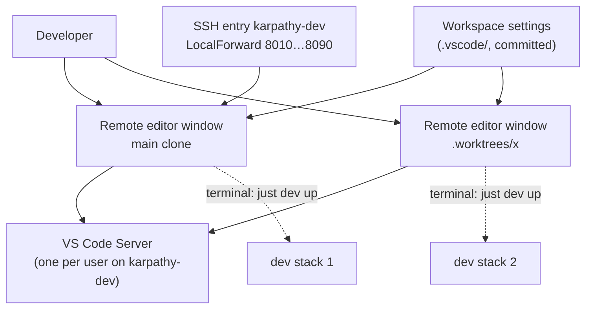

# Domain: edit code on the dev server from the Mac's VS Code

## New terms

| Term | Meaning |
|---|---|
| **Remote editor window** | A VS Code window on the Mac that is connected to the remote dev host through Remote-SSH, on one checkout (the main clone or one worktree). Files, terminals, git, language servers and extensions run on the server; the Mac shows the UI. One window per checkout, so it matches the existing rule of one stack per checkout. |
| **VS Code Server** | What Remote-SSH installs on the remote dev host the first time a window connects, in `~/.vscode-server/`. VS Code installs and updates it, not Ansible. It runs the workspace extensions and terminals. |
| **Workspace settings** | The committed `.vscode/settings.json` and `.vscode/extensions.json`. They hold project rules every checkout needs: which ports VS Code leaves alone, what it doesn't watch, which extensions it recommends. Personal preferences (theme, font, keybindings) don't belong there. |
| **Stack port range** | 8000–8099: every dev stack's port block (80N0–80N9, N = 1…9) plus 800x. VS Code never auto-forwards these ports. Only the SSH entry's `LocalForward` maps them, so a stack opens on the Mac at the same number. |

Changes no existing term. A remote editor window is a client of a **dev host** like a terminal is. It isn't a dev host
itself, and it owns no stack.

## How the pieces relate

## Scenarios

- **Open the main clone**: `just code` on the Mac → a window on `karpathy-dev:~/karpathy.app`. The first time, VS Code
  installs its server (about a minute) and offers the recommended extensions.
- **Open a worktree**: `just code x` → a second window on `~/karpathy.app/.worktrees/x`. That worktree's `just dev up`
  takes the next free stack, as in a terminal.
- **The worktree doesn't exist**: VS Code opens the window but reports a missing folder. `just code` doesn't check
  first, because the path lives on the server and the recipe runs on the Mac.
- **A stack starts in a window's terminal**: VS Code sees port 80N0 listening, ignores it (stack port range), and
  https://localhost:80N0 works through the SSH entry's forward, the same port as in a terminal.
- **herdr is also connected**: herdr's SSH connection already holds the `LocalForward` ports. VS Code's SSH connection
  warns `bind: Address already in use` in its log and carries on. Whichever connection came first serves the
  forward. Closing it drops the forward until the next connect.
- **The connection drops**: the window reconnects by itself. Terminals come back if the reconnect happens within
  VS Code's reconnection grace time; past it, they are gone. Long runs (`claude`, `just e2e`) therefore belong in
  herdr or tmux, or `just resume` picks the conversation up again. Dev stacks keep running.
- **Mac stack on the same port**: as before, one dev host at a time (`docs/dev-server.md` › Ports).

## Unchanged

- Stack numbering, ownership and the `just` commands on the server.
- herdr and tmux stay the way to run long jobs that must survive a disconnect.
- The SSH entry `karpathy-dev` stays the one place that defines host, keepalive and forwards. VS Code reads it.
