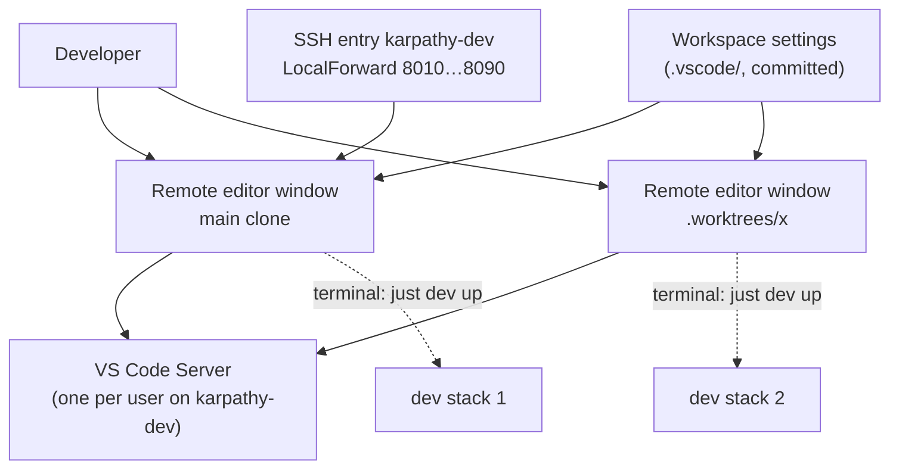

# Domain: edit code on the dev server from the Mac's VS Code

## New terms

| Term | Meaning |
|---|---|
| **Remote editor window** | A VS Code window on the Mac that is connected to the remote dev host through Remote-SSH, on one checkout (the main clone or one worktree). Files, terminals, git, language servers and extensions run on the server; the Mac shows the UI. One window per checkout, so it matches the existing rule of one stack per checkout. |
| **VS Code Server** | What Remote-SSH installs on the remote dev host the first time a window connects, in `~/.vscode-server/`. VS Code installs and updates it, not Ansible. It runs the workspace extensions and terminals. |
| **Workspace settings** | The committed `.vscode/settings.json` and `.vscode/extensions.json`. They hold project rules every checkout needs: which ports VS Code leaves alone, what it doesn't watch, which extensions it recommends. Personal preferences (theme, font, keybindings) don't belong there. |

## Changed terms

**Changes system term *Port forward*.** Today: "the SSH entry's `LocalForward` maps the remote 80N0 to the Mac's
`localhost:80N0`". New: the SSH entry's `LocalForward` stays the one forward for the nine stack ports 8010, 8020, …,
8090. VS Code leaves those alone (they are listed one by one, not as a range). Any other port a process on the remote
dev host opens, such as prodtest's 80N5 or the `just site` preview on 8099, is forwarded by a remote editor window's
VS Code itself, at the same number if that number is free on the Mac.

A remote editor window is a client of a **dev host** like a terminal is. It isn't a dev host itself, and it owns no
stack.

## How the pieces relate

## Scenarios

- **Open the main clone**: `just code` on the Mac → a window on `karpathy-dev:~/karpathy.app`. The first time, VS Code
  installs its server (about a minute) and offers the recommended extensions.
- **Open a worktree**: `just code x` → a second window on `~/karpathy.app/.worktrees/x`. That worktree's `just dev up`
  takes the next free stack, as in a terminal.
- **The worktree doesn't exist**: VS Code opens the window but reports a missing folder. `just code` doesn't check
  first, because the path lives on the server and the recipe runs on the Mac.
- **A stack starts in a window's terminal**: VS Code sees port 80N0 listening, ignores it (one of the nine forwarded
  stack ports), and https://localhost:80N0 works through the SSH entry's forward, the same port as in a terminal.
- **prodtest or the site preview in a window's terminal**: `just prodtest` listens on 80N5 and `just site` on 8099.
  The SSH entry doesn't forward either one, so VS Code auto-forwards them, at the same number if it's free on the Mac.
  From a herdr terminal they still can't be reached, as today.
- **`just code` typed on the server**: the script sees that the local host name is `$KARPATHY_DEVHOST` and stops with
  "run on the Mac; here use `code .worktrees/x`", instead of having the server SSH to itself.
- **herdr is also connected**: herdr's SSH connection already holds the `LocalForward` ports. VS Code's SSH connection
  warns `bind: Address already in use` in its log and carries on. Whichever connection came first serves the
  forward. Closing it drops the forward until the next connect.
- **The connection drops**: the window reconnects by itself. Terminals come back if the reconnect happens within
  VS Code's reconnection grace time; past it, they are gone. Long runs (`claude`, `just e2e`) therefore belong in
  herdr or tmux, or `just resume` picks the conversation up again. Dev stacks keep running.
- **Mac stack on the same port**: as before, one dev host at a time (`docs/dev-server.md` › Ports).

## Unchanged

- Stack numbering, ownership and the `just` commands on the server.
- herdr and tmux stay the way to run long jobs that must survive a disconnect.
- The SSH entry `karpathy-dev` stays the one place that defines host, keepalive and forwards. VS Code reads it.
