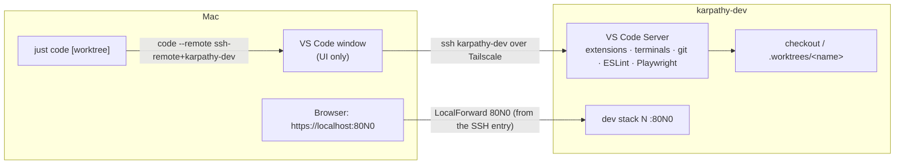

# Proposal: edit code on the dev server from the Mac's VS Code

## Why

The remote dev host `karpathy-dev` runs checkouts, dev stacks, `just check`, `just e2e` and `claude`, but the only way
to work there today is a terminal (herdr, tmux, plain SSH). Reading and editing code in a terminal is slow next to
an editor: no file tree, no multi-file search, no inline lint, no diff view, no Playwright test runner.

We want to **edit code that lives on `karpathy-dev` in VS Code on the Mac**. The files, git, Node, Docker and the
stacks stay on the server; only the window is on the Mac. VS Code's **Remote-SSH** does exactly this: the Mac's
VS Code connects over SSH, installs a small VS Code Server on the remote host, and runs the extensions, terminals,
language servers and git there.

`docs/dev-server.md` already names "VS Code Remote-SSH" as a way to connect, but nothing makes it work well. Several
things go wrong out of the box:

- **Port forwards collide.** VS Code auto-forwards every port a remote process listens on. Stack N's proxy on 80N0 is
  already forwarded by the SSH entry's `LocalForward`, so VS Code picks a *different* free local port. The app then
  loads at the wrong port and Vite's live reload breaks, because `HMR_CLIENT_PORT` expects 80N0.
- **File watchers run out.** Ubuntu's default `fs.inotify.max_user_instances` is 128 (checked on `karpathy-dev`
  2026-10-21: 128 instances, 243 651 watches). A VS Code window per worktree, plus Vite, `tsc --watch` and the
  ESLint server in each, exhaust it. VS Code then shows "Visual Studio Code is unable to watch for file changes".
- **Watching too much.** Without a workspace config VS Code watches and indexes `.worktrees/` (every parallel
  agent's whole checkout, with its own `node_modules`), `tmp/` and the build outputs.
- **Opening a worktree takes steps.** Each worktree should be its own window, which means typing a remote path in
  the "Connect to Host" dialog every time.
- **No recommended extensions**, so every new setup starts from nothing.

## What changes

- **Workspace settings in the repo** (`.vscode/settings.json`): VS Code ignores the stack ports 8000–8099 for
  auto-forwarding, so the SSH entry's `LocalForward` stays the one path to a stack. It also excludes `.worktrees/`,
  `tmp/` and the build outputs from file watching and search. Committed, so every checkout and worktree gets them.
- **Recommended extensions** (`.vscode/extensions.json`): ESLint, Playwright Test, Claude Code, Ansible, `just`
  syntax. VS Code offers to install them on the remote side when the folder opens.
- **Higher inotify limits on the dev server**: role `devtools` sets `fs.inotify.max_user_instances` and
  `max_user_watches` through `/etc/sysctl.d/`, and applies them.
- **`just code [worktree]` on the Mac**: opens a new VS Code window on `karpathy-dev` for the main clone, or for
  `.worktrees/<worktree>`, through `code --remote ssh-remote+karpathy-dev <path>`. On the server, `code <file>` in
  a VS Code terminal opens the file in that window (built into Remote-SSH).
- **Docs**: a "VS Code" section in `docs/dev-server.md` covering the one-time Mac setup (VS Code, the Remote-SSH
  extension, the `code` CLI), the first connect, worktree windows, port forwards and what survives a dropped
  connection. Also short pointers in `deploy/README.md` and `CLAUDE.md`.

## Out of scope

- Browser-based editors on the server (code-server, `code tunnel`, GitHub Codespaces): they need a public or tunnelled
  endpoint and a second auth path. Remote-SSH reuses the Tailscale-only SSH we already have.
- Editing from the iPad or phone: still out of scope, as in `remote-dev`.
- Other editors (Cursor, Zed, JetBrains Gateway). Cursor and VSCodium read `.vscode/` too, and nothing here prevents
  them, but only VS Code is tested.
- Syncing personal VS Code settings, keybindings or themes: Settings Sync handles that, per user.
- Debug launch configs (`.vscode/launch.json`) for the backend or Vite: a follow-up if needed. The stack runs in
  Docker, so attaching a debugger is a change of its own.
- A VS Code dev container: the dev server *is* the environment, so a container on top adds nothing.

## Expected outcome

On the Mac, `just code` opens a VS Code window connected to `karpathy-dev` on `~/karpathy.app`. The recommended
extensions are offered, and ESLint marks lint errors inline. With `just dev up` running in that window's terminal,
https://localhost:80N0 in the Mac's browser loads the app on the same port (no second, VS Code-chosen port appears in
the Ports view), and editing a `.tsx` file live-reloads it. `just code <worktree>` opens a second window on a
worktree at the same time, and neither window reports that it can't watch for file changes. `claude` (CLI or the
Claude Code extension) runs inside the window as it does in herdr.
