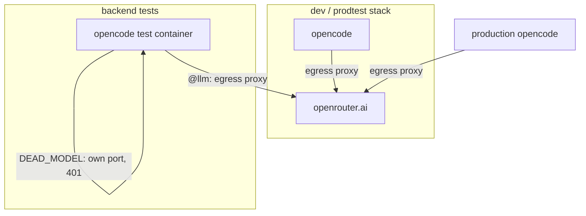

# Architecture: remove Ollama

## Overview

**Every model call goes to OpenRouter** (user decisions 2026-10-16, after the first apply round: omlx made three
`@llm` tests fail; then "remove omlx completely"). Production, dev, prodtest, e2e and the backend's `@llm` tests use
the production OpenRouter models, locally and in CI. No local model server, no relay to the Mac.

## Test harness (`apps/backend/test/opencode-container.ts`)

- `ensureOllama()` and the `kai-test-ollama` container go; `startOpencode` starts no model server.
- `pickTestModels(env, { openrouterKey })` (pure, unit-tested):
  1. No OpenRouter key (`OPENROUTER_API_KEY`, else the file `deploy/secrets/openrouter_api_key`) → the `@llm` tests
     throw "no OpenRouter key: put it into deploy/secrets/openrouter_api_key (or OPENROUTER_API_KEY)", before any
     container starts. No silent model, no auth error mid-turn.
  2. `LLM_TEST_MODEL` / `LLM_VISION_MODEL` set → those (other OpenRouter models).
  3. Else the models of `deploy/settings/test.yaml` (= production's).
  The default tier doesn't need a test model (see `DEAD_MODEL`).
- The provider config handed to the container (`OPENCODE_CONFIG_CONTENT`): the built-in `openrouter` provider with
  the ZDR routing options of `settings.yaml` (`renderOpencodeProviders`); the key passed by name
  (`-e OPENROUTER_API_KEY`), so it never appears in a command line; traffic through the egress proxy as in production.
- `DEAD_MODEL = 'dead/kai-no-such-model'`, `DEAD_MODEL_2` likewise with image input declared, on a test-only
  `openai-compatible` provider `dead` whose base URL is opencode's own port in its container
  (`http://127.0.0.1:4096/no-such-provider/v1`): opencode's server answers 401 (its server password; the spike saw the
  turn end in "Unauthorized" after about 1 s), which the AI SDK marks non-retryable, so the turn fails fast. Offline:
  no model server, no network, no key; the default tier runs the same in CI and on any Mac. It makes no model call
  (grill 2026-10-16, Q2). The `dead` provider exists only in the test container's config, never in `deploy/settings`.
- The vision model for `look_at_image`: `VISION_BASE_URL` OpenRouter's, `VISION_API_KEY` passed by name,
  `VISION_REQUEST_OPTIONS` from the gateway's model options.
- Tests that name a local provider or its ids are rewritten, assertions unchanged: the vault-can't-override test and
  the websearch-offered test use the `dead` provider (always there); fixtures and unit tests get `openrouter/…` ids.

## Settings (`deploy/settings`, `packages/settings`)

- `settings.yaml`: gateways `ollama` and `omlx` removed; `openrouter` is the only gateway.
- `schema.ts`: `relay_upstream` removed. The `openai-compatible` kind (with `base_url`) stays: the harness stays
  provider-agnostic (CLAUDE.md), and the settings tests keep covering it with a neutral gateway in their fixture.
- `render.ts`: the relay upstream env var goes from the compose `.env`.
- `dev.yaml`, `prodtest.yaml`, `test.yaml`: no `ai` block; they inherit production's gateway, default model and
  vision model. The key comes from `deploy/secrets/openrouter_api_key` (dev renders with it; `just prodtest` copies
  `deploy/secrets/*_api_key`).
- Fixtures: `dev-ollama.json` and `dev-omlx.json` deleted; `test/helpers.ts` central fixture on a neutral
  `openai-compatible` gateway + `openrouter`.

## Compose, proxy, scripts

- `compose.dev.yml`, `compose.prodtest.yml`: the relay service (`ollama` / `ollama-bridge`) and opencode's `NO_PROXY`
  override (it only named the relay) go.
- `deploy/proxy/Caddyfile.ollama-relay`: deleted.
- `deploy/dev.sh`: the model pull and the `stack_model_ready` check go; `deploy/stack.sh`: `stack_model_ready` goes.
- `deploy/stack.test.sh`: the checks of the relay and of `stack_model_ready` are removed with them (the thing they
  tested no longer exists); the `hetzner: no relay` check goes too.

## CI (`.github/workflows/ci.yml`)

- Nightly job: the Ollama volume and model pull go; `npm run test:llm` stays and runs on OpenRouter with the GitHub
  secret `OPENROUTER_API_KEY` (the production key). It also runs `npm run test:github`.
- Default job: needs no model server, no network to a provider and no `OPENROUTER_API_KEY` (offline dead model).

## Guard against a comeback

`packages/settings/test/repo-settings.test.ts` (it already reads the repo) gains: `git ls-files` minus
`specs/research/**`, `DECISIONS.md` and this change's own directory (`specs/changes/remove-ollama/`, deleted at
archive) contains no line matching the word case-insensitively. The test builds its pattern from pieces
(`'olla' + 'ma'`) so it doesn't match itself and needs no exemption. Generated renders (`*.html`, `*.svg` of `.mmd`
sources) are regenerated, not exempted. No such guard for omlx (offered, not asked for).

## Decisions

| Decision | Alternatives | Why |
|---|---|---|
| All tests on OpenRouter, everywhere (backend `@llm`, e2e, prodtest; local and CI) | omlx → OpenRouter → fail (grill 2026-10-15, built in the first apply round) | The user's call (2026-10-16): one mental model, no test runs that fail because the local model is weak; budget is fine. |
| omlx removed completely, with the relay | keep omlx as a `dev.local.yaml` option (Q3a) | The user's call (2026-10-16): no scenario uses a local model; the option kept a whole relay layer alive for nobody. |
| `openai-compatible` gateway kind kept | remove it with omlx | Provider-agnostic by design (CLAUDE.md); costs nothing. |
| No key → `@llm` tests throw before starting | auth error inside the turn | No silent or half-broken model; says what to do. |
| Production OpenRouter key for tests and CI | a separate test key | The user's choice: one key to manage. |
| `DEAD_MODEL` on a test-only `dead` provider pointing at opencode's own port (401) | OpenRouter unknown id; a stub 404 container | Offline: default tier needs no network, key or CI secret, and an OpenRouter outage can't redden lifecycle tests; it makes no model call (grill 2026-10-15, confirmed 2026-10-16). |
| Dev, prodtest, test settings inherit production's models | cheaper OpenRouter models | Tests run what ships. |
| `@llm` nightly in CI with the key as a secret | every push; none | User decision Q1 (2026-10-16): coverage without paying per push. |
| Guard pattern built from pieces | exempt the guard file | The guard file stays checked itself. |
| A guard test for the word | rely on review | A mechanical check keeps a rule the user stated as absolute. |
