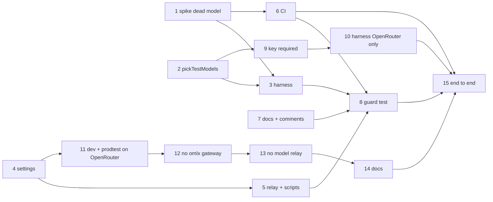

# Plan: remove Ollama

The test harness, the settings and the stack scripts move independently; the guard test closes the change once
every mention is gone. Commands: `npm test -w apps/backend -- <file>`, `npm test -w packages/settings`,
`bash deploy/stack.test.sh`, full suite `just check`, model tier `npm run test:llm`.

## Test harness

- [x] Spike: a turn on the offline dead model fails fast
  - Depends on: none
  - Test first: `apps/backend/test/opencode-container.test.ts` › "a turn on dead/kai-no-such-model (provider `dead` → http://127.0.0.1:4096/no-such-provider/v1) ends in error and idle within 15 s, never in retry", with no network to a provider and no key in the env. Fails today: no `dead` provider. If opencode's port doesn't answer a fast non-retryable 4xx there, stop and re-grill (fallback was a stub 404 container).
  - Verify: `npx vitest run test/opencode-container.test.ts` (in `apps/backend`) → green
- [x] `pickTestModels`: override → omlx → OpenRouter → error
  - Depends on: none
  - Test first: `apps/backend/test/opencode-container.test.ts` › "LLM_TEST_MODEL wins", "omlx answering → the dev.yaml omlx models", "omlx answering without the dev.yaml model → throws `omlx has no <model>`, no OpenRouter fallback", "no omlx, a key in the env or deploy/secrets → the test.yaml OpenRouter models", "neither → throws with 'start omlx' and the secrets path". The probe is passed in (a function), so no network in the unit test. Fails today: no function.
  - Verify: `npx vitest run test/opencode-container.test.ts` → green
- [x] `startOpencode` without an Ollama container; provider config from the picked models; `DEAD_MODEL` on the `dead` provider
  - Depends on: 1, 2
  - Test first: existing `chat.test.ts`, `opencode-tools.test.ts`, `egress.test.ts` stay green with the new `DEAD_MODEL`; `opencode-container.test.ts` › the dead-model test also asserts the container's config has only the `dead` provider and `OPENCODE_MODEL=DEAD_MODEL` (no model server needed; a `docker ps` check would trip over other checkouts' containers); `opencode-tools.test.ts` › the vault-can't-override test on `provider.dead`. Fails today: the container is started.
  - Verify: `npm test -w apps/backend` → all green; `npm run test:llm -- -t "AGENTS.md wins"` → green on omlx (Mac) and on OpenRouter (run with `LLM_TEST_MODEL=openrouter/z-ai/glm-5.3`, not by stopping omlx: the dev stacks share it; the fallback choice itself is unit-tested)

## Settings and stack

- [x] Settings: no `ollama` gateway; `test.yaml` on OpenRouter; omlx via the model relay; `MODEL_UPSTREAM`
  - Depends on: none
  - Test first: `packages/settings/test/render.test.ts` › "MODEL_UPSTREAM is the active gateway's relay_upstream" (renamed from the OLLAMA_UPSTREAM block), "test renders the openrouter gateway with the production default and vision models"; `repo-settings.test.ts` › "no gateway is named ollama"; fixtures on omlx/openrouter, `dev-ollama.json` deleted. Fails today: the gateway and the env name exist.
  - Verify: `npm test -w packages/settings` → green; `just settings check` → clean
- [x] Relay renamed: `model-relay` service, alias, `:8000`, `Caddyfile.model-relay`; `dev.sh` and `stack.sh`
  - Depends on: 4
  - Test first: `deploy/stack.test.sh` › "dev and prodtest render a model-relay service with MODEL_UPSTREAM host.docker.internal:8000 and alias model-relay.internal", "opencode's NO_PROXY names model-relay.internal", "stack_model_ready reads MODEL_UPSTREAM". Fails today: the service is `ollama` / `ollama-bridge`.
  - Verify: `bash deploy/stack.test.sh` → all passed; `just dev up` → stack healthy, a chat turn answers on omlx
- [x] CI without Ollama; nightly `@llm` on OpenRouter (2026-10-16: run 38881200980 on the branch, all jobs green, `test:llm` 32/32)
  - Depends on: 1
  - Test first: none — workflow config; the guard (step 8) and CI itself check it.
  - Verify: `grep -n -i "ollama" .github/workflows/ci.yml` → no match; `actionlint` clean; the nightly job runs `test:github` and `test:llm` with `OPENROUTER_API_KEY` from the secret (set with `gh secret set`); after push, the CI run on the branch is green and a `workflow_dispatch` of the nightly job is green
- [x] Docs, diagrams, comments, fixture model ids
  - Depends on: none
  - Test first: none — text only; step 8's guard proves it. Includes `deploy/compose.yml` and `deploy/opencode/lib/look-at-image.ts` comments, `apps/web` test fixtures (`ContextMeter.test.tsx`, `chat.test.ts`: `omlx/…` ids; `snippet.test.ts`: another word in the sample line).
  - Verify: `grep -rn -i ollama README.md deploy docs e2e apps CLAUDE.md` → no match; `npm test -w apps/web` → green; `docs/diagrams/*.svg` re-rendered from their `.mmd`

## Close

- [x] Guard test: no "ollama" in tracked files outside history
  - Depends on: 3, 5, 6, 7
  - Test first: `packages/settings/test/repo-settings.test.ts` › "no tracked file mentions ollama outside specs/research, DECISIONS.md and specs/changes/remove-ollama" (over `git ls-files`; the pattern built from `'olla' + 'ma'` so the test file needs no exemption). Red until steps 3–7 are done; shown red at the start of the change, green here.
  - Verify: `npm test -w packages/settings` → green

## Every model on OpenRouter; omlx removed (user decisions 2026-10-16)

- [x] `pickTestModels`: a key is required; override → test.yaml; no omlx
  - Depends on: 2
  - Test first: `opencode-container.test.ts` › "no key → throws with the secrets path, before any container starts", "a key → the test.yaml models", "LLM_TEST_MODEL wins (with a key)"; the omlx cases are removed. Fails today: the function takes an omlx probe and returns omlx models.
  - Verify: `npx vitest run test/opencode-container.test.ts` → green
- [x] Harness: OpenRouter only; the @llm suites pass on it (2026-10-16: 30/32 in one run; the two `/research` misses were model-side and green on the rerun)
  - Depends on: 9
  - Test first: none new — the `@llm` suites are the tests; on omlx three of them failed.
  - Verify: `npm test -w apps/backend` → green; `npm run test:llm` → all green on OpenRouter (no `LLM_TEST_MODEL` set)
- [x] Dev and prodtest on the production OpenRouter models
  - Depends on: 4
  - Test first: `repo-settings.test.ts` › "dev and prodtest run on the production OpenRouter models"; `render.test.ts` › dev renders the OpenRouter providers and no relay upstream. Fails today: dev.yaml/prodtest.yaml pick omlx.
  - Verify: `npm test -w packages/settings` → green (secrets fixtures carry `openrouter_api_key`, dev now needs it); `just settings check` → clean
- [x] No omlx gateway, no `relay_upstream`, no upstream env var
  - Depends on: 11
  - Test first: `repo-settings.test.ts` › "openrouter is the only gateway"; `render.test.ts` › "the compose .env has no model upstream" (the `MODEL_UPSTREAM` block and the omlx overlay go; the openai-compatible branch is covered by a neutral gateway in `helpers.ts`); `schema.test.ts` › "relay_upstream is not a setting". Fails today: the gateway, the field and the env var exist.
  - Verify: `npm test -w packages/settings` → green; `just settings check` → clean
- [x] No model relay: compose services, Caddyfile, `stack_model_ready`
  - Depends on: 12
  - Test first: `deploy/stack.test.sh` › "dev and prodtest render no relay service and no NO_PROXY override"; the relay and `stack_model_ready` checks are removed with what they tested (named in the report). Fails today: the `model-relay` services exist.
  - Verify: `bash deploy/stack.test.sh` → all passed; `grep -rn "model-relay\|MODEL_UPSTREAM\|stack_model_ready" deploy` → no match
- [x] Docs, comments and fixture ids without omlx
  - Depends on: 13
  - Test first: none — text only.
  - Verify: `git ls-files | xargs grep -il omlx` → only `specs/research/**`, `DECISIONS.md`, this change, `specs/system/*` (archive); `npm test -w apps/web` → green; diagrams re-rendered

## Close (end to end)

- [x] End to end on a quiet Mac (2026-10-21, after merging `main`: `just check` green apart from one load timeout
  in `chat.test.ts`, green alone; `test:llm` on OpenRouter in CI run 39574469211; `just dev up` (no relay) and
  `just e2e --grep-invert @llm` 513/514, the one load flake green on `--last-failed`; no local OpenRouter key, so
  local `@llm` e2e and `just prodtest` stay for the user — DECISIONS.md run-2026-10-21-1058-2)
  - Depends on: 6, 8, 10, 14
  - Test first: none — the suites above are the tests.
  - Verify: `just check` → green apart from the known `api.test.ts` load flake (separate issue; each failure re-run alone green); `npm run test:llm` → green on OpenRouter; `just dev up` and the full `just e2e` → green on OpenRouter; `just prodtest` up and a chat turn works

System docs are updated at `/spec:archive`. Exception: the guard (step 8) needs `specs/system/*` free of the word
before then, so their mentions were already rewritten to the new state while applying (2026-10-16).
