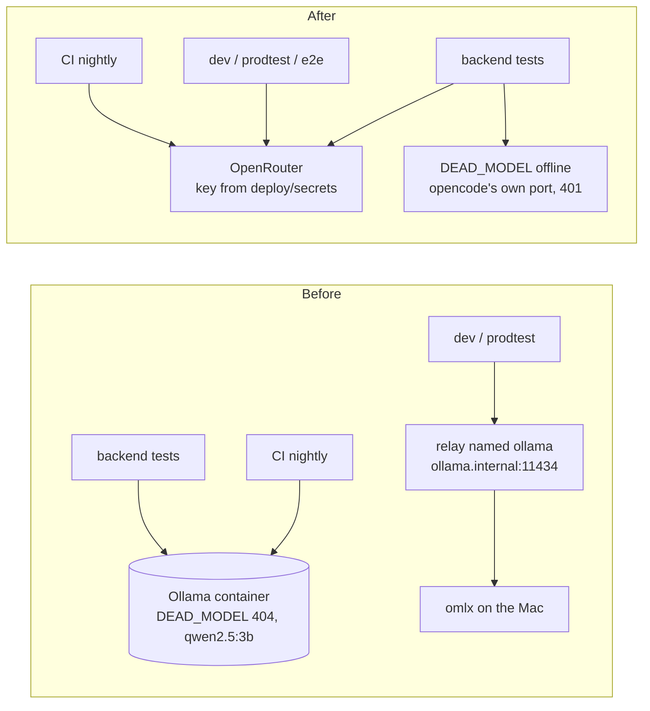

# Proposal: remove Ollama and omlx; every model comes from OpenRouter

**Issue:** [#157](https://github.com/tillg/karpathy.app/issues/157)

## Why

Ollama is no longer how the project runs models, but it is still everywhere:

- Dev and prodtest use **omlx** on the Mac (`deploy/settings/dev.yaml`, `prodtest.yaml`); production uses
  **OpenRouter**. The native Ollama recipe went with the Lima VM (2026-10-15).
- The tests still start an **Ollama container** (`kai-test-ollama`) for every backend test run, CI included, only so
  that `DEAD_MODEL` (`ollama/kai-no-such-model`) answers 404 and turns fail fast. The `@llm` tests use Ollama's
  `qwen2.5:3b`, a model too small for half of them (the `/research` tests need a hosted one), and it silently
  answers nothing when the model was never pulled (browser-tools retro).
- The relay that reaches omlx is still named after Ollama: service `ollama` / `ollama-bridge`, alias
  `ollama.internal:11434`, `Caddyfile.ollama-relay`, `OLLAMA_UPSTREAM`, plus an `ollama` gateway in the settings and
  about 60 mentions in tests, fixtures, docs and e2e comments.
- Local models are a second mental model: in the first apply round, omlx made three `@llm` tests fail that pass on
  OpenRouter.

The user's rules: **Ollama is not mentioned or referenced anywhere** (2026-10-15); **every test runs on OpenRouter,
on every platform, and omlx goes completely: OpenRouter is the only model source** (2026-10-16).

## What changes

- **Every model call goes to OpenRouter** (production models), in production, dev, prodtest, e2e and the backend's
  `@llm` tests, locally and nightly in CI. Without a key the `@llm` tests stop with a message before they start.
  `LLM_TEST_MODEL` picks another OpenRouter model.
- **`DEAD_MODEL`** moves to a test-only provider `dead` that points at opencode's own port: it answers a
  non-retryable 401 and the turn fails fast, as today. Offline: no container, no network, no key. It makes no model
  call, so it isn't a model source.
- **No local model server:** the `ollama` and `omlx` gateways, the relay that reached the Mac (compose services,
  Caddyfile, `relay_upstream`, the upstream env var, `stack_model_ready`), the model pull in `dev.sh`, and the omlx
  setup docs go. The `openai-compatible` gateway kind stays (provider-agnostic, CLAUDE.md).
- **Settings:** `dev.yaml`, `prodtest.yaml` and `test.yaml` no longer name models; every environment inherits
  production's OpenRouter models from `settings.yaml`.
- **CI:** the Ollama pull goes; `test:llm` runs nightly on OpenRouter with the production key as the GitHub secret
  `OPENROUTER_API_KEY`. The default tier needs no secret (offline dead model).
- **A guard test** fails when "ollama" appears in any tracked file outside the history (`specs/research/**`,
  `DECISIONS.md`), so it stays gone.

## Decisions

Taken with the user (2026-10-15):

- Ollama is mentioned nowhere. Tests use the production OpenRouter key.
- The guard builds its pattern from pieces, so it needs no exemption for itself.

Settled at grill (2026-10-15), still valid:

- `DEAD_MODEL` is offline (test-only `dead` provider → opencode's own port, 401).
- `test.yaml` uses the production default and vision models.

After the first apply round (2026-10-16), superseding the grill's omlx-first rules (omlx → OpenRouter → fail; omlx up
without its model → fail; no `@llm` in CI):

- Every test runs on OpenRouter, everywhere; the budget is there.
- No key → the `@llm` tests stop with a message before they start.
- CI runs `test:llm` nightly with the production key as a secret (Q1).
- The dead model stays offline: it makes no model call (Q2).
- omlx is removed completely, including the model relay (the user's "yes, remove omlx completely", replacing Q3a's
  local option).
- Follow-ups: the `api.test.ts` load flake gets its own issue; stale dev stack 3 and the leftover test container and
  volume are removed.

## Scope

In scope: test harness (`apps/backend/test/opencode-container.ts` and the tests that use its constants), settings
(`deploy/settings/`, `packages/settings` incl. fixtures and tests), compose and proxy (dev, prodtest, the relay
removed), `deploy/dev.sh`, `deploy/stack.sh`, `deploy/stack.test.sh`, CI workflow, docs (README, CLAUDE.md,
`deploy/README.md`, `specs/system/*` at archive, `docs/diagrams/*.mmd`), e2e comments, fixture model ids, the guard
test. Also the comments in `deploy/compose.yml` and `deploy/opencode/lib/look-at-image.ts`, and the web unit tests'
fixture ids (`apps/web/src/**/*.test.*`, incl. the word in `snippet.test.ts`'s sample line).

Out of scope: production behaviour (OpenRouter already; only comments change); the app's runtime code (no reference
to either local server in `apps/*/src` outside tests); history (`specs/research/**`, `DECISIONS.md`); choosing new
production models; a guard for the word omlx (offered, not asked for).

## Expected outcome

- `grep -ri ollama` over the tracked files finds only history; omlx and the model relay are gone from code, config and
  docs (`specs/system/*` follow at archive).
- `just check` runs without starting a model container and without any model (offline dead model).
- `npm run test:llm` runs on OpenRouter, locally and nightly in CI; without a key it stops with a message.
- Dev and prodtest stacks, and so e2e, run on OpenRouter; no host dependency on a model server.
- CI is green; its nightly `@llm` run is green on OpenRouter.

## Impact

| Area | Change |
|---|---|
| `apps/backend/test` | `opencode-container.ts`: no Ollama container; OpenRouter only, key required; `DEAD_MODEL` on the offline `dead` provider; tests that name `ollama/…`, `omlx/…` or those providers |
| `deploy/settings`, `packages/settings` | Drop gateways `ollama` and `omlx`, `relay_upstream` and its env var; `dev.yaml`, `prodtest.yaml`, `test.yaml` inherit production's models; fixtures and tests |
| `deploy/` compose, proxy, scripts | Relay services, Caddyfile and `NO_PROXY` overrides removed; `dev.sh` pull step and `stack_model_ready` gone; `stack.test.sh` |
| `.github/workflows/ci.yml` | Ollama pull removed; nightly `test:llm` on OpenRouter with the secret; default tier offline, no secret |
| Docs | README, CLAUDE.md, `deploy/README.md`, diagrams, e2e comments; `specs/system/*` at archive |
| Guard | New test: no "ollama" in tracked files outside history |
