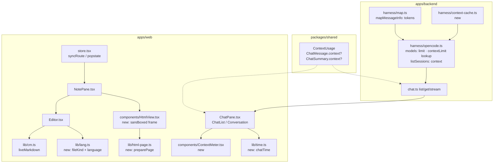
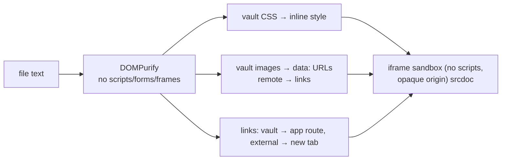
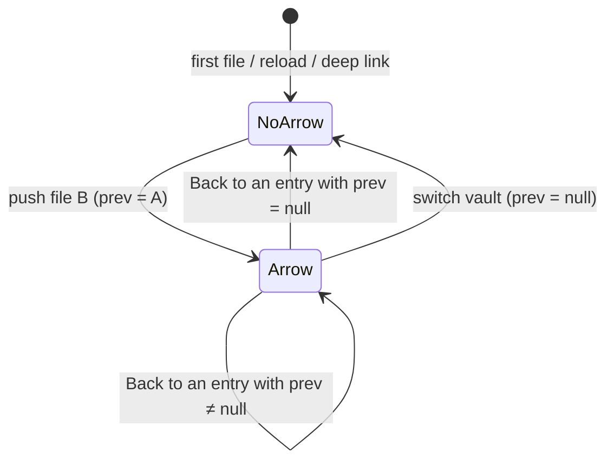
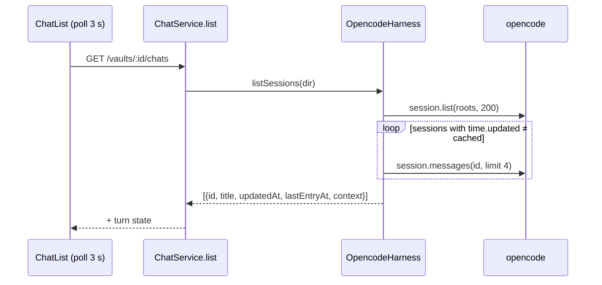

# Architecture: UI batch – code files, back arrow, chat context

Three independent slices. Each is described with the files it touches, the decision taken and the alternatives
dropped.

## Key decisions

| Decision | Alternatives considered | Why |
|---|---|---|
| "Note" means a Markdown file (`.md`/`.markdown`); **text file** is the umbrella for note, HTML page and code file (changes system term Note) | Keep "note" as any text file, with "Markdown note" as a sub-kind | A `.py` called a note reads wrong in the UI ("Delete note"); the note graph already counts only `.md`. |
| File kind by name, after the media table: `.svg` is a media file, `.mdx`/`.txt` are code files | Content sniffing; `.svg` as editable code; `.txt` as a note | Predictable from what the user sees; `.svg` already is an image in the media table, it just never reached the media view because its bytes are text. |
| HTML Read mode runs no scripts; a separate origin for vault pages is a later change | Scripts now (needs a second hostname and certificate, plus its security review); never | Reading static pages covers the issue; the sandbox keeps the token safe without new infrastructure. |
| The back arrow steps to the **previous file** of the same vault: any file shown in the note pane, not only notes | Notes only; across vaults | Browser Back already returns after an image (Place); the arrow must agree with Back. A vault switch is not "the page open just before". |
| Context used = the last AI reply's tokens against its model's window; warning ≥ 70 %, critical ≥ 90 %; the tooltip explains the drop after compaction | One color; sum of all replies; default model's window | The last reply is the current fill; colors make "start a new chat" visible at a glance. |
| A chat's **last entry** = time of its last message, from the same cached fetch as its context; updated time until known | opencode's `session.time.updated` | Literally what #140 asks; a rename or abort doesn't move it; the fetch is already there. |
| The composer meter shows at every fill level once a reply has tokens | Only from 70 % | #140 asks to see it while typing. |
| Every number, date and time shown follows the browser's locale (`Intl.NumberFormat(locale)` incl. the tooltip's percent, `chatTime`), never a fixed `en-US` | US format for the meter | User request after apply: the meter and the chat time must not disagree in style. |
| HTML pages have their own sticky **page mode preference**, Read by default | Share the notes' mode preference; always open in Read | Pages are mostly read; editing one shouldn't switch notes to Write and vice versa. |
| The chat list is sorted by last entry (newest first) | Keep opencode's order (updated time) | The order must match the time each row shows. |
| A new file keeps a typed extension (already true in `FileTree`); only notes start as `# <title>`, other text files empty | Always add `.md`; code files out of scope | Today `run.py` gets `# run` as Python content; one rule makes code files creatable from the phone. |
| Phone note header with the arrow (found in the visual check: it overflowed 390 px, and ✦ already did by 19 px before): the arrow is ↩ (`arrow_uturn_left`), the ‹ Files/Search/Changes button drops its label while the arrow shows (`aria-label` keeps it), the ✦ chat toggle is gone on the phone (the Chat tab is the way there), Write/Read buttons 7 px side padding | Drop find or outline from the header; smaller than 44 px targets | Keeps every note action and 44 px targets; ✦ duplicated the tab bar's Chat tab. |
| UI wording: only the header's delete label and the back arrow's tooltip follow the narrowed "note" | Reword all UI copy now | Keeps the change small; a full wording pass is a follow-up (non-goal). |
| A hit position (search hit, AI open at a line) in an HTML page shows its source (Write) for that opening; the page mode preference stays (review) | Stay in Read and highlight the text in the rendered page; leave it (the jump is dropped) | Read has no lines, so the jump would be lost silently; Write never loses it. Highlighting in the page can come later. |
| `@codemirror/language-data` with `^` like its siblings (review) | Pin the exact version | Same policy as the other CodeMirror packages; the lockfile pins the build. |



## 1. Code files (#126)

### Kind and language — `apps/web/src/lib/lang.ts` (new)

- `fileKind(path, binary)`: `'media'` when `mediaKind(path)` (so `.svg` → media although its bytes are text), else
  `'binary'` when `binary`, else `'note'` (`/\.(md|markdown)$/i`), `'html'` (`/\.html?$/i`) or `'code'`. The one
  place that decides; `NotePane`, the editor and the header read it.
- `languageFor(path)`: `LanguageDescription.matchFilename(languages, name)` from `@codemirror/language-data`
  (`languages` covers extensions and full names like `Dockerfile`), returns the description or `null` (plain text).
  `desc.load()` is called by the editor; each language is its own lazy chunk.

### Editor — `Editor.tsx`, `lib/cm.ts`

- New prop `kind: 'note' | 'code'` (derived by `NotePane` from the path).
- `markdown` → today's extension list unchanged (`liveMarkdown`, frontmatter hiding).
- `code` → `codeView(path)`: a `language` **compartment** (empty first, filled with `desc.support` after `load()`
  resolves, so the text shows at once and colors arrive a moment later), `syntaxHighlighting(defaultHighlightStyle)`,
  `EditorView.lineWrapping` (phone width; no horizontal page scroll), a monospace font class. **Not** included:
  `liveMarkdown` line classes, the `wikilinks` and `embeds` plugins (they would decorate `[[…]]` in code), the
  `hide` compartment, the file drop handler.
- Shared parts stay shared: `eolExtension` (CRLF kept), history, search, keymaps, the `readOnly` compartment
  (conflict), autosave and drafts (they work on the text, not the kind).
- A file opened while its language chunk can't load (offline, not yet cached) stays plain text; no error shown.

### Note pane — `NotePane.tsx`

- `const kind = note && fileKind(note.path, note.binary)`. `media` and `binary` → `MediaView` (today only
  `note.binary` does; the change routes `.svg` there too, so an SVG shows as an image and isn't editable in the app).
- Header for code files: no outline button, no mode toggle, no attach; find stays; delete says "Delete file".
- Body: always the editor (never `ReadView`), regardless of the sticky mode; no `PropertiesPanel`.
- `title` keeps the extension for code files (`.md` is stripped only for notes).
- `switchMode` is unreachable for code files, so the sticky preference is untouched (as for media).
- Exception: HTML pages (next section) keep the toggle, on their own page mode.

### HTML pages — `lib/html-page.ts` (new), `components/HtmlView.tsx` (new)

For `kind === 'html'` `NotePane` keeps the mode toggle; Write is the code view (language HTML), Read is
`<HtmlView>` instead of `ReadView`. The mode comes from the store's new `pageMode` (localStorage
`karpathy.pageMode`, default `read`), next to today's `mode` (`karpathy.mode`, notes only); `switchMode` writes the
one that matches the open file's kind. The place (scroll, mode) is kept per file as today.

### New text files — `store.tsx` `newNote`

`FileTree` already keeps a typed extension. `newNote` writes `# <title>\n` only when `fileKind(path, false) ===
'note'`, otherwise an empty file.

**Preparing the page** — `preparePage(html, ctx)` (pure apart from the injected `load(path)`):

1. Parse with `DOMParser` and sanitize with the DOMPurify already in `lib/markdown.ts` (`WHOLE_DOCUMENT`, keep
   `<style>` and `style=`): drops `<script>`, event handlers, `javascript:` URLs, `<form>`, `<iframe>`, `<object>`,
   `<embed>`, `<base>`, `<meta http-equiv>`.
2. `<link rel="stylesheet" href="rel/path.css">` to a vault file → fetched via `load` (`GET /raw` with the token) and
   replaced by `<style>` with its text. Remote or missing stylesheets are removed.
3. `` / `<source src>` to a vault file → fetched via `load` and inlined as a `data:` URL (up to 10 MB per
   file, the rest shows the missing card's text as alt). Remote images → replaced by a link with the alt text, as in
   Markdown notes.
4. `<a href>`: external → `target="_blank" rel="noopener noreferrer"`; a vault path → the app route
   `#/<vault>/<path>` with `target="_top"`; `#anchor` stays.
5. Relative paths resolve against the page's folder, never outside the vault root (same check as embeds).

**Showing it** — `<iframe sandbox="allow-popups allow-popups-to-escape-sandbox allow-top-navigation-by-user-activation" srcdoc={prepared} title=<file name>>`:

- No `allow-scripts`, no `allow-same-origin`: the page runs no code and gets an opaque origin, so it can't read the
  app's token, storage or DOM even if sanitizing missed something.
- `srcdoc` inherits the app's CSP (`script-src 'self'`, `img-src 'self' data: blob:`, `style-src 'self'
  'unsafe-inline'`), which is why images go in as `data:` and stylesheets as inline `<style>`; nothing in the
  prepared page may trigger a CSP violation (the e2e `cspGuard` fails on one).
- Height: the frame fills the note pane's scroll area (`height: calc(100dvh - 190px)`, the space below the header) and scrolls itself; the parent can't measure
  the content of an opaque-origin frame.
- A link to a vault file navigates the top window to its hash route → the existing `popstate`/route code opens it
  and pushes a history entry, so the back arrow (#139) works from a rendered page too.
- Re-prepared when the text changes (AI edit, pull) or the mode switches to Read, not when only the file list is refetched with the same paths; the first
  preparation shows the skeleton, a later one keeps the old page until the new one is ready. A page that can't be
  prepared shows a short message instead.



### Dropped alternatives

| Alternative | Why not |
|---|---|
| HTML Read mode with scripts (`allow-scripts`) | Inline scripts are blocked by the inherited CSP anyway; allowing them needs a separate origin for vault content (own hostname, certificate, token handling). Deferred to a later change (non-goal here). |
| Render HTML into the app's DOM (like Markdown) | Its CSS would leak into the app and the app's into it; a frame isolates both ways. |
| Serve the page from the backend at its own URL (`/raw` in the frame) | The bearer token can't ride on a frame `src`; relative resources need the same token. |
| Read mode for code via a highlighter (Shiki, highlight.js) | A second highlighting stack and a second view to keep in sync with the editor; the editor in read-only already is a faithful view. |
| Keep the Write/Read toggle for code, Read = read-only editor | A toggle that changes nothing visible but editability is confusing; conflict already gives read-only. |
| Add only the five languages in the issue (`@codemirror/lang-python`, …) | `language-data` gives the "other standard languages" the issue asks for, lazily, with one dependency. |
| Decide kind by content sniffing | Unpredictable; the file name is what the user sees and controls. |

### PWA cache

The precache glob `**/*.js` will include the language chunks (~1–2 MB in total, each language separately). Kept on
purpose: code files then color offline too. If the build exceeds workbox's per-file or total limit, the plan step
for the dependency fails its `just check` and the language chunks get a runtime cache rule instead.

## 2. Back arrow (#139)

### Mark file entries — `store.tsx` `syncRoute`

Today `pushState(null, …)` / `replaceState(null, …)`. Change the state object to `{ prev: <path of the entry being
left> | null }` when the new route has a file path (any kind: note, HTML page, code, media, binary), and `null`
otherwise. `replaceState` keeps the `prev` of the entry it replaces (`history.state?.prev`), so an outline jump or a
move into an own folder doesn't lose the arrow.

`prev` is set only when the entry being left is itself a file route of the **same vault**; switching vaults pushes
`prev: null` (Back would switch the vault, which is not "the page open just before").

### Expose it — store

`canGoBack: boolean` in the store, recomputed from `history.state?.prev` after every `syncRoute` and in the
`popstate` handler (it already runs on every Back/Forward). `goBack()` = `history.back()`. Nothing else: the existing
`popstate` handler opens the note and restores its place.



A reload restores `history.state` for the current entry, so after a reload in the middle of a session the arrow is
still right.

### UI — `NotePane.tsx` header

- `{s.canGoBack && <button className="ib" title="Back to <prev file name>" aria-label="Back" data-testid="note-back" onClick={s.goBack}><Icon n="chevron_left" /></button>}`
- Wide/tablet: first item after the sidebar toggle, before the crumb. Phone: right after the existing
  `data-testid="back"` button, icon only (44 px target). The phone button keeps its meaning (leave the note).
- Icon ↩ (`arrow_uturn_left`), so it doesn't look like the phone's ‹. On the phone, while the arrow shows, the ‹ button
  drops its label and the header has no ✦ chat toggle (see Key decisions), so the header fits 390 px.
- `popstate` also fills in `{prev}` for an entry the browser made itself (a link in a rendered HTML page, an edited
  URL): such an entry has `history.state === null`.

### Dropped alternatives

| Alternative | Why not |
|---|---|
| An in-app stack separate from browser history | Two histories drift (browser Back, swipe-back, reload); bugs of #5 again. |
| Always show the arrow and call `history.back()` | On the first note it would leave the app or go to the vault list. |
| Reuse the phone's `back` button | It means "leave the note" and `mobile.spec.ts` relies on it. |

## 3. Chat context and date/time (#140)

### Shared types — `packages/shared/src/index.ts`

```ts
/** Tokens the chat's last AI reply used, against its model's context window (opencode `limit.context`). */
export interface ContextUsage { used: number; limit?: number }
// ChatMessage: context?: ContextUsage   (assistant messages only)
// ChatSummary: context?: ContextUsage   (from the last assistant message)
// ChatSummary: lastEntryAt?: number     (time of the last message, any role; absent until fetched)
```

`updatedAt` stays as it is (opencode's updated time); the list shows `lastEntryAt ?? updatedAt`.

### Tokens — `harness/map.ts`

`mapMessageInfo` reads `info.tokens` of assistant messages: `used = tokens.total ?? input + output + reasoning +
cache.read + cache.write` (what opencode's own TUI shows as context). `used === 0` (a reply still starting) → no
`context`. Pure function, unit-tested with the SDK's message shape.

### Context window — `harness/opencode.ts`

- `models()` also returns `limit: info.limit?.context` (the field exists on the SDK's `Model`; for the dev models it
  comes from `deploy/settings/settings.yaml`, e.g. `qwen2.5:3b … limit: { context: 16384 }`). Missing or `0` →
  unknown.
- A small cache `limits: Map<modelId, number>` filled from `models()` and refreshed when a lookup misses (a model
  added by a settings change). The harness adds `context.limit` to every mapped assistant message — in
  `messages()` (chat load) and on the `message` events of the stream — by looking up the message's `model`.
- The `/settings` `modelInput` path is unchanged.

### Chat list — `listSessions`

For each listed session the harness needs the last assistant message. Fetching messages of 200 sessions on every
3-second poll is too much, so:

- `lastEntries: Map<sessionId, { updated: number; lastEntryAt?: number; context?: ContextUsage }>` in the harness.
- On `listSessions`, sessions whose `time.updated` equals the cached `updated` reuse the cache; the others call
  `session.messages({ sessionID, limit: 4 })` (the SDK takes `limit`; 4 covers a trailing user message plus queued
  ones) and take the newest message's `time.created` as `lastEntryAt` and the last assistant message's context.
  These calls run with a concurrency of 4.
- `listSessions` returns the list sorted by `lastEntryAt ?? updatedAt`, newest first; the frontend keeps that order.
- A cold start therefore loads each chat once; afterwards only chats that changed are fetched (normally one).
- The cache dies with the process; nothing is persisted.
- The cache logic lives in a pure module `harness/context-cache.ts` (`refresh(sessions, cache, fetchLast)`, with
  `fetchLast` passed in), so it is tested without the SDK; `OpencodeHarness` passes the real
  `session.messages` call.



### Frontend

- `lib/time.ts` `chatTime(t, now)`: `14:22` today, `Oct 3, 14:22` this year, `Oct 3 2025, 14:22` otherwise (the
  browser's locale via `toLocaleString`, 2-digit hour and minute). Replaces `when()` in `ChatPane.tsx`.
- `components/ContextMeter.tsx`: `{ usage: ContextUsage; variant: 'bar' | 'full'; model?: string }`. `bar` = 3 px
  track with a fill (`role="meter"`, `aria-valuenow/max`); `full` = bar + `3,560 / 16,384` (`Intl.NumberFormat`),
  tooltip `22 % of <model>'s context · drops when the chat is compacted`. Levels `ok` < 70 % ≤ `warn` < 90 % ≤ `crit` as a class; colors are tokens
  in the existing light/dark theme. No limit → `full` shows `3,560 tokens`, `bar` renders nothing.
- `ChatList` row: `chatTime(c.lastEntryAt ?? c.updatedAt)` + `bar` under the title when `c.context` exists.
- `Conversation`: `full` meter above the composer row (one line, also on the phone), at every fill level, from the
  last assistant message in `chat.messages` that has `context`. `applyChatEvent` already replaces message info on `message` events, so the meter follows the stream.

### Dropped alternatives

| Alternative | Why not |
|---|---|
| Track tokens from the stream only (no `session.messages` on list) | Misses chats run before the backend started and turns from another device on a fresh backend; the lazy fetch covers both and stays cheap. |
| Hardcoded context table per model | Breaks provider-agnosticism (CLAUDE.md); the provider config already has the number. |
| Sum of all replies' tokens | Overcounts: each request re-sends the conversation; the last reply's tokens are the current fill. |
| Use the current default model's window | A chat's replies may have run on another model. |

## Testing

| Slice | Unit (vitest) | E2E (Playwright, `just e2e`) |
|---|---|---|
| #126 HTML | `html-page.test.ts` (scripts/handlers/forms removed, vault CSS inlined, vault image → `data:`, remote image → link, link rewriting, `../` outside the vault refused) | `html-pages.spec.ts`: Read renders the page in a sandboxed frame with its styles and a vault image, Write shows the source, the toggle is sticky, a vault link opens the file in the app, no CSP violation |
| #126 | `lang.test.ts` (`fileKind` for the kind table in domain.md incl. `.svg`, `.mdx`, `.txt`; language by name; plain text fallback) | `code-files.spec.ts`: `.py` shows tokens with highlight classes, no mode toggle/outline; `.txt` keeps line breaks; `.md` unchanged; `.svg` shows as an image; sticky mode untouched by opening a code file |
| #139 | `store.test.tsx`: history state `prev` on push/replace/vault switch, also for media and code files; `canGoBack` | `back-arrow.spec.ts` (desktop + `@iphone`): A → link → B, arrow back to A, arrow gone; Write ↔ Read keeps it; note → image → arrow back to the note |
| #140 | `apps/backend/test/harness-map.test.ts` (tokens → used), `apps/backend/test/context-cache.test.ts` (pure cache logic with a plain fetch function passed in — no SDK mock; `lastEntryAt` from the newest message), `time.test.ts`, `ContextMeter.test.tsx` | `chat-context.spec.ts`: after one turn with the dev model the composer shows `n / 16,384` and the list row has a bar |

Fixture files for e2e are written per test through the file API (`Api` in `e2e/helpers.ts`), as other specs do.
