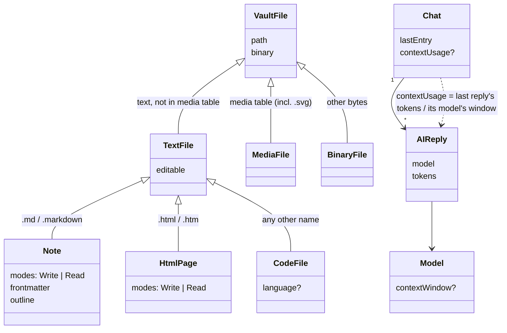
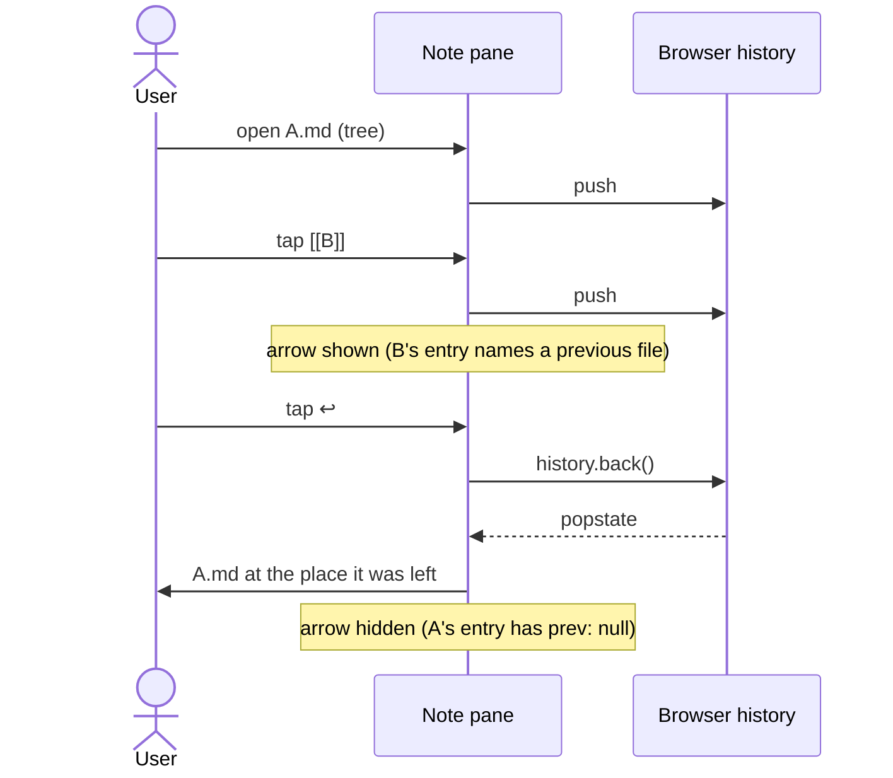
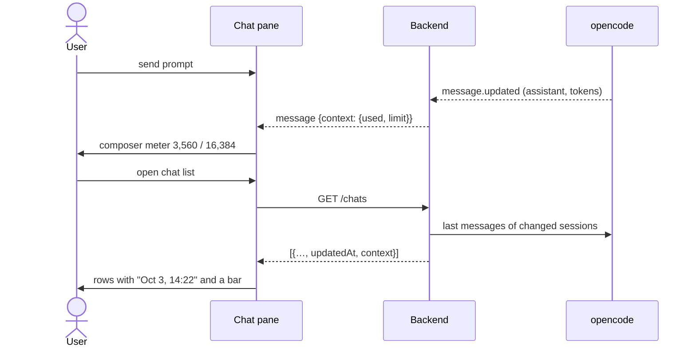

# Domain: text files, file history, context usage

## New and changed terms

| Term | Meaning |
|---|---|
| **Text file** (new) | A vault file the backend reads as text (no NUL byte, valid UTF-8; `binary: false`) and that is not a media file. Every text file can be edited. Kinds: note, HTML page, code file. *Avoid:* note (for a text file that isn't Markdown). |
| **Note** (changes system term Note) | A text file whose name ends in `.md` or `.markdown` (any case). System today: "a vault file that is UTF-8 text, usually `.md`". Only notes get live preview, the properties form, the outline, wikilinks, embeds and the note graph. *Avoid:* Markdown note (just "note"). |
| **HTML page** (new) | A text file named `*.html` / `*.htm`. Like a note it has two modes: Write (source in the editor) and Read (the page rendered in a sandboxed frame: no scripts, no forms, no remote resources; vault images and stylesheets inlined). |
| **Code file** (new) | Any other text file, incl. `.txt` and `.mdx`. Shown in the editor with the language picked from its file name, or as plain text. One view, no modes. |
| **Language** (new) | The syntax used to color a code file or an HTML page's source, found by file name (extension or full name such as `Dockerfile`). None found → plain text. |
| **Page mode preference** (new) | The Write/Read mode last chosen on an HTML page; applies to every HTML page opened afterwards, survives a reload, one per browser. Read for a new browser. Separate from the **mode preference**, which now applies to notes only (changes system term Mode preference: "every note" now means Markdown notes). |
| **Write mode / Read mode** (changes system term) | System today: "Media and binary files have no mode". Now: notes and HTML pages have both modes; code, media and binary files have none. Read mode of an HTML page is the rendered page, not Markdown. |
| **New text file** (changed) | "Create a note" with a name that has an extension keeps it (`run.py`); without one `.md` is added. Only a note starts as `# <title>`; any other text file starts empty. |
| **Media file** (unchanged, clarified) | The media table decides before the text check: `.svg` is a media file (shown as an image, not editable in the app) although its bytes are text. Today it wrongly opens in the Markdown editor. |
| **File history** (new) | The in-app part of the browser's history in this tab: one entry per vault file opened in the note pane (note, HTML page, code file, media or binary file) by a tree tap, link, search hit, chip or AI open. Outline jumps and moves into an own folder replace the entry instead of adding one (unchanged). |
| **Previous file** (new) | The file of the history entry just before the current one, if that entry belongs to the file history **of the same vault**. The back arrow is shown only while one exists. *Avoid:* previous note, previous page. |
| **Context window** (new) | The most tokens the chat's model can take in one request (opencode's `limit.context` of the model). Comes from the provider config, never from a table in the app. |
| **Context used** (new) | The tokens of the chat's **last AI reply**: input + output + reasoning + cache read + cache write. This is what the next request starts from, so it is the honest "how full is this chat". |
| **Context usage** (new) | The pair *used / window* of a chat, e.g. `3,560 / 16,384`. The window may be unknown; then only *used* is shown. |
| **Last entry** (chat) | The time of the chat's last message (user or AI), shown with date and time in the chat list, which is sorted by it (newest first). Until it is known (first list after a backend start), the chat's updated time stands in. A rename doesn't change it. |
| **Compaction** (opencode term, now visible) | opencode summarizing a long chat to free its context. The next reply's context used drops; the meter shows that drop, its tooltip explains it. |

## Rules

- **Kind by name, not content.** `notes.md` is a note even if it contains code; `notes.txt` is a code file shown as
  plain text even if it contains Markdown. Order: media table first (`.svg` → media), then the backend's text check,
  then the name (note / HTML page / code file).

| Name | Kind |
|---|---|
| `a.md`, `A.MD`, `a.markdown` | note |
| `a.html`, `a.htm` | HTML page |
| `a.mdx`, `a.txt`, `a.py`, `Dockerfile`, `a.unknown` | code file (`.txt`, `.unknown`: plain text) |
| `a.svg`, `a.png` | media file |
| `a.pdf`, `a.zip`, text that isn't UTF-8 | binary file |
- **Two sticky modes.** Notes follow the mode preference (Write for a new browser), HTML pages the page mode
  preference (Read for a new browser). Toggling on one kind never changes the other's. Code, media and binary files
  read and change neither.
- **A rendered page is inert.** Read mode of an HTML page never runs its scripts, submits forms or contacts other
  hosts; it sees nothing of the app (no token, no storage). What can't load is shown as a link or left out.
- **Back = browser Back.** The arrow never keeps its own stack; it is a button for the history the browser already
  has, so arrow, browser Back, the phone's swipe-back and the mouse's back button always agree.
- **Context per reply's model.** A chat may have run with another model than today's default; its usage is measured
  against the window of the model its last reply ran with.
- **Thresholds.** Below 70 % normal, 70–90 % warning, above 90 % critical.
- **Back stays in the vault.** The previous file is always in the current vault; an entry of another vault never
  shows the arrow (browser Back still goes there).
- **The meter is always there.** Once a chat has an AI reply with tokens, the composer shows its meter, at every
  fill level.

## Flows

