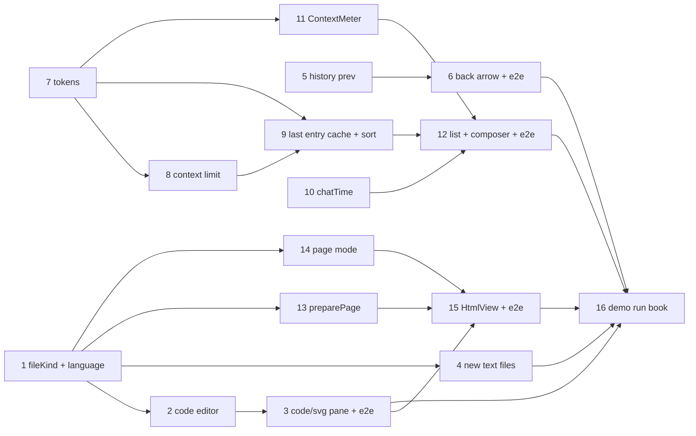

# Plan: UI batch – code files, back arrow, chat context

Three independent tracks (#126 with its HTML-page part, #139, #140) plus the demo run book. E2E steps run against
this checkout's stack (`just dev up` first, `just dev down` when done).

## #126 Text files

- [x] Add `@codemirror/language-data` (pinned) and `lib/lang.ts` with `fileKind(path, binary)` and `languageFor(path)`
  - Depends on: none
  - Test first: `apps/web/src/lib/lang.test.ts` › "kind table" (every row of the kind table in domain.md: `A.MD`, `a.markdown` → note; `a.html`, `a.HTM` → html; `a.mdx`, `a.txt`, `a.py`, `Dockerfile` → code; `a.svg` with `binary: false` → media; `a.pdf` with `binary: true` → binary), "language by name" (`a.py` → Python, `b.ts` → TypeScript, `c.js` → JavaScript, `D.java` → Java, `e.sh` → Shell, `Dockerfile` → Dockerfile, `p.html` → HTML), "unknown → null" (`notes.txt`, `x.unknownext`) — fails today: the module doesn't exist
  - Verify: `npm -w apps/web test -- lang` → green; `just check` → green; `npm -w apps/web run build` → exit 0 (the PWA precache limits still hold with the language chunks)
- [x] `Editor` takes `kind`; `code` gets `codeView(path)` (language compartment, plain highlighting, no live Markdown, no wikilinks/embeds, no frontmatter hiding, no drop handler)
  - Depends on: 1
  - Test first: `apps/web/src/components/Editor.test.tsx` › "code kind: `[[x]]` in a .py file is no wikilink" (no `.cm-wikilink` element), "code kind: Python keyword gets a highlight class after load" (`def` inside a `span` with a token class), "markdown kind unchanged: `[[x]]` is a wikilink" — fails today: no `kind` prop, everything gets `liveMarkdown`. If jsdom can't host `EditorView`, assert on the `EditorState` (language facet set, no wikilink plugin) and leave the DOM checks to step 3's e2e
  - Verify: `npm -w apps/web test -- Editor` → green; `just check` → green
- [x] `NotePane` by `fileKind`: code files with one view (no mode toggle, outline, properties or attach; title keeps the extension; "Delete file"; no sticky mode read or written); `.svg` in the media view
  - Depends on: 2
  - Test first: `e2e/code-files.spec.ts` › "a .py file is highlighted and has no Write/Read" (file written via `Api`; no `mode-toggle`, no `outline-button`, a highlighted `def`), "a .txt file keeps single line breaks in Read mode" (switch an `.md` note to Read first, then open a three-line `.txt`: the editor shows three `.cm-line`, no rendered `
`), "opening a code file keeps Read mode for the next note", "an .svg shows as an image, not as text", "a .md note is unchanged" — fails today: every text file gets the Markdown UI and `.svg` opens in the editor
  - Verify: `just e2e code-files media` → green (desktop and `@iphone`); `just check` → green
- [x] New files: a note starts as `# <title>`, any other text file empty (a typed extension is already kept)
  - Depends on: 1
  - Test first: `apps/web/src/store.test.tsx` › "newNote('a/run.py') writes an empty file", "newNote('a/x.md') writes `# x`", "newNote('a/page.html') writes an empty file" (fake API records the PUT body) — fails today: every new file gets `# <title>`
  - Verify: `npm -w apps/web test -- store` → green; `just check` → green

## #139 Back arrow

- [x] `syncRoute` stores `{prev}` in history state for every file route (push: path left in the same vault, else `null`; replace: keeps `prev`); store exposes `canGoBack` and `goBack`
  - Depends on: none
  - Test first: `apps/web/src/store.test.tsx` › "opening B after A sets prev = A and canGoBack", "a media or code file counts as a file", "first file: canGoBack false", "replace (outline jump / move) keeps prev", "switching vault: prev null", "popstate back to A: canGoBack follows A's entry" — fails today: state is always `null`, no `canGoBack`
  - Verify: `npm -w apps/web test -- store` → green; `just check` → green; existing `just e2e fix-5 fix-links sticky-mode` still green
- [x] Note header shows the ‹ back arrow (`data-testid="note-back"`, tooltip `Back to <file name>`) when `canGoBack`, on every layout; phone keeps its Files/Search/Changes button
  - Depends on: 5
  - Test first: `e2e/back-arrow.spec.ts` › "A → wikilink → B, arrow returns to A at its place, then hides" (desktop and `@iphone`), "note → tapped image → arrow returns to the note", "no arrow on the first file or for a deep link opened in a new tab", "Write ↔ Read on B keeps the arrow", "phone: `back` still leaves the note" (vault switch: covered by the `routeState` unit test of step 5) — fails today: no `note-back` button
  - Verify: `just e2e back-arrow mobile` → green; `just check` → green

## #140 Chat context and last entry

- [x] Shared `ContextUsage`; `ChatMessage.context?`, `ChatSummary.context?` and `ChatSummary.lastEntryAt?`; `mapMessageInfo` sets `context.used` from assistant `tokens`
  - Depends on: none
  - Test first: `apps/backend/test/harness-map.test.ts` › "assistant tokens → used = total", "no total → input + output + reasoning + cache read + write", "zero tokens → no context", "user message → no context" — fails today: tokens are dropped
  - Verify: `npm -w apps/backend test -- harness-map` → green; `just check` → green
- [x] `models()` returns `limit.context`; the harness adds `context.limit` to assistant messages (chat load and stream) by the message's model, refreshing its limit map on a miss
  - Depends on: 7
  - Test first: `apps/backend/test/harness-map.test.ts` › "mapModels keeps what the model reads and its context window" (SDK `config.providers` shape; `models()` uses it), "withLimit adds the window of the message's model", "unknown model → no limit; no context → unchanged" — fails today: `models()` drops `limit`, no `withLimit`. The real dev model's 16,384 is checked end to end by step 12's e2e (no live opencode in the default test tier)
  - Verify: `npm -w apps/backend test -- harness-map` → green; `just check` → green
- [x] `harness/context-cache.ts`: `listSessions` returns `lastEntryAt` and `context` per chat, fetching `session.messages(limit 4)` only for sessions whose `time.updated` changed (concurrency 4), sorted by `lastEntryAt ?? updatedAt`, newest first
  - Depends on: 7, 8
  - Test first: `apps/backend/test/context-cache.test.ts` › "cold cache fetches each session once", "unchanged updated → no fetch", "changed updated → refetch only that one", "lastEntryAt = newest message of any role", "last assistant message's context wins over a trailing user message", "no assistant message → no context", "sorted by lastEntryAt, falling back to updatedAt" (with a plain `fetchLast` function counting calls) — fails today: module doesn't exist
  - Verify: `npm -w apps/backend test -- context-cache chat` → green; `just check` → green
- [x] `lib/time.ts` `chatTime(t, now, locale = [])`: the time today, date and time this year, date with year and time before, all in the device's format (`en-US`: `02:22 PM`, `Oct 3, 02:22 PM`, `Oct 3, 2025, 02:22 PM`)
  - Depends on: none
  - Test first: `apps/web/src/lib/time.test.ts` › the three cases with a fixed `now` and locale `en-US`, plus "midnight boundary: 23:59 yesterday is not today" — fails today: module doesn't exist
  - Verify: `npm -w apps/web test -- time` → green; `just check` → green
- [x] `ContextMeter` (`bar` / `full`, levels ok < 70 % ≤ warn < 90 % ≤ crit, compaction tooltip, no limit → `3,560 tokens` and no bar)
  - Depends on: 7
  - Test first: `apps/web/src/components/ContextMeter.test.tsx` › "full: 3,560 / 16,384 and meter 22 %", "levels at 69/70/89/90 %", "tooltip names the model and compaction", "no limit: full shows tokens, bar renders nothing", "aria-valuenow/max" — fails today: component doesn't exist
  - Verify: `npm -w apps/web test -- ContextMeter` → green; `just check` → green
- [x] Chat list rows show `chatTime(lastEntryAt ?? updatedAt)` and the bar, in the backend's order; the composer shows the full meter of the last assistant message at every level, live while streaming
  - Depends on: 9, 10, 11
  - Test first: `e2e/chat-context.spec.ts` › "after one turn the composer shows `n / 16,384`" (dev model, n > 0), "the chat list row shows the time and a meter", "the chat just used is first in the list", "a new chat shows no meter"; `apps/web/src/lib/chat.test.ts` › "a message event with context replaces the message's context" — fails today: no meter, no context in the data
  - Verify: `just e2e chat-context chat chat-main` → green; `just check` → green

## #126 HTML pages (Write = source, Read = rendered)

- [x] `lib/html-page.ts` `preparePage(html, ctx)`: sanitize, inline vault CSS and images, remote images → links, rewrite links, stay inside the vault
  - Depends on: 1
  - Test first: `apps/web/src/lib/html-page.test.ts` › "script, onclick, javascript: href, form, iframe, base removed", "`<style>` and style= kept", "vault `<link rel=stylesheet>` becomes `<style>` with its text", "vault `` becomes a data: URL; over 10 MB keeps alt only", "remote `` becomes a link", "vault link → `#/<vault>/<path>` target _top; external → _blank noopener", "`../../x.png` outside the vault is not loaded" (with a plain `load` function returning fixed bytes) — fails today: module doesn't exist
  - Verify: `npm -w apps/web test -- html-page` → green; `just check` → green
- [x] Store `pageMode` (localStorage `karpathy.pageMode`, default `read`); `switchMode` writes `pageMode` on an HTML page and `mode` on a note
  - Depends on: 1
  - Test first: `apps/web/src/store.test.tsx` › "a new browser opens HTML pages in Read and notes in Write", "switching to Write on a page leaves the notes' mode", "switching on a note leaves the page mode", "page mode survives a reload" — fails today: one mode for everything
  - Verify: `npm -w apps/web test -- store` → green; `just check` → green; existing `just e2e sticky-mode` still green
- [x] `HtmlView` (sandboxed `srcdoc` frame) and `NotePane` for HTML pages: Write/Read toggle on the page mode, Write = HTML code view, Read = rendered page
  - Depends on: 3, 13, 14
  - Test first: `e2e/html-pages.spec.ts` › "a page opens in Read: its heading styled by its own `<style>` and a vault image visible inside the frame", "the frame has `sandbox` without allow-scripts and a `<script>` in the file didn't run", "Write shows the source with HTML highlighting; the next `.md` note still opens in its own mode", "a link to a vault note in the page opens the note in the app and the back arrow returns", "no CSP violation" (`cspGuard`) — fails today: `.html` renders through `marked`
  - Verify: `just e2e html-pages code-files sticky-mode` → green (desktop and `@iphone`); `just check` → green

## Demo run book

- [x] `Karpathy Demo.md` in `~/git/karpathy_demo_wiki`: chapters for code files (with a sample `Sources/demo/hello.py`), HTML pages (a sample `Sources/demo/page.html` with its own style and a vault image), the back arrow and the context meter, each with a *Try it* step; bump `updated`. Commit locally, push only at release
  - Depends on: 3, 4, 6, 12, 15
  - Test first: none — documentation in another repo
  - Verify: `grep -c -E "^#+ .*(Code files|HTML pages|Back arrow|Context meter)" ~/git/karpathy_demo_wiki/"Karpathy Demo.md"` → 4; `test -f ~/git/karpathy_demo_wiki/Sources/demo/hello.py && test -f ~/git/karpathy_demo_wiki/Sources/demo/page.html`

System docs are updated at `/spec:archive`.
