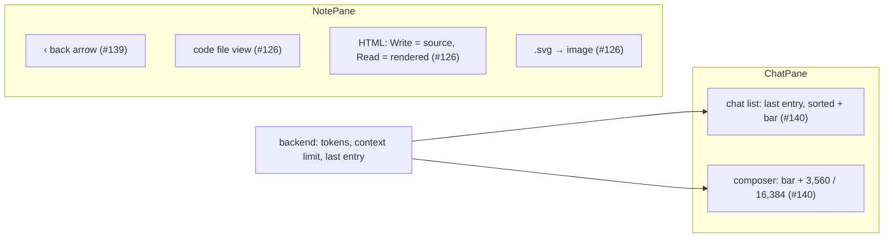

# Proposal: UI batch – code files, back arrow, chat context

**Issue:** [#126](https://github.com/tillg/karpathy.app/issues/126), [#139](https://github.com/tillg/karpathy.app/issues/139), [#140](https://github.com/tillg/karpathy.app/issues/140)

## Why

All open issues with the `UI` label, collected into one change as requested. They don't depend on each other, but
they touch the same two panes (note pane, chat pane) and ship together.

| Issue | Problem today |
|---|---|
| #126 Text files other than `.md` | Every text file opens as Markdown: live-preview decorations, properties form, outline, Read mode through `marked`. A `.py` or `.sh` loses its single line breaks in Read mode and gets no syntax colors; an `.html` file shows as sanitized Markdown, not as the page it is; an `.svg` opens as text instead of an image; a new `run.py` starts with `# run`. |
| #139 Back arrow from a page | Browser Back already returns to the previous file (`pushState`/`popstate`, #5), but there is no visible control for it. In the installed PWA on iPad/iPhone there is no browser Back button at all. |
| #140 Chat date/time and context size | The chat list shows only `HH:MM` (today) or `Mon D` (older): no time for older chats. Nothing shows how much of the model's context window a chat uses, so the user can't tell when to start a new chat. |

## What changes

### #126 – Text files: notes, HTML pages, code files

- **File kinds by name** (after the media table): a **note** is `.md` / `.markdown`; an **HTML page** is `.html` /
  `.htm`; every other text file is a **code file** (incl. `.txt`, `.mdx`). `.svg` is a **media file** and shows as an
  image (today it opens as text). "Note" now means Markdown only; **text file** is the umbrella.
- **Code files** open in the editor with syntax highlighting chosen by file name (`.py`, `.ts`, `.js`, `.java`,
  `.sh`, `.json`, `.yaml`, `.css`, `Dockerfile`, … — CodeMirror's language list), lazily loaded. Unknown extension
  → **plain text**: no colors, every line break as written.
- A code file has **one view**: no Write/Read toggle, no outline, no properties form, no live preview, no wikilink or
  embed decorations, no attach. Find-in-file, Delete ("Delete file") and autosave work as for notes. The title keeps
  its extension (`run.sh`, not `run`). Opening one changes no sticky mode.
- **HTML pages** have the **Write/Read toggle** with their own sticky **page mode** (Read for a new browser; toggling
  on a page never changes the notes' mode, and the other way round).
  - **Write:** the editor with HTML highlighting.
  - **Read:** the page rendered in a sandboxed frame in the note pane. Its own `<style>` and inline styles apply;
    stylesheets and images **from the vault** (relative paths) are loaded through the app and inlined; links to vault
    files open in the app, other links in a new tab.
  - **Never runs:** scripts, forms, plugins. Remote images and stylesheets (`https://…`) don't load (the app's
    content security policy); a remote image shows as a link, as in notes.
- **New files:** "Create a note" keeps a typed extension (`run.py`; already so) and only a note starts as
  `# <title>`; any other text file starts empty.

### #139 – Back arrow in the note header

- A **‹ back arrow** in the note header, on every layout, shown only when the previous history entry is another file
  of **the same vault** opened in this tab (note, HTML page, code file, image, …). It does exactly what browser Back
  does (`history.back()`): the previous file opens at the place where it was left.
- Not shown on the first file of a session, after a reload into a deep link, or when Back would leave the app or
  switch the vault.
- On the phone, the existing **‹ Files / Search / Changes** button stays (it leaves the note); the new arrow is a
  separate icon-only ↩ button next to it. While it shows, the ‹ button drops its label. The phone header no longer has
  the ✦ chat button (the Chat tab does the same), so everything fits the width.

### #140 – Chat list: last entry and context bar; composer: context meter

- **Chat list:** each row shows its **last entry** (time of the last message) as `14:22` today, `Oct 3, 14:22` this
  year, `Oct 3 2025, 14:22` before, and the list is sorted by it, newest first. Plus a thin **context bar**: the
  share of the model's context window used by the chat's last AI reply. No bar for a chat without an AI reply yet.
- **Composer:** above the input, at every fill level once a reply has tokens: the same bar plus numbers,
  `3,560 / 16,384` (tooltip: `22 % of qwen2.5:3b's context · drops when the chat is compacted`). It updates live
  while a reply streams. If the model's limit is unknown, only the used count shows (`3,560 tokens`), without a bar.
- Bar color: normal below 70 %, warning from 70 %, critical from 90 %.

## Non-goals

- Language servers, linting, formatting, line numbers (from #126).
- Scripts in HTML Read mode. They need vault pages served from a separate origin (own hostname, certificate, token
  handling); a later change.
- A forward arrow.
- Rewording every UI text that says "note" for any text file ("Create note", the note pane's label, …): only the
  header's delete label and the back arrow's tooltip follow the narrowed term now; a full wording pass is a follow-up.
- Rendering other formats (CSV as a table, JSON as a tree).

## Impact

- **Frontend** (`apps/web`): `NotePane`, `Editor`, `lib/cm.ts`, new `lib/lang.ts`, `lib/html-page.ts`, `HtmlView`,
  `ContextMeter`, `lib/time.ts`; `store.tsx` (history state, page mode, new files); `ChatPane`.
- **Backend** (`apps/backend`): the harness keeps message tokens and the models' context limits; the chat list carries
  last entry and context, sorted by last entry.
- **Shared types** (`packages/shared`): `ContextUsage`, new optional fields on `ChatMessage` and `ChatSummary`.
- **Dependency:** `@codemirror/language-data` (lazy per-language chunks).
- **System terms changed at archive:** Note, Mode preference, Write mode / Read mode (domain.md lists them).
- **Demo run book:** four chapters in `Karpathy Demo.md`, plus a sample code file and HTML page in the demo vault.
- No API removed; old clients ignore the new optional fields.

## Expected outcome

All three issues can be closed: a `.py` file reads like code, an `.html` file (e.g. a report in the vault) can be
read as a page and edited as source, an `.svg` shows as an image, a back arrow returns to the previous file in the
PWA, and a glance at the chat list or composer shows when a chat was last used and how full its context is.
