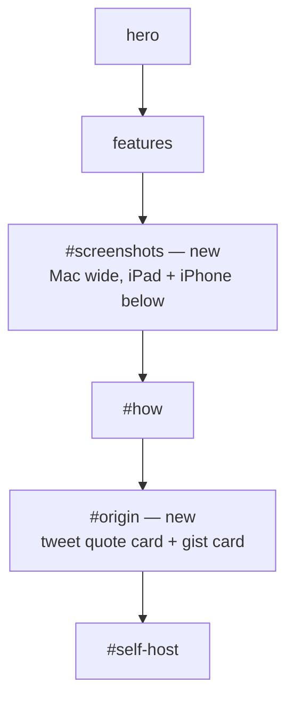
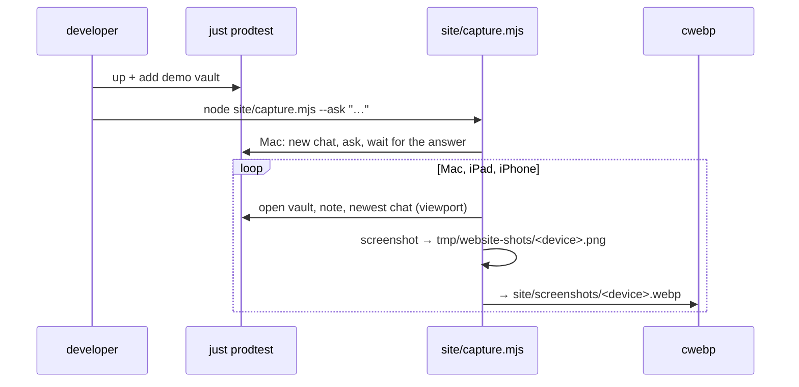

# Architecture: website screenshots and the idea's origin

The site stays what it is (`specs/system/architecture.md` › Website): plain HTML + CSS, no script, no
third-party request, relative paths only, assembled by `site/build.sh` into `_site/` and deployed by
`pages.yml` on pushes to `main`.

## Page structure

### `#screenshots`

- Heading "See it on every device", then three `<figure>`s with a `<figcaption>` each (Mac, iPad, iPhone).
- The Mac shot spans the full content width; iPad and iPhone share the row below (CSS grid, the iPhone column
  narrow). At phone width all three stack.
- Each `` has `alt`, the real `width`/`height` of the file (no layout shift), `loading="lazy"` and
  `decoding="async"`, and is wrapped in a link to the file itself (click = full size, no script).
- Rounded corners and the site's `--shadow`, so the shots sit on the page like device screens.

### `#origin`

- The hero gets one line under the lead: "Built on Andrej Karpathy's LLM Wiki idea", linking `#origin`.
- Heading "Where the idea comes from".
- A `<blockquote cite="https://x.com/karpathy/status/2039805659525644595">` with the tweet's title line and its
  opening sentence, then a footer line: Andrej Karpathy, the date as `<time datetime="2026-04-02">`, a link
  "View on X".
- A card for the gist "LLM Wiki" (2026-04-04) with one sentence on what it describes and a link.
- One closing sentence: karpathy.app brings that loop to the iPad and the phone.

## Files

| File | Change |
|---|---|
| `site/index.html` | the two sections |
| `site/style.css` | `.shots`, `.shot`, `.origin`, `.quote` rules; tokens unchanged (the token-equality test stays) |
| `site/screenshots/{mac,ipad,iphone}.webp` | new |
| `site/build.sh` | also copies `site/screenshots/` to `_site/screenshots/` |
| `site/capture.mjs` | new: takes the shots |
| `site/site.test.mjs` | tests for both sections and the images |
| `README.md` › Website | how to retake the screenshots |

## Taking the screenshots: `site/capture.mjs`

A Node script using the repo's `playwright` dependency (WebKit for all three, so they render like Safari). It
targets this checkout's prodtest only (port from `deploy/stack.sh`, token from `tmp/prodtest/secrets/`, vault
`demo-wiki`), so the certificate check it skips never concerns another host. Options: `--note` (default
`Wiki/synthesis/which-brewer-for-which-bean.md`) and `--ask "<question>"`. For each device class it opens a fresh
browser context at the viewport and scale of the domain table, logs in with the token, opens the vault, the note in
Read mode and the newest chat, scrolls the chat to its start, waits for the images to load, saves a PNG to
`tmp/website-shots/`, and converts it with `cwebp -noalpha -q 82` into `site/screenshots/`.

`--ask` writes a chat into the prodtest copy of the demo vault (never the real one). The local dev model's answers
vary, so the developer views the shots and repeats `--ask` until the answer is short and right; a run without
`--ask` reshoots the newest chat.

## Key decisions

| Decision | Alternatives considered | Why |
|---|---|---|
| Static quote card for the tweet, no `widgets.js` | official X embed | no script / tracking on the site; works when X is unreachable ([DECISIONS](../../../DECISIONS.md#run-2026-10-16-1016-3)) |
| Shots from `just prodtest` + demo vault | prod over Tailscale; a dev stack | no prod credentials; release UI with the `karpathy.app` header ([DECISIONS](../../../DECISIONS.md#run-2026-10-16-1016-2)) |
| WebP only, no PNG fallback | `<picture>` with PNG fallback | every browser the site targets (Safari ≥ 14) decodes WebP; one file per shot |
| A capture script in `site/` | Playwright MCP by hand | shots can be retaken after UI changes |
| Light mode only | a dark set via `<picture media>` | half the files; the shots are illustrations, not the page's own theme |
| The hero links to `#origin` ("Built on Andrej Karpathy's LLM Wiki idea") | origin section only, far down the page | #132 asks for the origin to be *visible*; a reader of the hero sees it without scrolling |
| WebKit for all three device classes | Chromium for the Mac | Safari is the browser on all three; one engine, one font rendering |
| The quote is the tweet's title line and first sentence, verbatim | a paraphrase; the whole tweet | short, attributed, linked; a paraphrase would put words in his mouth |
| Shot content: the demo vault's coffee topic — the synthesis note `which-brewer-for-which-bean` (Read mode, its pairing table) and a chat whose answer reads that page (file chip visible) | the note `aeropress` (first choice: in the shots its long properties form filled the screen); the topology or mountains topics | the synthesis page shows the wiki's point — an answer built from the vault's own pages; file chips show what makes the app different |
| The capture script clicks through the UI (login, vault, note, chat) | deep links | the app has no URL routing for vault, note or chat |

## Tests (`site/site.test.mjs`)

- `#screenshots` has three `` under `screenshots/`, each with non-empty `alt`, numeric `width`/`height` and
  `loading="lazy"`; the `width`/`height` match the WebP file's real size (read from its `VP8X`/`VP8 ` header).
- Each screenshot is ≤ 400 KB.
- `#origin` links `https://x.com/karpathy/status/2039805659525644595` and
  `https://gist.github.com/karpathy/442a6bf555914893e9891c11519de94f`, has a `<blockquote cite>` and a
  `<time datetime="2026-04-02">`.
- The existing "every local href/src exists in _site" test covers the build copying `screenshots/`.
