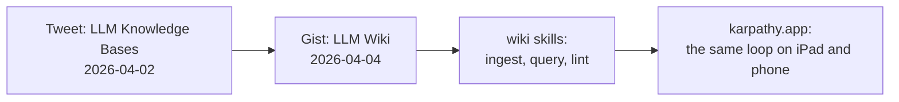

# Domain: website screenshots and the idea's origin

## Concepts

**Website screenshot** — a picture of the app on one **device class** (Mac, iPad, iPhone), taken from the
release images (`just prodtest`, header `karpathy.app`) with the **demo vault** open. It shows no admin screens,
tokens or secrets. It belongs to the website, not to the app: it lives in `site/screenshots/` and is retaken with
`site/capture.mjs` when the UI changes enough to make it look outdated.

**Device class** — the three form factors the app is built for, each with one fixed viewport:

| Device class | Viewport (CSS px) | Scale | Layout it shows |
|---|---|---|---|
| Mac | 1440 × 900 | 2 | file tree, note, chat |
| iPad | 1180 × 820 (landscape) | 2 | note and chat side by side |
| iPhone | 393 × 852 | 3 | chat |

**Origin of the idea** — Andrej Karpathy's tweet *LLM Knowledge Bases* (2026-04-02, id 2039805659525644595) and his
gist *LLM Wiki* (2026-04-04, `karpathy/442a6bf555914893e9891c11519de94f`): raw sources go into a folder, an LLM
compiles them into an interlinked Markdown wiki, answers questions from it and lints it. karpathy.app brings that
workflow (and the user's existing wiki skills) to the iPad and the phone.

## Vocabulary

| Term | Meaning | Avoid | Where |
|---|---|---|---|
| **Website screenshot** | A picture of the app on one device class, for the website | screen capture, mockup | `site/screenshots/` |
| **Device class** | Mac, iPad or iPhone, each with one fixed viewport | breakpoint, form factor | `site/capture.mjs` |
| **Origin** | Karpathy's tweet and gist the app is built on | inspiration, credits | `site/index.html` › `#origin` |
| **Demo vault** | The public example vault `tillg/karpathy_demo_wiki` (coffee, mountains, topology) with the demo run book; the screenshots show it | sample vault, test vault | `~/git/karpathy_demo_wiki` |

Uses the system terms **Website** and **Website deploy** (`specs/system/domain.md`) unchanged; **Demo vault** is
new to the system glossary.
