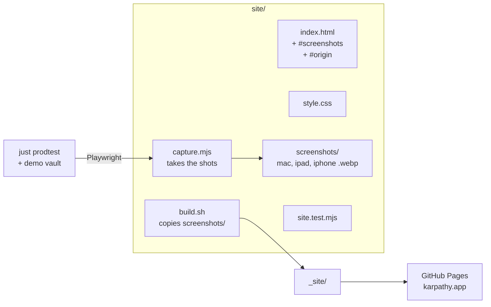

# Proposal: website screenshots and the idea's origin

**Issue:** [#156](https://github.com/tillg/karpathy.app/issues/156), [#132](https://github.com/tillg/karpathy.app/issues/132)

## What

Two additions to the start page at https://karpathy.app (`site/index.html`):

1. **Screenshots** (#156): the app as it looks on a **Mac**, an **iPad** and an **iPhone**, working in the demo
   vault — vault, note and AI chat side by side on the big screens, the chat on the phone.
2. **Where the idea comes from** (#132): the app is built on Andrej Karpathy's
   [tweet "LLM Knowledge Bases"](https://x.com/karpathy/status/2039805659525644595) (2026-04-02) and the
   [gist "LLM Wiki"](https://gist.github.com/karpathy/442a6bf555914893e9891c11519de94f) he published two days
   later. The page names both visibly, with a short quote of the tweet and links to the originals.

## Why

- The page tells what the app does but never shows it. A screenshot answers "what does it look like on my iPad"
  faster than four feature cards.
- The name *karpathy.app* only makes sense with its origin. Visitors who know the tweet recognize the idea; those
  who don't get the source to read.

## Scope

In scope:

- A `#screenshots` section after the feature cards, a `#origin` section after "How it works", and a one-line
  link to `#origin` in the hero.
- The screenshot files in `site/screenshots/`, compressed (WebP), with fixed `width`/`height` and lazy loading.
- `site/capture.mjs`: a script that takes the three shots from a running stack, so they can be retaken after the
  UI changes.
- `site/build.sh` copies `site/screenshots/` into `_site/`.
- Tests in `site/site.test.mjs` for both sections and a size budget for the images.
- README › Website: how to retake the screenshots.

## Non-goals

- No embedded tweet (`widgets.js`): the site stays without scripts and third-party requests.
- No dark-mode screenshot set; the shots are light mode.
- No screenshot carousel or lightbox; a click opens the full image.
- No change to the app; no demo run book chapter (the run book covers app features).

## Outcome

After the merge to `main`, the Pages workflow publishes the page; https://karpathy.app shows the three
screenshots and the origin section, in light and dark, at phone width without horizontal scroll.
