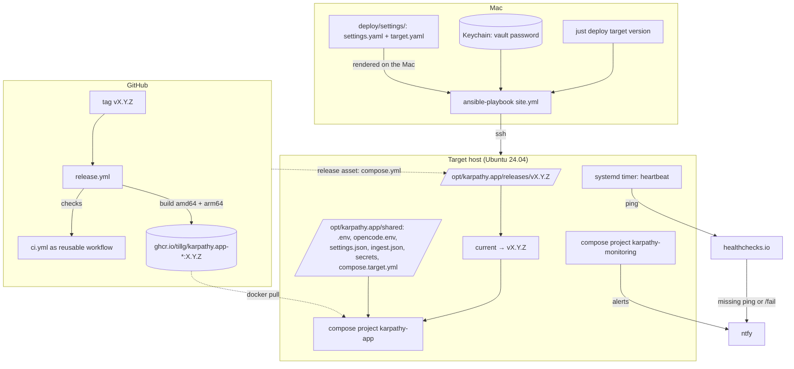
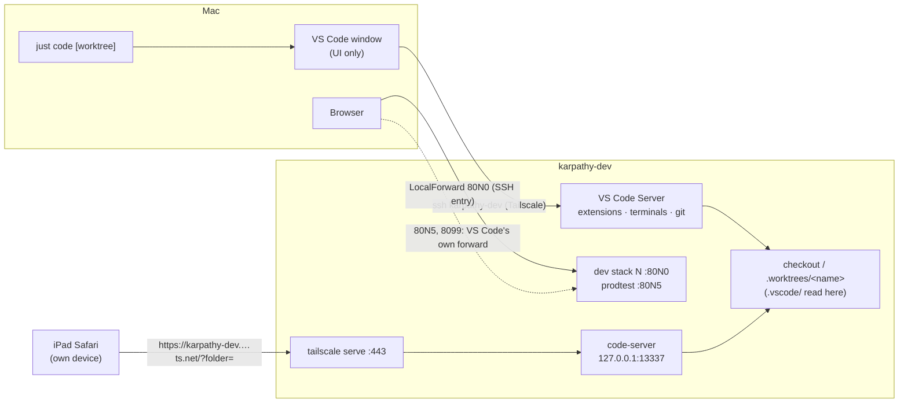
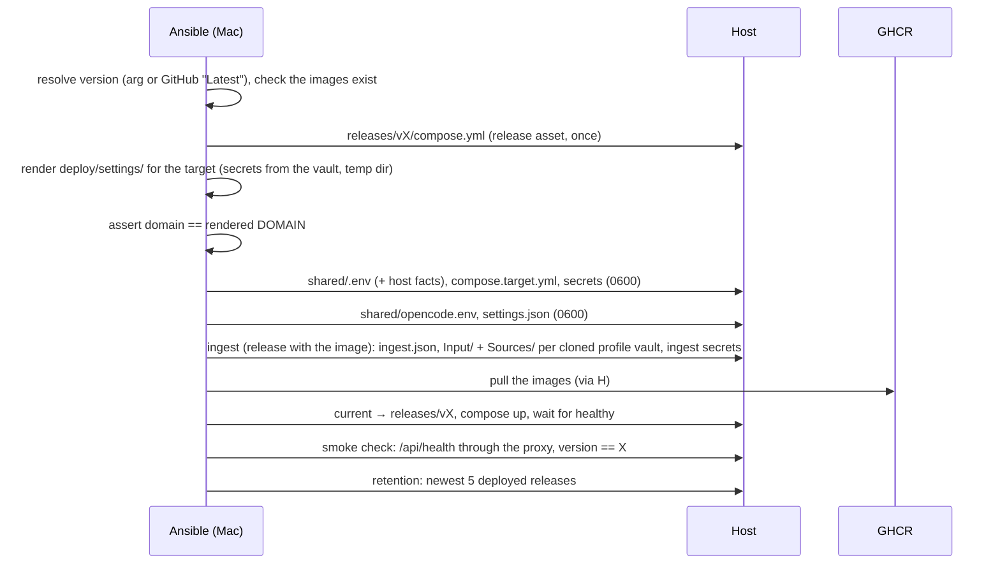
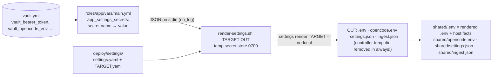
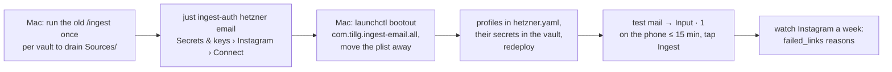
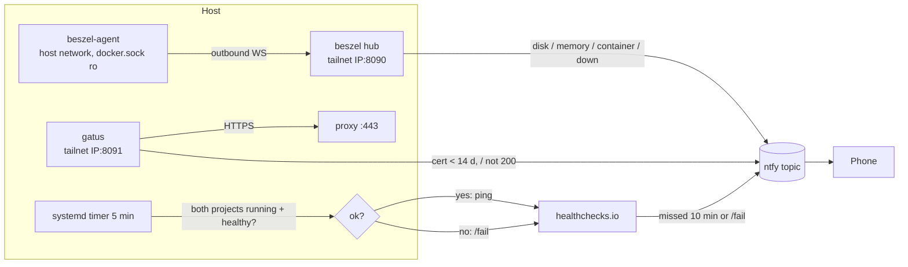
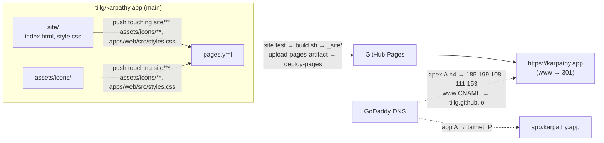

# Deployment: releases, targets and operations

As built on 2026-10-02, production running since then. How a version of the app gets built, put on a
server and watched. The how-to with every `just` recipe is [`deploy/README.md`](../../deploy/README.md);
this page is the system view and the decisions behind it.

## Overview

Three parts, each with one job:

1. **Release workflow** (GitHub Actions) turns a tag into immutable images plus the matching
   `compose.yml`, attached to the GitHub release.
2. **Ansible playbook** (run from the Mac) brings a host to the desired state and switches it to a
   release. Nothing is built on a host, and a host holds no copy of the source.
3. **Monitoring** (on the host, plus a heartbeat to an outside service) tells the operator when it breaks.

The public website at https://karpathy.app has its own, much simpler pipeline: [Website](#website).

## Releases

- A **release** is a tag `vX.Y.Z` on `main`; a **pre-release** is `vX.Y.Z-rc.N` from any commit.
  `just release <version>` tags and pushes; it refuses a dirty tree, and a final version unless HEAD
  is on `main`. The workflow's `guard` job enforces the same.
- `release.yml`: `check` (the CI workflow, reusable) and `web` (the PWA build, once) → `build` (matrix image × arch, native
  `ubuntu-24.04` and `ubuntu-24.04-arm` runners, pushed by digest) → `manifest` (`:X.Y.Z`, and
  `:latest` only for the highest final version) → `release` (`gh release create`, `compose.yml` as
  asset; pre-releases never become "Latest"). Permissions are read-only except for the push and release
  jobs.
- **The PWA is built once per release:** the `web` job runs in parallel with `check`, builds `apps/web` with
  `APP_VERSION` and uploads `dist` as an artifact. Both proxy builds download it and pass it as the named build
  context `web` (`build-contexts: web=tmp/web-dist`), which replaces the `web` stage of `deploy/proxy/Dockerfile`
  (`FROM scratch AS web`, the dist as its root); the node build stage `web-build` isn't run then. Without the
  context (`just dev up`, `just prodtest`, compose builds) BuildKit builds that stage itself, so local builds need
  no extra step. `deploy/stack.test.sh` checks both paths.
- **The ingest image's private source:** the ingest image is built from the private repo `tillg/ingest_email` at the
  commit in `deploy/ingest/ingest-email.ref`. CI and the release workflow check it out with a read-only deploy key on
  that repo (repo secret `INGEST_EMAIL_DEPLOY_KEY`, `persist-credentials: false`) and hand it to the build as the named
  build context `ingest_email`; the `check` job of a release needs the secret too. Locally,
  `deploy/ingest/fetch-source.sh` clones it into `tmp/ingest_email-src` with the developer's own git access.
- **One version string without the `v`:** image tag, `APP_VERSION` (baked into the backend image and
  the PWA build) and what `GET /api/health` reports. Dev and prodtest builds report `dev`. Every tag is
  built on its own; a final release on an RC's commit isn't a retag (the version is in the images).
- **Built and Deployed:** the guard job's time goes into the backend image as `BUILT_AT`; role `app`
  writes `DEPLOYED_AT` to `shared/.env`, keeping it when the same version is redeployed (an unchanged
  `.env` recreates nothing). `GET /api/health` reports both as `built` / `deployed` (`null` locally).
- Images: `ghcr.io/tillg/karpathy.app-{proxy,backend,opencode,egress,ingest}`, public (the repo is), pulled
  anonymously. Every version stays in GHCR. Releases before `0.0.17-rc.1` have no `ingest` image.

## The compose stack on a target

`deploy/compose.yml` is the one stack definition for dev, prodtest and every target:

- `image: ghcr.io/…:${APP_VERSION:-dev}` per service. Dev stacks reset it, so compose names their images
  per project (`karpathy-app-N-backend`, …) and neither parallel dev stacks nor prodtest share a tag; prodtest
  builds keep `ghcr…:dev`.
- The proxy publishes only `${BIND_IP}:${HTTPS_PORT}:443` (no port 80: DNS-01), and has a healthcheck
  answered by Caddy itself on `127.0.0.1:8081`.
- All services: `cap_drop: [ALL]` (the proxy keeps `NET_BIND_SERVICE`), `no-new-privileges`, json-file
  log rotation (3 × 10 MB). The backend has `init: true`: its PID 1 (`npm exec`) didn't reap orphaned
  git processes.
- `TZ` from the target's settings (`timezone`; `tzdata` in the backend image), so commit times follow it.
- Settings arrive rendered ([Settings on a target](#settings-on-a-target)): compose interpolates `shared/.env`, the
  backend mounts `shared/settings.json` read-only (`SETTINGS_FILE=/etc/karpathy/settings.json`), opencode reads
  `shared/opencode.env`.
- Networks: `edge` (proxy), `internal` (`internal: true`: proxy, backend, opencode, ingest, egress) and `egress`
  (backend and the `egress` Squid proxy, the only two with a route out). opencode and ingest reach the internet only
  through `egress:3128`; the backend talks to opencode with the `opencode_password` (HTTP Basic, also in opencode's
  healthcheck) and to the ingest endpoint (`ingest:8090`) with the `ingest_token`.
- **Ingest service** ([architecture.md](architecture.md#ingest-service-deployingest)): volume `ingest-state` (Gmail
  keyring, Instagram session; backed up with the server), `shared/ingest.json` read-only at `/etc/ingest/config.json`,
  healthy while its last-run file is younger than 20 min. Without profiles it idles, healthy.

A target adds `shared/compose.target.yml` (rendered by Ansible): the `vaults` volume as a bind mount
of `/srv/vaults`, and the ingest service's vault mounts: per ingest profile whose vault is already cloned,
`/srv/vaults/<id>[/<root>]/Input` read-write and `…/Sources` read-only at the same path under `/vaults` (the `vaults`
volume itself is not mounted into it).

## Targets

| Target | Host | Reached as | TLS |
|---|---|---|---|
| `hetzner` | Hetzner CPX22, Nuremberg (CX23 was sold out); https://app.karpathy.app | `ops@karpathy` over Tailscale | Let's Encrypt via DNS-01 at GoDaddy |

Each target is an environment with three homes:

| What | Where |
|---|---|
| App settings (gateway, model, domain, TLS, timezone, git identity, …) | `deploy/settings/settings.yaml` + `deploy/settings/<target>.yaml` ([architecture.md](architecture.md#settings)) |
| Host provisioning (Tailscale, host timezone, `vaults_fs_size`, `bind_ip`, `https_port`, `app_url`, monitoring, users) | `deploy/ansible/inventories/<target>/group_vars/all/main.yml` |
| Secret values | the inventory's encrypted `vault.yml` |

`domain` stays in `group_vars` as well (the monitoring role and the smoke check read it, and `--only monitoring`
runs without role `app`); role `app` asserts it equals the rendered `DOMAIN` and stops on a mismatch.

| Target | Model |
|---|---|
| `hetzner` | OpenRouter `z-ai/glm-5.3`, routed to zero-data-retention hosts (the central default). |

Not targets, and not deployed by the playbook: the **dev stacks** on a dev host (stack N, project `karpathy-app-N`,
on https://localhost:80N0, started with `just dev up [N]`) and their **paired prodtest** (the prod images built
locally as `karpathy-app-N-prodtest` on https://localhost:80N5, `just prodtest`). They are the environments `dev`
and `prodtest`; both use production's OpenRouter models (key in `deploy/secrets/openrouter_api_key`, else the host
secrets). Details: [architecture.md](architecture.md#dev-stacks).

## The dev server {#dev-server}

The remote dev host `karpathy-dev` is a second dev host next to the Mac, not a target: Ansible gives it tools and
keys, never a release. Connecting and daily use: `docs/dev-server.md`; booking: `deploy/README.md` › Dev server.

| What | Value |
|---|---|
| Host | Hetzner CAX41 (ARM, 16 vCPU, 32 GB), Ubuntu 24.04, backups on, booked by hand in the console; always on |
| Reached as | the developer's login user over Tailscale (hostname `karpathy-dev`); no public ports after bootstrap |
| Set up by | `just devhost [--check] [--bootstrap <ip>]` → `deploy/devhost.sh` → `deploy/ansible/dev.yml` against inventory `dev` (the first run as root on the public IP) |
| Roles | `base` (dev switch), `tailscale` (hostname variable, `tag:server-dev`), `docker`, `devtools`, `code_server`; not `app`, `monitoring`, `vaults_fs` |
| Secrets | `dev` vault (password in Keychain `karpathy-ansible-dev`): OpenRouter and Exa keys → host secrets `~/.config/karpathy/secrets/`; a fine-grained GitHub token (`karpathy.app`, `karpathy_demo_wiki`, `ingest_email`) → the login user's git credential; Tailscale auth key |
| Monitoring | none; automatic updates come from `base` |

- **`base` on a dev host:** the login user (`ansible_user`) gets uid/gid 1000 with sudo and the docker group, so
  bind-mounted sources fit the containers' `APP_UID`; no `deploy` user exists. Hardening, automatic updates and
  timezone are shared with prod, and prod's users are unchanged.
- **`devtools`:** pinned Node 22, upstream `just` (Ubuntu's is too old for the justfile), ripgrep, jq, netcat, `gh`,
  Ansible (`just check` renders a role template), the Claude Code CLI and Playwright Chromium with its system deps;
  writes the host secrets (mode 600), the git credential and the git identity (`devtools_git_user`), puts
  `~/.local/bin` on the PATH of non-login shells, and raises the inotify limits
  (`/etc/sysctl.d/60-karpathy-devtools.conf`: 1024 instances, 1 048 576 watches, applied by a `sysctl --system`
  handler) for several VS Code windows plus Vite, `tsc` and ESLint.
- **Connecting:** a `~/.ssh/config` entry `karpathy-dev` with `LocalForward` 8010…8090 and `ServerAliveInterval`;
  terminal (tmux / herdr) or VS Code Remote-SSH. Its stacks open on the Mac at `https://localhost:80N0`; a Mac stack
  on the same port blocks that forward, so use one dev host at a time. Claude Code logs in once with the
  subscription; no personal `~/.claude` config is copied. `just resume` (`claude --continue`) continues the last
  session after a reconnect.
- **Editing in VS Code:** `just code [worktree]` on the Mac (`deploy/code.sh`, tested by `deploy/code.test.sh` in
  `just check`) runs `code --remote ssh-remote+$KARPATHY_DEVHOST <checkout>[/.worktrees/<worktree>]` (defaults
  `karpathy-dev`, `/home/$USER/karpathy.app`). It refuses a worktree name that is a path, a missing `code` CLI, and
  running on the dev host itself (`hostname -s` = `$KARPATHY_DEVHOST`). The committed `.vscode/settings.json` makes
  VS Code ignore the nine forwarded stack ports for auto-forwarding (each listed, not a range, so 80N5 and 8099 still
  auto-forward) and keeps `.worktrees/`, `tmp/`, `node_modules/` and the build outputs out of watching and search;
  `.vscode/extensions.json` recommends ESLint, Playwright Test, Vitest, Claude Code, Ansible and `just` syntax. Long
  runs stay in herdr or tmux: a VS Code terminal outlives only a short drop.
- **Browser editor (iPad):** role `code_server` installs the pinned code-server `.deb` (`code_server_version`, per
  architecture) and runs `code-server@<user>` (the package's systemd template, as the login user with its `$HOME`).
  `~/.config/code-server/config.yaml` (mode 600): `bind-addr: 127.0.0.1:13337`, `auth: none`, `cert: false`,
  telemetry and update check off, `trusted-origins` = the node's tailnet name (`Self.DNSName` without the dot); a
  change restarts the service. When `code_server_tailnet_serve` (default `tailscale_enabled`), the role runs
  `deploy/tailnet-serve.sh 443 http://127.0.0.1:13337`: exit 3 while Tailnet HTTPS is off (`CertDomains` empty), so
  `just devhost` fails with the admin-console step; `unchanged` when `tailscale serve status --json` already proxies
  that port's `/` to the target, else `tailscale serve --bg --https=443 …` and `changed` (Ansible reports changed only
  then). Result: `https://karpathy-dev.tailab154c.ts.net/`, no password, reachable only as the tailnet policy allows.
  `just code-web [worktree]` (`deploy/code.sh --web`) builds `$KARPATHY_DEVHOST_URL/?folder=<checkout>[/.worktrees/<wt>]`
  and opens it on the Mac, or prints it with a QR code (`qrencode`) on the dev host. Extensions: code-server offers
  `.vscode/extensions.json` from Open VSX; Ansible installs none. Its user settings are its own
  (`~/.local/share/code-server`). `code_server_enabled: false` turns the role off. Tested by `dev.test.sh` (version,
  service, `/healthz`, loopback-only bind, config, the serve call, a second run with `changed=0`) and
  `deploy/tailnet-serve.test.sh`.
- **Tailnet policy:** explicit grants, pasted by hand from `docs/dev-server.md` › Tailnet policy (not managed as
  code): own devices (`autogroup:member`) reach everything, `tag:server-dev` reaches `tag:server-prod`, and
  `tag:server-prod` gets no grant, so prod starts no connection on the tailnet. The policy's `tests` refuse an edit
  that lets prod reach the dev host's 22, 443 or 8010. Each server's auth key carries its own tag; the `tailscale`
  role asserts after `tailscale up` that the node has `tailscale_tag` (`roles/tailscale/tasks/tag.yml`, tested by
  `deploy/ansible/tailscale-tag.test.sh`; skipped in check mode).

## The playbook

`site.yml` runs the roles in order; `--only app|monitoring` runs one role (tags) on an already deployed
host.

| Role | Does |
|---|---|
| `base` | Users (below), sshd hardening (no root, no passwords; a marker file forces the restart if an earlier run died before the handler), unattended-upgrades, timezone. |
| `tailscale` | Apt repo, `tailscale up` with a single-use key tagged `tailscale_tag` (`tag:server-prod` on `hetzner`, `tag:server-dev` on `dev`), refreshes the facts so `bind_ip` (the tailnet IP) is known; stops with a clear message for a used key, a taken tailnet name, or a node without its tag. Runs where `tailscale_enabled` (`hetzner`, `dev`). |
| `docker` | Docker CE + compose plugin; on Tailscale hosts, Docker starts after `tailscaled` and `net.ipv4.ip_nonlocal_bind=1` lets containers bind the tailnet IP before it exists at boot. |
| `vaults_fs` | A loop-mounted ext4 file at `/srv/vaults` (5 G local, 20 G hetzner, inside the backed-up disk), `nofail`; Docker requires the mount. |
| `app` | Downloads the release's `compose.yml` once, renders the target's settings on the controller and writes `shared/` ([Settings on a target](#settings-on-a-target)), sets up the ingest service when the release has its image (`ingest.json`, `Input/` and `Sources/` in each profile vault that is cloned, their mounts in `compose.target.yml`, the generated `gog_keyring_password` and `ingest_token`), pulls the images before switching `current`, `docker compose up` (recreated when a secret, `opencode.env`, `settings.json`, or `ingest.json` changed), smoke check, a ntfy message when the version changed (`karpathy-<target>: vX.Y.Z deployed`, with the previous one), keeps the 5 most recently deployed releases and their images. |
| `monitoring` | Beszel hub + agent and Gatus as compose project `karpathy-monitoring`, Beszel provisioned through its API, the heartbeat timer. |

- **Smoke check:** `curl --resolve <domain>:<port>:<bind_ip>` with the bearer token: the real name
  (TLS, SNI) on the address the proxy binds, so it works before the DNS record exists; it waits up to
  5 min for a first certificate. A failed smoke check fails the deployment and leaves `current` on the
  new release; there is no automatic rollback.
- **Rollback** = deploying the older version with today's playbook (`just deploy <target> <old>
  --only app`, about 50 s). The playbook supports every release since it shipped; a template change
  that would break an older `compose.yml` must stay backward compatible. That is why the rendered `.env` keeps every
  key the old `env.j2` wrote (`DEFAULT_MODEL`, `GIT_AUTHOR_*`, `TLS_MODE`, …; a golden test pins the set): a release
  from before the settings ignores `settings.json` and reads those. A release whose `compose.yml` has no `ingest` image (before `0.0.17-rc.1`) gets no
  `ingest.json` and no ingest mounts (fact `app_ingest`).
- **Bootstrap:** `just deploy hetzner <version> --bootstrap <public-ip>` runs the same play once as
  `root` on the public IP (with the temporary `setup-ssh` firewall); it needs exactly one inventory host
  and forgets the IP's old host key. Rebuilding a server is a short procedure in `deploy/README.md`.

## Settings on a target {#settings-on-a-target}

Role `app` renders the target's settings with the same renderer as the dev stacks (`packages/settings`), on the
controller, never on the host (which has no source checkout):

- **Secret names from the vault:** the vault layout is unchanged; `roles/app/vars/main.yml` maps it to the names the
  settings refer to: `bearer_token`, `github_token`, `dns_api_token`, `git_author_name` / `git_author_email` (from
  `vault_git_author_*`) and each key of `vault_opencode_env` lower-cased (`OPENROUTER_API_KEY` →
  `openrouter_api_key`). A stack test checks that every secret a target's settings use (`--list-secrets`) has a
  source there. The opencode password is still generated on the host; the renderer gets a placeholder, since
  `settings.json` only names its file.
- **`render-settings.sh`** takes the secrets as JSON on stdin (never as arguments), writes them to a `mktemp -d` store
  (0700, files 0600, empty values left out) that its `trap` removes, and runs the CLI with `--no-local`. The rendered
  files land in an Ansible temp dir that an `always:` block deletes.
- **`shared/.env`** (0600) is the rendered `.env` plus this host's facts: `APP_VERSION`, `DEPLOYED_AT` (kept on a
  redeploy of the same version), `BIND_IP`, `HTTPS_PORT`, `APP_UID`, `APP_GID`. **`shared/opencode.env`** (0600) and
  **`shared/settings.json`** (0600, owned by `deploy`) are copied as rendered; a change to either recreates the stack.
  `settings.json` also carries the `secrets` manifest (names, purpose, set or not, never values) that admin mode › Secrets
  & keys shows (#150), so a secret added, changed or removed in the vault shows there only after the next render: every
  deployment renders, and on a dev stack `just dev up` does. An older `settings.json` without it still loads (the table
  is empty until the re-render).
  **`shared/ingest.json`** (0600, owned by `deploy`) likewise; its profiles also decide the ingest mounts. Only
  `hetzner.yaml` may hold profiles, and it holds none yet ([Ingest cutover](#ingest-cutover)).
- **Checks:** `domain` (inventory) must equal the rendered `DOMAIN`. The smoke check reads `TLS_MODE` from the rendered `.env`.
- `just settings show <target>` prints what a target runs with (secrets as references); the controller needs the
  checkout's `node_modules` (`tsx`), as for every `just` recipe.

## Users and access on a server

| User | uid | Has | For |
|---|---|---|---|
| `ops` | 1001 | SSH key, passwordless sudo, docker group | Ansible and the operator |
| `deploy` | 1000 | nothing: no login shell, no keys, no sudo, no docker | the app's uid inside the containers, owner of `/srv/vaults` |

A container breakout as uid 1000 doesn't land on a sudoer. The Hetzner firewall `no-inbound` blocks all
inbound traffic; SSH, the app (443), Beszel (8090) and Gatus (8091) are reached only over Tailscale
(the services bind the tailnet IP; sshd relies on the firewall).

## Secrets

| Secret | Used by | On the host |
|---|---|---|
| Bearer token | backend | `shared/secrets/bearer_token` (uid 1000, 0600) |
| GitHub token | backend | `shared/secrets/github_token` (uid 1000, 0600); the fallback: a token set in the app's settings wins and needs no redeploy |
| GoDaddy `<key>:<secret>` | proxy (DNS-01) | `shared/secrets/dns_api_token` (root, 0600: Caddy runs as root without CAP_DAC_OVERRIDE) |
| Provider key of the gateway, optional `EXA_API_KEY` (with the non-secret web caps, model and provider config) | opencode | `shared/opencode.env` (0600), rendered from `deploy/settings/`; vault: `vault_opencode_env` |
| Commit author (`hetzner`: secret references, no personal data in the public repo) | backend | resolved into `shared/settings.json` (uid 1000, 0600) and `shared/.env` (0600); vault: `vault_git_author_name` / `_email` |
| opencode server password | backend, opencode | `shared/secrets/opencode_password` (uid 1000, 0600); generated once on the target by role `app` (`force: false`), no vault entry; a change recreates the stack |
| Ingest token, gog keyring password | backend + ingest; ingest | `shared/secrets/ingest_token`, `shared/secrets/gog_keyring_password` (uid 1000, 0600); generated once on the target by role `app` like the opencode password, no vault entry; a change recreates the stack |
| Gmail OAuth client + refresh token | ingest | gog's file keyring in the `ingest-state` volume; put there by `just ingest-auth <target> <email>` from the Mac's Keychain, not by the playbook |
| Instagram session | ingest | `ingest-state` volume; made in the app (Secrets & keys › Instagram), not by the playbook |
| Ingest profile account and allowed senders (`hetzner`: secret references) | ingest | resolved into `shared/ingest.json` (0600); vault entries and their mapping in `roles/app/vars/main.yml` still to be added with the first profile |
| `INGEST_EMAIL_DEPLOY_KEY` | CI, release workflow | GitHub repo secret (read-only deploy key on `tillg/ingest_email`); not on any host |
| Tailscale auth key | `tailscale up` | not stored; single-use |
| ntfy topic, healthchecks.io URL, Beszel password / hub key / token | monitoring | monitoring files, 0600 |

- Which secret a component needs is named in `deploy/settings/` (secret references); the values stay in the vault.
- One Ansible Vault per target, encrypted in git; values named `vault_*`, mapped in `group_vars/all/main.yml` and
  `roles/app/vars/main.yml` ([Settings on a target](#settings-on-a-target)). The
  vault password is in the macOS Keychain (`karpathy-ansible-<target>`), read by
  `vault-pass-client.sh`. `just secrets <target>` fills a vault with hidden prompts (taking keys
  already entered for the dev stack as defaults) and generates the token, Beszel secrets and the ntfy
  topic. `vault-get.sh` reads one value for the other scripts.
- Secret files carry no trailing newline (Caddy's `{file.…}` hands the DNS token over verbatim); tasks
  that handle secrets are `no_log`.
- **Logging a device in:** `just token <target>` copies the token; `--qr` prints a QR code of
  `<app url>/#token=…`. The PWA stores a token from that link and removes it from the URL and history;
  the home-screen app on iOS has its own storage, so its token screen can scan the QR code with the
  camera ("Scan QR code").

## Ingest service operations {#ingest-cutover}

- **Gmail:** `just ingest-auth <target> <email>` (targets `dev` = this checkout's dev stack, `hetzner`) pipes
  this Mac's gog OAuth client (`gog auth credentials`) and the account's refresh token (Keychain `gogcli`,
  `token:default:<email>`, from `gog auth add <email>` once) into the target's `ingest` container (`gog auth credentials
  set`, `gog auth import --refresh-token-stdin`) and checks `gog auth list`. Nothing is printed or written to disk on the
  way. Checked against a dev stack with a throwaway account.
- **Instagram:** admin mode › Secrets & keys › Instagram in the app, by the user ([functional.md](functional.md#instagram-connection)).
- **Profiles:** `ingest.profiles` in `deploy/settings/hetzner.yaml`, then a redeploy. Dev stacks, prodtest
  and the tests never get profiles; a real end-to-end mail test uses a separate test label (e.g. `MyLifeTest`), never a
  real one.

**Cutover (open).** From 0.0.17 on, production has the ingest service running idle (no profiles), the input count,
the Ingest button and `move_to_sources`. Until the cutover the Mac's launchd agent (`com.tillg.ingest-email.all`) keeps fetching
mail into the vaults' `Sources/` as before. The remaining steps, by the operator:

0. On the Mac, per vault: run the old llm-wiki `/ingest` once so every source it already fetched is ingested; what's
   left stays in `Sources/` (nothing is migrated into `Input/`). Each vault needs its own `ingest` skill in
   `.agents/skills/ingest/` (reads `Input/`, uses `move_to_sources`) and a real `Schema/methodology.md` instead of the
   symlink into `llm_wiki` before it can ingest on the server.
1. `just ingest-auth hetzner <email>`, then Secrets & keys › Instagram › Connect (the first real login from the server).
2. On the Mac: `launchctl bootout gui/$(id -u) ~/Library/LaunchAgents/com.tillg.ingest-email.all.plist` and move the
   plist away. Stopping it first avoids two pollers on one Gmail label.
3. Add the profiles to `deploy/settings/hetzner.yaml` (account and allowed senders as secret references, their values in
   the `hetzner` vault, mapped in `roles/app/vars/main.yml`), `just deploy hetzner`; send a test mail → `Input · 1` on
   the phone within 15 min; tap Ingest.
4. Watch Instagram for a week (`failed_links` reasons). If Hetzner's IP is blocked, decide on the fallback: only the
   Instagram resolver on the Mac against the server's `Input/`.
5. Push the demo vault (run book chapter "Ingest from the inbox") now that the feature is released.

The ingest-email prerequisites (atomic item creation, `archive_dirs` duplicate lookup, hand-made items, Reel
re-encoding, `no-session` waits) are open in its own repo; they matter as soon as a profile is enabled, and bumping
`deploy/ingest/ingest-email.ref` to a tag that has them is part of the cutover.

## Monitoring {#monitoring}

- **Beszel** (hub + agent, v0.20): disk over 80 % (the fullest of `/` and `/srv/vaults`), memory over
  85 % for 10 min, a container unhealthy, the system down. Provisioned through its API with no UI
  clicks: admin role, a permanent universal token from the vault, the ntfy webhook **before** the alert
  rules (a rule already over its threshold fires at once), then the rules; every write is guarded by a
  read, so a rerun changes nothing.
- **Gatus**: `https://<domain>/` is 200 and the certificate has more than 14 days (Caddy renews at 30).
  `hetzner` only.
- **Heartbeat**: every 5 min a ping to healthchecks.io, or `/fail` with the reason when a container of
  `karpathy-app` or `karpathy-monitoring` isn't running or is unhealthy. The only way to notice the
  whole box gone: healthchecks.io raises the alert after 5 min period + 5 min grace. A stuck ingest loop (last-run
  file older than 20 min) makes the `ingest` container unhealthy, so Beszel and the heartbeat report it like any
  other container. The ping body is `version X.Y.Z`, the running backend's image tag.
- **healthchecks.io → ntfy** (set up by hand, one check per target): the ntfy integration sends the DOWN alerts
  (priority for up events: Disabled); a webhook integration sends the UP alert, so it can carry the ping body: up
  URL `https://ntfy.sh/<topic>`, POST, headers `Title: $NAME is UP` and `Tags: green_circle`, body
  `We are up again: $BODY`; the down URL stays empty.
- **ntfy**: one random topic per target on ntfy.sh, no account; alerts carry system names and numbers,
  never note content. `just ntfy-topic <target>` copies it.
- **In-app Server section** (admin mode › Server, #150): the app's own view of the machine, next to Beszel and not in place
  of it. The backend samples CPU, memory, load, the disks of `/vaults` and `/config` and opencode's health every 30 s and
  keeps 7 days in `metrics.jsonl` on the `config` volume, so the operator sees on the phone, without SSH or the tailnet,
  whether the disk is filling up. It works the same on dev, prodtest and every target, needs no path from the compose
  network into the tailnet and no Beszel hub credentials. It has no thresholds and sends nothing: **alerts stay with Beszel,
  Gatus and healthchecks.io** (ntfy). The history is as long as the `config` volume lives; it isn't backed up separately.
- RAM: about 20 MB for hub and agent. The Beszel agent has the Docker socket, which makes it
  root-equivalent on the host (accepted: official image, connects only to the hub).

## Operations

- **Cheaper server watch:** `just hetzner-watch install` (launchd on the Mac, 08:00 and 14:00) pushes to
  the hetzner topic when a CX23 or CAX11 can be booked again; needs a read-only Hetzner API token in the
  Keychain.
- **Updates:** unattended-upgrades covers Ubuntu's security updates but not the Docker and Tailscale
  packages and doesn't reboot.
- **Backups:** Hetzner's daily server backup (7 slots) includes the vaults filesystem; no off-site copy.

## Website {#website}

The public product page at **https://karpathy.app** is separate from the app: static, no user data, not
versioned with a release, hosted on GitHub Pages, live since 2026-10-02.

- **Source:** `site/` (plain HTML + CSS, its own npm workspace `@karpathy/site`). `site/build.sh` assembles
  `_site/` (gitignored) from the page files, `site/screenshots/` and `assets/icons/`. Preview: `just site`
  (http://localhost:8099).
- **Check:** `site/site.test.mjs` (node:test, part of `npm test`, so `ci.yml` covers it) builds `_site/` and
  checks the title, lang, viewport and repo link, that every local `href`/`src` resolves, that no path is
  root-absolute, the self-hosting section with the hosting contact, the origin section (post and gist links,
  dates) and the hero's link to it, the three screenshots (exactly `mac`, `ipad`, `iphone.webp`; `alt`, lazy,
  `width`/`height` equal to the WebP's real size, ≤ 400 KB each), and that the `:root` token blocks in
  `site/style.css` equal the app's in `apps/web/src/styles.css` (light and dark).
- **Screenshots:** `node site/capture.mjs [--ask "<question>"]` against this checkout's `just prodtest` with the
  demo vault (a bare clone at `tmp/dev/remotes/tillg/karpathy_demo_wiki.git`, vault id `demo-wiki`): WebKit, one
  context per device class, `cwebp -noalpha -q 82`. `--ask` writes a chat to the prodtest vault; the model's
  answers vary, so every shot is viewed before it is committed.
- **Website deploy:** `.github/workflows/pages.yml` on pushes to `main` that touch the site, the icons or the app's
  stylesheet, and on manual dispatch. Release tags don't deploy it.
- **Pages settings:** source "GitHub Actions" (`build_type=workflow`), custom domain `karpathy.app` set in the
  repo settings (a `CNAME` file is ignored with Actions deploys), HTTPS enforced; GitHub's Let's Encrypt
  certificate covers `karpathy.app` and `www.karpathy.app`.
- **DNS:** the apex and `www` point at GitHub; `app.karpathy.app` keeps pointing at the server's tailnet IP.
  The GoDaddy Website Builder site is an unpublished draft. `.app` is HSTS-preloaded, so the site is reachable
  only over HTTPS.

## Key decisions

| Decision | Why |
|---|---|
| Ansible run from the Mac, push-button, no CD | Covers host setup too; CD would need a Tailscale key in GitHub. |
| Images from GHCR, never built on a target | No builds on a 4 GB box; identical bits on every target; a real version to roll back to. |
| `compose.yml` as a release asset | Images and stack definition always come from the same release, even with a dirty checkout; no git or source on the host. |
| Native arm64 runners, not QEMU | Free for public repos, fast. |
| Monitoring: Beszel + Gatus + healthchecks.io, its own compose project | The lowest RAM covering every alert; an app deploy never restarts the monitoring. |
| The in-app Server section samples on its own, alerts stay out of the app | Works on every target and in dev without a tailnet path or hub credentials; one place for alerting. |
| Secrets in Ansible Vault, password in the Keychain | No extra tool per deploy; one password per target. |
| ntfy.sh with a random topic | Free; a self-hosted ntfy would die with the server it reports on. |
| DNS at GoDaddy | Same place as the operator's other domains; the key can't be limited to one zone. |
| Separate login user `ops` | A breakout of the app's uid must not reach sudo or Docker. |
| Website on GitHub Pages, deployed by Actions (no `gh-pages` branch) | Free, no server, source next to the code; generated files stay out of git history. |
| A read-only deploy key for the private ingest-email, not a personal token | Least privilege: one repo, read only; the developer's token can write every repo. Making the repo public was the other option. |
| Ingest profiles only on `hetzner`, enabled by the operator after the Mac agent is stopped | Two pollers on one Gmail label would fetch twice; any other stack with a real label would take mails before production. |
| A separate dev server (Hetzner CAX41, always on, Tailscale only), not GitHub Codespaces or dev stacks on prod | No per-core-hour billing, set up like prod; agents with a shell, Docker and a GitHub token stay away from prod's data. ARM like the Mac, so dev images run unchanged; `prodtest` there tests arm64, CI covers amd64. |
| The dev server is an Ansible target `dev` with its own `just devhost`, not `just deploy dev` | `deploy` keeps meaning "release the app to a target"; same roles as prod, no prod-only steps. |
| Dev stacks there are opened through an SSH `LocalForward`, not a public dev site | Caddy's dev site and Vite's HMR stay `localhost`-only and unchanged. The iPad gets the browser editor, not the stacks (phase 2 of #171, not built). |
| Editing there with VS Code Remote-SSH over the existing SSH entry, not `code tunnel`, code-server or a mounted file system | Reuses the Tailscale-only SSH and its keys: nothing new listens, no second login. Language servers, ESLint and git run next to the files and `node_modules`. |
| VS Code ignores exactly the nine forwarded stack ports (8010…8090, one entry each), not the range 8000–8099 | A stack must open at the same number (Caddy answers on `localhost`, Vite's HMR dials `HMR_CLIENT_PORT` = 80N0), and VS Code would move a taken port. A range would also swallow 80N5 and 8099, which only VS Code's own forward brings to the Mac. |
| Workspace settings committed in `.vscode/`, project rules only | Every checkout and worktree gets them with `git worktree add`, on the Mac too; personal taste stays in user settings. |
| inotify limits raised by `devtools` (1024 / 1 048 576), the applied values checked by `dev.test.sh` | Ubuntu's 128 instances run out with a few windows; a watch costs at most ~1 KB, and only if used. The privileged test container also raises the test machine's limits (only ever up): accepted. |
| On the iPad: code-server from its pinned `.deb`, run by the package's systemd template as the login user | openvscode-server; VS Code Remote Tunnels (relay through Microsoft, second login); a container (terminals, `~/.claude` and git credentials would all need mounting). |
| Browser editor without a password, published by `tailscale serve` on 443 | Only own devices reach it through the tailnet policy; one login fewer on the iPad. A password from the vault was the alternative. 443 gives the shortest URL. |
| A tailnet policy with explicit grants; prod starts nothing on the tailnet; one tag per server role (`tag:server-prod`, `tag:server-dev`) | With the default allow-all policy and one shared `tag:server`, a compromised prod could open the password-less editor. Tags survive a rebuild, IPs don't. The policy's `tests` keep the prod → dev path shut; it was proven once from prod at rollout instead of a permanent probe. |
| `just devhost` fails while Tailnet HTTPS is off; `trusted-origins` set up front | A green run means the editor is reachable; no fix-and-rerun loop for websocket origin checks. |
| VS Code Server installed by VS Code, not by Ansible | It is pinned to the Mac client's commit; an Ansible-installed one would be wrong after every client update. |
| Website as plain HTML + CSS, no generator | One page; revisit when there are more than ~3 pages or shared markup gets copied. |
| App tokens copied into `site/style.css`, kept equal by a test | Looks like the app without touching the app's build; drift fails CI. |
| Custom domain set only after the first deploy was checked on `tillg.github.io` | A set custom domain redirects the github.io URL to a domain that still pointed elsewhere. |

## Known gaps

- A secret changed in a run that then fails isn't applied by the next run (the recreate triggers only
  on a change in the same run).
- Handlers (Docker restart, systemd reload) are lost when a run fails (`force_handlers` is off).
- No automated test of the `tailscale` role, the bootstrap or the reboot path.
- Secrets appear briefly in process lists (the smoke check's curl, `tailscale up`).
- Gatus has no authentication on the tailnet.
- Let's Encrypt allows 5 certificates per name per week: repeated rebuilds can run into it.
- Changing the Beszel password breaks provisioning (the hub reads it only on first start).
- `karpathy.app` isn't verified as a domain in the GitHub account (TXT record), so another account could claim it
  if Pages were ever disabled while DNS still points at GitHub.
- Changing a token in `apps/web/src/styles.css` fails the site test until `site/style.css` gets the same value.
- GitHub didn't start the certificate for a custom domain set before DNS pointed at it; removing and re-setting
  the domain started it.
- CI on fork and Dependabot PRs has no `INGEST_EMAIL_DEPLOY_KEY`, so the ingest checkout and the jobs after it fail
  there (#135).
- Only vaults already cloned get ingest mounts: a profile for a vault added later needs a redeploy.
- The ingest image is public on GHCR, with the private ingest-email's code inside ([security.md](security.md#gaps-known-not-built)).
