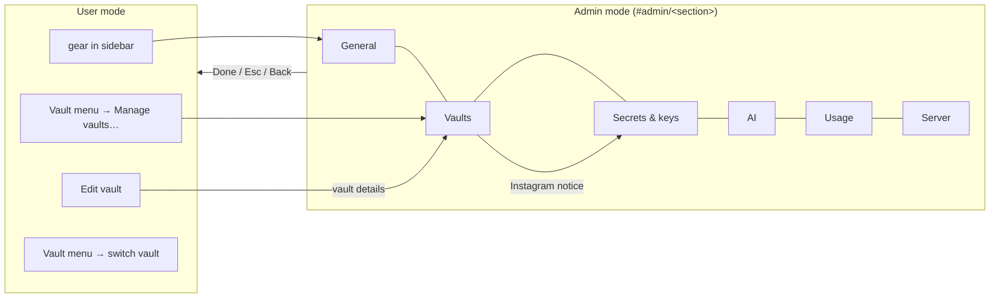
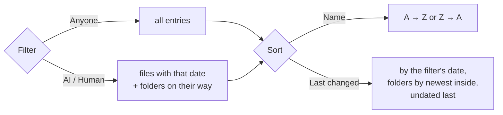
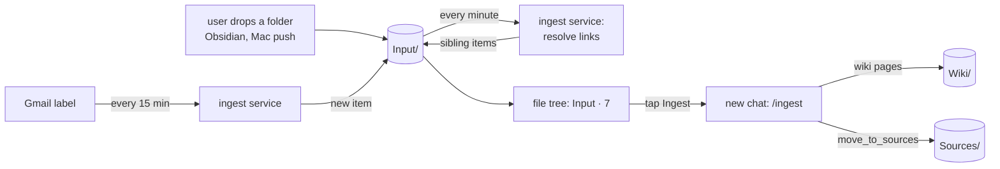
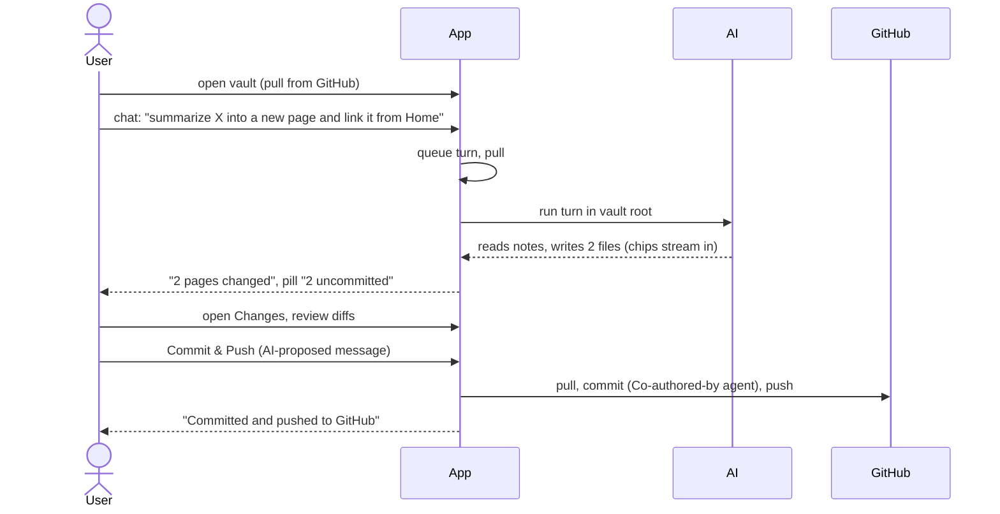
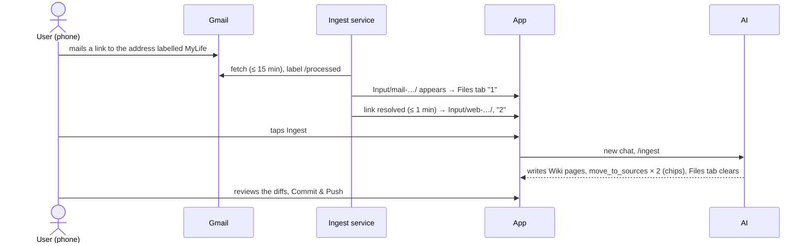
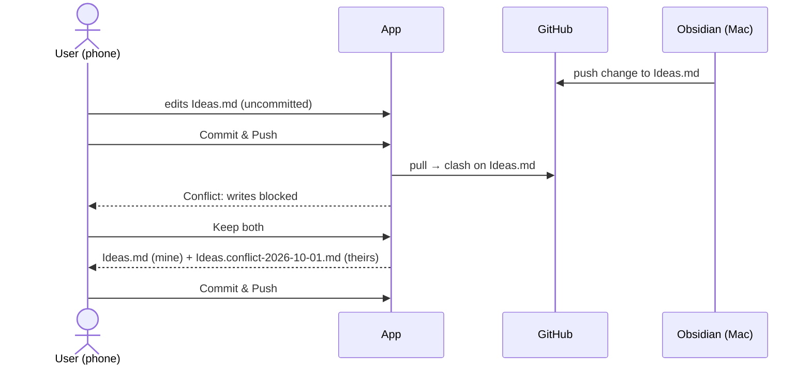
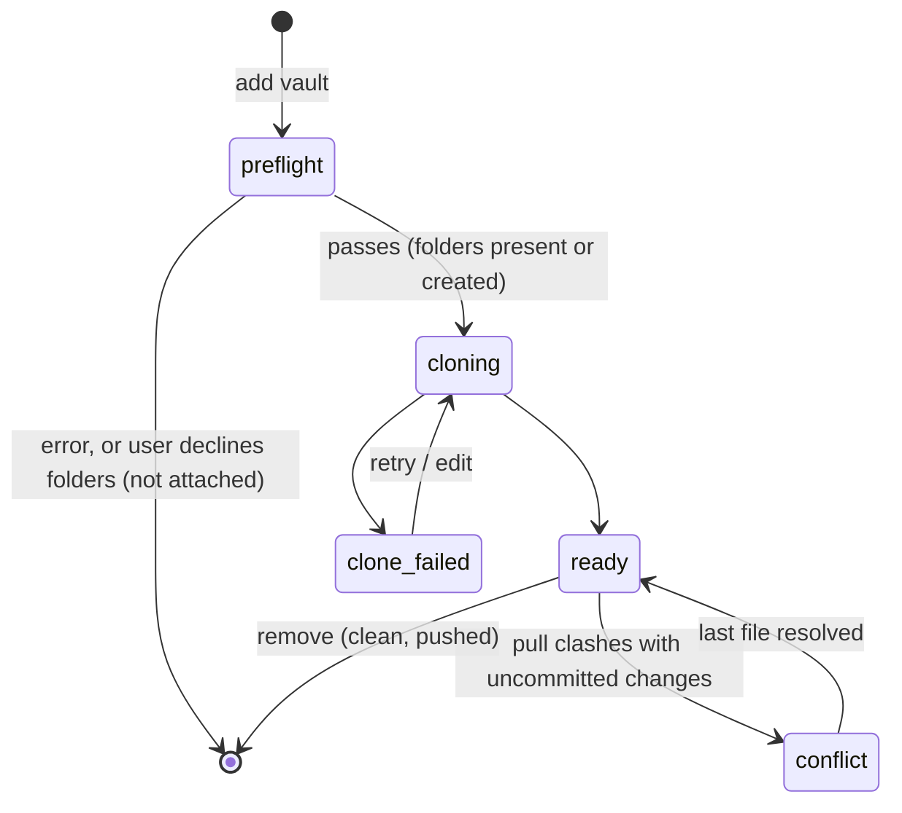
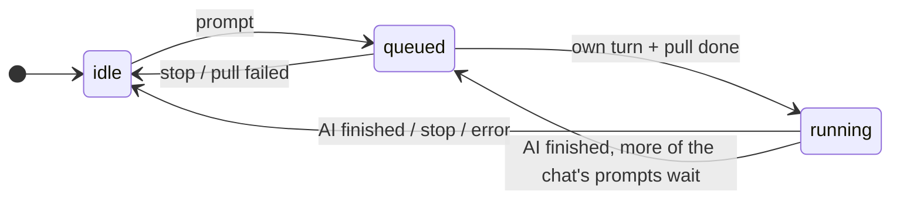

# Functional: karpathy.app

What the user can do, as built on 2026-10-02. What the operator can do (releases, deployments, alerts) is in
[deployment.md](deployment.md). Terms are defined in [domain.md](domain.md).

## Scope

Built up to the MVP milestone **M4**: a chat that reads and writes configured vaults, on mobile, synced through git
(M0 scaffold, M1 vaults and reading, M2 editing and git, M3 AI reads, M4 AI writes). Next is **M5**: the existing
wiki skills usable in the chat ([Skills](#skills)), at least `query` and `lint` on mobile, and at least one
non-Claude model tried. The chat part of it is built: skills in `.agents/skills/` start with `/name` (palette and chips); the
skills that need shell or credentials are not. Fetching mail and links moved out of the skills into a server-side
**ingest service**, so a vault's `/ingest` only turns what waits in `Input/` into wiki pages ([Ingest](#ingest)).

Next to the app there is a public **website** at https://karpathy.app: one static start page that says what the
app is, shows it on a Mac, an iPad and an iPhone (**website screenshots** of the demo vault), names where the idea
comes from (Andrej Karpathy's post "LLM Knowledge Bases" and his gist "LLM Wiki", linked from the hero), that the
project ships code and not a running service (self-hosting needs a server, Tailscale and a set of secrets and
keys), and how to ask for a hosted version (mail to the maintainer). It has no login and holds no user
data ([deployment.md › Website](deployment.md#website)).

Deliberately not built: an Obsidian clone (no plugins or canvas; the graph is a view, not an editor), multiple users or real-time
collaboration, a sync protocol of its own, offline AI, creating GitHub repos from the app.

## Features

### Access

- **Token screen:** one password field; the token is checked against `/api/health` and stored on the device only.
  Any 401 later drops the token and the offline note cache and shows the screen again.
- **Login link and QR code:** opening `<app url>/#token=…` stores the token and removes it from the URL and the
  history before anything else runs. The token screen's **Scan QR code** reads that link with the camera, for the
  home-screen app on iOS, which doesn't share Safari's storage. The operator gets the QR code from
  `just token <target> --qr`.
- **Version:** admin mode › General shows the server's and the loaded PWA's version (`dev` for local builds), so
  after a deploy you see whether the new release and its service worker are live; for a release also when it was
  **Built** and **Deployed** (local date and time).
- **PWA:** installable (standalone, app icons); updates itself when a new version is deployed, re-checking whenever
  the app comes back to the foreground.

### Admin mode (#150)

The app is in one of two modes. **User mode** is the app as used day to day: file tree, note, search, chat, changes;
it includes **switching** between vaults. **Admin mode** is a full-screen view of its own for configuring and watching
the installation: six sections, no notes or chat. It replaced the former "Vaults" and "Settings" dialogs. Admin mode is
two roles ahead: today the one bearer token is both User and Admin, nothing is enforced yet (see
[Permissions and visibility](#permissions-and-visibility)).

| Entry point | Opens |
|---|---|
| Sidebar **gear** (tooltip "Settings") | **General** (on the phone: the section list) |
| Vault menu → **Manage vaults…** ("Add / configure GitHub repos") | **Vaults**, on the vault list |
| **Edit vault** (note pane, changes panel) | **Vaults**, on that vault's details |
| "**Reconnect in Secrets & keys**" notice in Vaults | **Secrets & keys** |



Entering admin mode saves the open note first. The mode has its own address (`#admin/<section>`), so reload, Back and a
bookmarked link work; after a reload straight into admin mode, **Done** goes to the last vault.

| Section | Content |
|---|---|
| **General** | Commit reminder threshold (1–1000 changed files, own **Save**); **Version** (see [Access](#access)) |
| **Vaults** | Vault list, details, Add vault, "What is a vault?" (below) |
| **Secrets & keys** | GitHub token, Instagram login, and the status of every deployment secret (below) |
| **AI** | Model (`provider/model`, server-wide; the server rejects models opencode doesn't offer; free text, no picker), "Default: …" line with **Use default**, **Title model** and **Vision model** the same way, **Web access** switch, **Save settings** |
| **Usage** | Tokens and cost over time, by day, model and vault ([Usage](#usage)) |
| **Server** | CPU, memory, load and disk over time, opencode status, uptime ([Server](#server)) |

Each section saves only its own fields. The texts and validation of the moved forms are unchanged.

**Layouts**

| Width | Layout |
|---|---|
| wide (≥ 1024 px) | A left rail (brand, an **ADMIN** pill, icon + label per section, footer "Admin mode: settings for this installation, all vaults and all users.") and the open section beside it (at most 780 px wide); header bar with the section title and **Done** |
| tablet (700–1023 px) | The same rail, narrow: icon + short label ("Secrets" for Secrets & keys) |
| phone (≤ 699 px) | Strict two levels. The **section list** (**ADMIN** pill, **Done**, large title "Admin", one summary line per section such as "5 of 6 set" or "12.3k tokens this week · $0.40") is the top level and the only place with **Done**. A tap opens the section, whose bar has only "‹ Admin" back to the list. User mode's bottom tab bar is hidden |

- **Leaving:** **Done** returns to where admin mode was entered from: the same vault, note and pane. On wide screens and
  tablets **Escape** does the same, unless the focus is in a text field or a dialog is open (Escape in a field is the
  field's, so typed input isn't lost). On the phone Escape does nothing. Browser Back: on wide screens and tablets one step
  leaves admin mode (moving between sections doesn't add history entries); on the phone it goes from a section to the list
  and from the list out.
- **Focus:** on entering and, on the phone, on each page change, the focus goes to the section heading; leaving puts it back
  on what opened admin mode (the gear or the vault menu button), else the gear.
- **Vault switching stays in user mode** (vault menu, always available). Admin mode has no vault switcher: it isn't about
  one vault. Background work continues in admin mode: a streaming reply keeps streaming and the vault event stream stays
  connected.

#### Vaults section

Three views, switched inside the section. Details and Add vault have an "All vaults" back button to the list.

- **Vault list** (opens first): one row per vault with name, `repo · branch · /root` and the state badge; a row opens
  its details. Below: **Add vault** and a line "Switching between vaults stays in your notes (the vault menu). Here you
  add, edit and remove them." A `(?)` button next to "Vaults" opens **What is a vault?**: a
  short explanation of `Sources/` (immutable source documents), `Wiki/` (the AI-maintained knowledge base) and optional
  `Schema/` (instructions for the AI), with a folder sketch and the note that the app offers to create missing folders.
  "Edit vault" in the note pane and the changes panel (vault not cloned) opens that vault's details directly (only that
  once: later visits to Vaults start at the list).
  While the Instagram connection is `expired`, the list shows "Instagram disconnected — N links waiting.
  **Reconnect in Secrets & keys**", which opens that section. In worker mode (see
  [Instagram connection](#instagram-connection)) it shows "Instagram needs a login on *name*. **Details in Secrets &
  keys**" while a worker reports `needs-login`, else "N Instagram links wait for a worker — none was seen in the last
  hour. **Workers in Secrets & keys**" while links wait and no worker reported for an hour.
- **Vault details:** the edit fields, **Retry** and **Remove** for one vault.
  - **Edit vault:** name any time; repo, branch or root only when the vault has no uncommitted changes and no unpushed
    commits.
  - **Remove vault:** deletes the local clone only, never the GitHub repo; same precondition. Returns to the list.
- **Add vault:** name, GitHub repo `owner/name`, branch (default `main`), optional vault root. The button reads
  "Checking the repo…" while the backend checks the repo first (see [Checked attach](#checked-attach)); the vault is
  stored and clones in the background only if the check passes (list refreshes every 2 s). A failure after the check
  shows the git error with **Retry** and **Edit**.
- **Switch vault** from the vault menu in user mode (shows `name · branch`); the open note is saved first.

#### Other sections

- **General:** the commit reminder threshold, and **Version**: server and PWA version, Built and Deployed ([Access](#access)).
- **Secrets & keys**, three blocks: **GitHub** (the server-wide token, [GitHub token](#github-token)), **Instagram** (the
  ingest service's Instagram login, or the Instagram workers in worker mode, [Instagram connection](#instagram-connection)) and **Deployment secrets**
  ([below](#deployment-secrets)).
- **AI:**
  - The model (`provider/model`, server-wide) and the **Web access** switch (on by default, for all vaults: "Lets
    the AI search the web (via Exa) and read pages you or it found. Each search and page is shown in the chat."). A line
    says that provider keys live on the server only and points to Secrets & keys for whether they are set.
  - **Model default:** below the model field a line "Default: `provider/model`" shows the deployment's default model
    (from its settings, `deploy/settings/`); while the field holds another model, a **Use default** button puts the
    default back into the field. Saving the default removes the override, so a later change of the deployment's
    default applies again; saving another model keeps it as an override until then. The threshold and the switch
    also start from the deployment's settings, but there a saved value keeps winning.
  - **Title model and Vision model** (#148), two more fields under the model, each with its own "Default: …" line and
    **Use default** like the model, saved with **Save settings**. The **Title model** writes the chat titles
    ([Chat with the AI](#chat-with-the-ai)); its default is "the chat model" (whichever model is in effect, an
    override included) until the deployment's settings name one (`ai.title_model`), and it must be a model opencode
    offers. The **Vision model** is the model of the `look_at_image` tool; it shows only when the deployment has a
    vision gateway and takes a model of that gateway (`<gateway>/<model>`; another gateway is a settings change). It
    applies from the next image on, without a restart; the model id isn't checked on save, so a wrong one shows as the
    tool's error. A blank field means the default.
- **Usage** and **Server:** see [Usage](#usage) and [Server](#server).

#### Checked attach

Adding a vault never leaves a half-attached vault behind. The backend first looks at the repo with the GitHub token:

- **Repo or branch unreachable** (typo, no access, no such branch) or **vault root missing:** an inline error under
  the form with the reason; nothing is stored or cloned.
- **`Sources/` or `Wiki/` missing** (names match case-insensitively; a file with that name counts as missing): a dialog
  "Create folders?" naming the missing ones. **Create folders** attaches the vault and, once cloned, creates each as an
  empty `.gitkeep` placeholder; they show up in the changes list as uncommitted until the next Commit & Push, and the
  empty folders appear in the file tree. **Don't attach** closes the dialog, keeps the form filled and stores nothing.
- **All present:** the vault attaches straight away.
- The same repo + branch + root can't be added twice, also not at the same time ("is being added already").

Not checked: changing repo, branch or root of an existing vault, and the structure of vaults that are already attached.
`Schema/` is never created or required.

#### GitHub token

One token is used for every vault. It is set in admin mode › Secrets & keys, so rotating an expired token needs no SSH and no restart; it
applies to the next git operation. The deployment's `github_token` secret (setting `git.github_token`) stays the fallback.

- **Field:** a password field. Its placeholder shows the state: "No token set", "Using the server’s token •••• abcd"
  (the secret) or "•••• abcd" (set in the app); the token itself is never shown again.
- **Save token** (enabled when the field is non-empty) stores it; **Remove** (only when one is set in the app) deletes it
  and falls back to the server's secret. A token must be 20–255 characters without spaces.
- **Test token** checks the typed token if the field is non-empty, else the stored one, without saving: a line "Works —
  signed in as `login`, expires YYYY-MM-DD" (expiry only if GitHub reports it) or the error ("GitHub rejected the token
  (401).", "GitHub is not reachable from the server right now."), plus one line per vault: the repo with a check mark,
  or why that vault's repo or branch isn't reachable with this token. Typing in the field clears the result.

#### Instagram connection

Who scrapes Instagram is a deploy setting, the **Instagram source** (`ingest.defaults.instagram_source`): `worker` in
production and dev, `local` elsewhere (#168, #137; [ADR 0006](../../docs/adr/0006-instagram-scraped-by-a-worker.md)).

**Worker mode.** Instagram blocks the server's data-centre IP, so the server doesn't scrape Instagram at all. An
**Instagram worker** on the user's own Mac or Linux machine (home IP) asks the server for one post at a time, scrapes
it there with instascraper and its own Instagram session, and uploads the result; the ingest service turns it into the
usual `Input/insta-…/` item. Setup: [`docs/instagram-worker.md`](../../docs/instagram-worker.md) (Tailscale on the
worker host, `pipx install`, `karpathy-instagram-worker configure` with the token from
`just instagram-worker-token <target>`, `login`, `doctor`, `once`, `service install`). Admin mode › Secrets & keys ›
Instagram then shows, instead of the Connect form:

- **Status line:** "Scraped by your worker(s)", followed by "— N links waiting" while Instagram links in the vaults'
  `Input/` wait.
- **One row per worker** seen in the last 30 days (newest first): its name, "last seen 3 min ago" and its last message,
  and a state pill: Idle, Scraping, Night (outside its active hours), Resting (a day ceiling or pacing), Needs login,
  Rate-limited, Error. "No worker has reported yet." when there is none.
- For each worker in `needs-login`: "Run `karpathy-instagram-worker login` on *name*."
- **Counts:** "N waiting · N in progress · N backing off · N failed" (posts, not links: the same post in two vaults is
  one job).
- A warning when two or more workers were active in the last hour: "Use one Instagram account per worker, or Instagram
  may block them."
- **Set up a worker:** a link to the setup guide on GitHub. The worker token's own row is in Deployment secrets.

Links **wait** while no worker runs: a waiting link never spends an attempt. A post a worker couldn't scrape is retried
after a backoff of 1 h, 2 h, … (at most 24 h); a post that doesn't exist, or the 5th failure, ends in the mail's
`failed_links`. A worker never scrapes while its account rests (outside the active hours, past a day ceiling), and it
holds no job meanwhile.

**Local mode.** The ingest service fetches Instagram posts with one logged-in account per deployment. Admin mode ›
Secrets & keys › Instagram makes and renews that login from any device; no Mac step.

- **Status line:** "Connected as @x", "Expired: Instagram rejected the session of @x", "Waiting for the code" or "Not
  connected", each followed by "— N links waiting" when Instagram links in the vaults' `Input/` wait for a session.
- **Connect** (or **Reconnect** when expired): Instagram username (a leading `@` is dropped; letters, digits, `.` and
  `_`, at most 30) and password, with the note "The server logs in once and keeps only the session; the password is not
  stored." The password field is cleared on submit.
- **Code step:** when Instagram asks for a 2FA or challenge code, the form shows "Code sent by SMS" (or the channel
  Instagram named) and a code field: **Verify** finishes the login, **Cancel** returns to the form. The code must come
  within 5 minutes ("The code request expired: connect again").
- **Disconnect** (when connected) removes the session.
- Errors under the form: "Wrong username or password", "Instagram did not answer in time: connect again" (no answer
  within 90 s), "Instagram login failed: <error type>". Without a running ingest service the section shows only "Ingest
  service not running".
- The Vaults list carries the "Instagram disconnected" notice while the status is `expired` (see Vault list above).
- A worker pointed at a server in local mode gets no jobs: it reports Idle with "the server is in local mode".

#### Deployment secrets

Below GitHub and Instagram, Secrets & keys lists every secret the deployment references: **Purpose**, **Secret** (its
name), **Used by** (component) and **Status** with an icon and a word: **Set**, **Missing** (a required secret without a
value) or **Not set (optional)**. The heading carries "N of M set". On the phone the secret name moves under the purpose
and the component column is hidden. Only secrets of the active gateway appear. Names and set or not: never a value or a
part of one (the GitHub token keeps its last four characters in its own form). The status is as of the last settings
render (a deployment, or `just dev up`), not probed live; provider keys, the Exa key, the bearer token and the DNS token
are set per deployment, not in the app. A line under the table says so.

The GitHub token's row shows **Set** whenever the app holds a token (set in the app) or the deployment does.

#### Usage

Admin mode › Usage: the LLM tokens the AI used. Range **7 days / 30 days** (default 7) with the date span.

- **Tiles:** Total tokens, Input, Output (reasoning counts as output; with the share of the total) and **Cost**, the last
  only when the provider reports one (otherwise hidden, also in the tables, rather than $0).
- **Tokens per day:** stacked bars (Input, Cache, Output; cache = read + write), a legend, a hover tooltip per day and a
  "Show numbers" table. Days without use show as zero.
- **By model** (input, output, cache, cost) and **By vault** (chats with use, tokens, cost).
- Footnote: "Counts the chats that still exist. A deleted chat drops out; cost as reported by the provider." Sub-agent
  sessions count; a failing vault is left out of the report instead of failing it.

#### Server

Admin mode › Server: the machine the backend runs on (on a dev stack: Rancher Desktop's VM). Range **1 hour / 24 hours /
7 days** (default 24 hours), "sampled every 30 s · updated N s ago". The page refreshes at the sampling interval while
shown and visible, and again when the page becomes visible.

- **Status rows:** the AI harness (opencode) **Up** or **Down**, and the backend's uptime ("7 h 41 min", "2 d 3 h").
- **Five sparkline cards:** CPU (share of all cores), Memory (in use of the total), Load (1-minute average), Disk ·
  vaults and Disk · config volume (used of the total, and percent), each with the current value, a hover crosshair and
  tooltip, its peak marked, min, max and latest, and "Show numbers" with those three.
- Right after a start the first sample is taken at once (CPU is measured against a reading primed at start); before any
  sample "No data yet — the first sample comes within 30 s."
- Footnote: "The machine the backend runs on. Alerts (disk, memory, down) still go to your phone via ntfy." Alerting stays
  with Beszel and healthchecks.io ([deployment.md › Monitoring](deployment.md#monitoring)); the history survives a
  backend restart (kept 7 days).

### Notes

- **File tree:** folders first, collapsed by default, expansion remembered per vault; `.md` hidden in names;
  dot-entries never shown, except the `.agents/` folder (the vault's skills; dot-files and other dot-folders inside it stay
  hidden). The whitelist is the deployment setting `files.visible_dot_dirs` (`[.agents]`; never `.git`). The open note's folders open and its row scrolls into view, unless a filter hides the note.
  The `Input` folder carries the red **input count** and the **Ingest** button ([Ingest](#ingest)).
- **Sort and filter the tree** (#122): two buttons in the *Notes* header, both remembered per browser for all vaults.
  - **Sort** (⇅): by **Name** (A → Z / Z → A) or by **Last changed** (Newest first / Oldest first). Picking a
    criterion sets its natural direction (A → Z, newest first). The menu stays open, so criterion and direction
    can be set in one visit. Under *Last changed*, folders are ranked by the newest change inside them; ties go by
    name; files without a date go last in both directions.
  - **Filter** (funnel): **Anyone** / **AI** / **Human**. Only files with that author's date show, plus the folders
    on their way; empty folders vanish. The menu closes on choice. A chip under the header ("Changed by AI" ✦ /
    "Changed by human" 👤) has a ✕ that resets to Anyone. Nothing matches: "No notes changed by the AI yet." / "…by
    a human yet."
  - The filter also picks the date *Last changed* uses: anyone → **last modified**, AI → **last modified by AI**,
    human → **last modified by human**. Under *Name* the filter only hides.
  - A button not at its default is tinted. The open note stays open when the filter hides it.
  - While dates are in use the tree updates live (debounced refetch on file changes, once more when an AI turn
    ends); offline it sorts and filters the cached listing.


- **Create a note** (path prompt; a typed extension is kept, e.g. `run.py`, otherwise `.md` is added). Only a note
  starts as `# <title>`; any other text file starts empty. Refused for existing names, names that differ only by
  case, and invalid names.
- **Delete a note** (recoverable until the next commit). On any file that isn't a note (code, HTML, media, binary) the
  button says "Delete file".
- **File kinds** (#126): what the note pane shows follows the file's kind by name ([File kinds](domain.md#file-kinds)):
  notes get everything below; HTML pages, code files and emails are described under **HTML pages**, **Code files** and
  **Emails**; `.svg` is a media file and shows as an image.
- **Code files** (#126): any text file that isn't a note or HTML page (`.py`, `.sh`, `.json`, `.txt`, `Dockerfile`, …)
  opens in the editor with syntax highlighting chosen by file name (CodeMirror's language list, each language loaded
  lazily and precached for offline); an unknown name is plain text with every line break as written. One view: no
  Write/Read toggle, no outline, no properties form, no live preview, no wikilink or embed decorations, no attach.
  Find-in-file, Delete ("Delete file") and autosave work as for notes; the title keeps its extension. Opening one
  changes no sticky mode.
- **HTML pages** (#126): `.html` / `.htm` files have the Write/Read toggle on their own sticky **page mode** (Read for
  a new browser; toggling on a page never changes the notes' mode, and the other way round). Write: the editor with
  HTML highlighting. Read: the page rendered in a sandboxed frame filling the note pane; its own `<style>` and inline
  styles apply, stylesheets and images from the vault (relative paths, never outside the vault) are inlined (images up
  to 10 MB), links to vault files open in the app (the back arrow returns), other links in a new tab. Never runs:
  scripts, forms, plugins; remote images and stylesheets don't load (a remote image shows as a link). A search hit or
  AI open at a line shows the page's source for that opening; the page mode stays.
- **Emails** (#166): an `.eml` file (any case; e.g. an ingested `Input/…/original.eml`) shows as a mail, read-only,
  in one view (no Write/Read toggle, find, outline, attach, autosave or save footer; Delete stays). On screen: the
  **subject** (the file name when there is none), the **header block** (From, To, Cc, Reply-To, each only if present,
  as `Name <address>`; the Date in the browser's locale), the attachments as cards (name, size; a tap downloads), and
  the **body**: the HTML part in the same sandboxed, inert frame as an HTML page's Read mode, with its inline images
  (`cid:`) in place, remote images as links and links in a new tab; without an HTML part, the text part with its line
  breaks. Mails that aren't UTF-8 (Latin-1, 8-bit parts) show the same way. A mail over 50 MB asks first ("Load
  anyway"); one that can't be read shows its file name and "This email can't be shown." A search hit in a mail opens
  the mail. An image named only from CSS, one over 10 MB and a forwarded mail are attachments.
- **Back arrow** (#139): a ↩ button in the note header, on every layout, shown only while the previous history entry is
  another file of the same vault opened in this tab (any kind); tooltip `Back to <file name>`. It does exactly what
  browser Back does (`history.back()`): the previous file opens at the place it was left. Not shown on the first file
  of a session, after a reload into a deep link, or when Back would leave the app or switch the vault. On the phone
  it sits next to the ‹ Files / Search / Changes button (which still leaves the note and drops its label while the
  arrow shows); the phone header has no ✦ chat toggle (the Chat tab does the same).
- **Write mode** (default for a new browser): Markdown with live preview, find-in-note; embeds show as a block below
  their line, the `![[…]]` text stays editable. The frontmatter shows as the properties form (below), or as a block
  of raw lines in the YAML view.
- **Copy on select** (#144, Write and Read mode): selecting text in the editor copies it to the clipboard at once, like a
  terminal, and the toast says "Copied". It fires when the gesture ends (mouse up, touch end, key up while Shift is held,
  i.e. shift+arrows/home/end/page), because Safari only allows the clipboard write inside that event. Cmd/Ctrl
  combos (select-all, find next) never copy. Trade-off: a mouse or touch selection (double-click a word) overwrites
  the clipboard, so "copy a URL, select text, paste to replace" pastes the selection; select first, then copy. An empty selection
  and a selection already copied aren't copied again (clearing it first re-arms the copy). A refused clipboard write
  (no secure context, no permission) is silent. Read mode does the same on the rendered page (same gestures and rules):
  it copies the selection's visible text (e.g. "AeroPress", not `[[aeropress]]`), and only a selection inside the page.
  The chat's messages do the same (rendered text, only a selection inside the message list); the composer doesn't,
  since there you select text to replace it.
- **Outline and note info** (#79): the list button in the note header (notes only, left of Write/Read) shows the
  note's headings, indented by level, the same in both modes; headings in code, the frontmatter and `%%comments%%`
  aren't listed. A tap jumps there: Write mode scrolls the heading's line to the top without moving the cursor or
  opening the phone keyboard; Read mode scrolls its block to the top and highlights it (a heading inside a callout or
  quote lands on that block). No history entry, so Back still leaves the note. The section at the top of the pane is
  marked while scrolling. Phone: a bottom sheet (closes on a jump, the dimmed note, the grabber or Escape); tablet: a
  panel at the top right of the note pane (closes on a jump, a tap outside or Escape); wide: the same panel, which
  stays open, also across notes, until the button or Escape closes it. Its footer: `2,418 words · 14,902 characters
  · ~11 min read` for the body without the frontmatter (220 words a minute, the browser's word rules), or
  `Selection: 312 words · 1,904 characters` when text is selected (in the editor or the rendered note; frontmatter
  never counted). While typing, the outline and the counts catch up after a short pause.
- **Properties form** (#82, Write mode): the frontmatter as a form between the title and the text, collapsible to one
  line ("Properties · 6 · ⚠ 1"); its lines are hidden in the editor and the cursor, select-all and editing keys can't
  reach them (a key that would shows them instead). Fields by kind: a picker (a value outside the list stays, flagged),
  a date with **Today**, a number field (`inputmode="decimal"`, non-canonical input like `007` kept as typed), a
  switch, a text field (commits on Enter or leaving it; with an `http(s)` URL as its whole value, an **open ↗** link
  to it in a new tab sits next to it, #147), chips with ✕ and an Add field (Enter adds and keeps the
  keyboard; link lists suggest note names and open the note on a tap), read-only text with "Edit in YAML" for block
  scalars, maps, multi-line lists, anchors and tags. **+ Property** adds a property: the schema's missing ones are
  offered, any plain name (letters, digits, spaces, `-`, `_`) can be typed. A change edits only that property's lines,
  is one undo step and autosaves like typing; an edit that can't keep every other byte is refused ("Edit this property
  in YAML") and writes nothing. New `[[…]]` list items are written quoted; a bare list stays bare (`.md` added when
  its items carry it). **YAML** shows the raw lines (remembered per browser); a note whose frontmatter can't be read
  ("Can't read these properties: …"), "Edit in YAML", a refused edit, or a search hit or find-in-note match inside
  the frontmatter shows that note's lines without changing the preference. Disabled when read-only. Phone: 44 px
  targets, no auto-capitalization or correction in names, Enter says "done".
- **Wiki schema:** on pages in `Wiki/` the form flags what doesn't fit, under the field, and never fixes it or blocks
  saving: `type` (entity, concept, topic, source, synthesis), `tags`, `updated` required; `confidence` high, medium or
  low; dates must be calendar dates; values of the wrong kind ("should be a number", "should be true or false",
  "should be a list", "should be a single value"); unquoted `[[…]]` in any list. Unknown properties are shown, not
  flagged. Outside `Wiki/` kinds come from the values and nothing is flagged. A vault's `.karpathy/schema.json`
  (`appliesTo` folders, `fields` with `kind`, `values`, `required`, `linkStyle`) replaces the default schema and
  applies without a reload; a broken one shows "Schema file ignored: …" once and the default applies. It is hidden
  in the tree and doesn't disable chat.
- **Read mode:** rendered, sanitized Markdown of the note's current text; frontmatter as a properties table, where
  `related` / `sources` values that name a note are links, and a bare `http(s)://…` URL in any value (scalar or list
  item) is an external link in a new tab (`rel="noopener noreferrer"`, #147). Obsidian syntax: callouts `> [!type] Title`, `==highlight==`,
  `%%comments%%` hidden, footnotes, task markers ☑ / ☐, media embeds (below), `![[note]]` as a link (no
  transclusion).
- **Sticky mode:** the Write/Read mode the user last chose holds for every note opened afterwards (tree, search,
  links, chat chips, AI opens) and after a reload, per browser. Opening a code, media or binary file doesn't change
  it; HTML pages have their own (see **HTML pages**).
- **Media embeds** `![[photo.png]]`, `![[clip.mp4|300]]` (width in px, any media kind), ``: images,
  videos (inline, also on iPhone) and audio show in Read mode, in Write mode and in chat replies. PDFs and other files
  show a file card (name, size, Download; Open for a PDF, in the browser's viewer in a new tab). Media over 50 MB shows
  **Load anyway (N MB)**; a missing target shows a "missing" card; offline shows an "offline" card. Remote images
  (`https://…`) stay links. A skeleton holds the space while bytes load. Tapping an image opens it in the note pane.
- **Attach photos and PDFs** (Write mode, online, not in conflict): the **+** in the toolbar offers **Take photo** (the
  back camera on a phone; the file picker elsewhere) and **Choose file** (JPEG, PNG, GIF, WebP, PDF; on iOS library,
  camera or Files). **Drag and drop** from the file system onto the note works too, with a drop outline while dragging.
  Each file is uploaded into the page's own folder and embedded as `![[name]]` on its own line, at the cursor or the
  drop point (typing during the upload doesn't move it). Several files go one after another, in order; a file that
  isn't uploadable is refused with a toast naming it, the others still go in. Photos (JPEG, HEIC) are scaled to
  2048 px and lose their metadata; HEIC that can't be decoded (Chrome) is refused with a message. Over 10 MB the app
  asks first ("adds N MB to the vault's git history for good"); over 50 MB is refused. The footer shows "Uploading…".
  Undo removes the embed text only; the file stays in Changes. An upload that finishes after the user left the note
  (other note, Read mode) still embeds the file, at the end of the note.
- **Move into own folder:** the first upload to a flat page (`Wiki/foo.md`) moves it to `Wiki/foo/foo.md`; the editor
  stays on the page, the address bar shows the new path (no new history entry), the local draft follows, and a toast
  says "Moved to … · updated links in N pages". Path-form links to the page and relative links inside it are
  rewritten; Changes shows the move as the old path deleted and the new one added. Refused while an AI turn runs
  ("The AI is working. Attach again when it's done.") or when the target already exists.
- **Pictures follow the AI's pages:** when an AI turn ends, every picture a page it wrote shows moves into that page's
  own folder, a flat page moving into `Wiki/foo/foo.md` first (the same move and link rewrite as above); the moves are
  AI changes in Changes. A picture already in (or below) the folder of a page showing it, and pictures in `Sources/`
  (a source keeps its media), stay. A picture several pages show goes to the one whose name it starts with most.
  `just tidy-attachments <vault dir> [--apply]` does the same for a whole vault clone (dry run without `--apply`).
- **Media view:** opening an image, video or audio file from the tree (or a tapped image) shows it in the note pane;
  a PDF or other binary file shows its file card. No mode toggle, no find-in-note; Delete stays.
- **Search hit and `[[note#heading]]` in Read mode** scroll to the rendered block that holds the line and highlight it
  briefly.
- **Place:** Back returns to where you left a note seen in this session (also after an image or link); switching
  Write ↔ Read keeps the place.
  Wide tables scroll sideways. Links: wikilinks carry the note's route (new tab and copy link work), relative Markdown
  links to vault notes open in the app, external links open in a new tab.
- **Wikilinks** `[[target#heading|alias]]`: click to open (resolved by path, then path suffix, then file name
  anywhere; with duplicate names the note's own folder wins, then the shortest path, then A–Z); links to missing pages
  are marked and say "No page “X” yet". In a table row the alias bar is written `[[target\|alias]]` (Obsidian's
  table-safe form); it opens, resolves and shows its alias like `[[target|alias]]` in Read and Write mode, backlinks and
  the graph.
- **Autosave** 1.5 s after the last edit; local drafts survive reloads and crashes; status footer
  "Saving…" / "● Unsaved changes" / "Saved".
- **Live updates:** a note changed by the AI or a pull reloads silently if it has no unsaved changes; a deleted note
  shows "Keep as new note" / "Close".

### Search

Ranked full-text search over the vault (#138), plus file-name matches; results grouped per note with up to 4 line
snippets, the matched words marked; capped at 200 hits ("refine your search"); opens the note at the hit, in the current mode.

- **Forgiving matching:** case and accents don't matter (`cafe` finds "Café", `strasse` finds "Straße"), and words
  match in their other forms: `handtuch` finds "Handtücher", `Handtuecher` finds "Handtücher", `towel` finds "towels",
  `cheval` finds "chevaux". Each note's language (German, English, French, Spanish or Italian) is detected when it is
  indexed, or taken from a `lang:` in its frontmatter; very short notes match in all of them.
- The last word also matches as the beginning of a word (`handt` finds "Handtuch"), so results come while typing.
  A word that matches nothing is looked up with typo tolerance (`glaicer` finds "glacier", `renovaton` finds
  "Renovation", in the file name or the text).
- **Whole words only:** a word is found from its beginning, never from inside a longer word: `tuch` does not find
  "Handtuch" (nor `tuch` the file `Handtuch.md`). Search for the compound, or its beginning.
- **File names and paths:** the full file name counts, extension included (`pdf` finds every PDF, `report.pdf` and
  `Meeting.md` find those files), and so do the folder names (`Wiki/glacier`).
- **Limits:** a repeated word counts once and at most 20 different words are looked up (the rest are ignored); search
  text longer than 500 characters is refused ("Search text: at most 500 characters"). Hidden, git-ignored and
  symlinked files are never searched.
- Several words find notes that contain all of them (in the text or the path) and show the lines of any of them; a
  `"quoted phrase"` matches as written (case and accents aside), within one line (#107).
- **Order:** notes whose file name matches every word come first (#99); then the best matches: a word in the file
  name counts most, then in a heading, then in the frontmatter; notes where the words are frequent and rare elsewhere
  in the vault rank higher (BM25); ties in path order.
- Changes by the user, the AI or a pull are searchable at once.

### Graph

The graph button (sidebar header) shows a 3D graph of the vault's notes in the note pane, in place of the note
(#130): one dot per `.md` file, a line per link between two notes (wikilinks, embeds and relative Markdown links,
resolved like in the editor; links in code don't count). The bar switches **Local | Wiki | All**: Wiki (the default)
shows only the notes in the `Wiki` folder, All adds the rest (no Wiki choice when the vault has no `Wiki` folder),
Local the open note's neighbourhood (below). A dot grows with its number of links; its
colour is its frontmatter `type` (`entity` blue, one colour per other type, grey without a type); the legend below the graph
has a checkbox per type to hide or show its notes, remembered in this browser. The open note is orange. Drag rotates, pinch or scroll zooms, hovering shows the note's name, a click opens
the note. Close (✕ or Escape) returns to the note as it was; on the phone, Back returns to the tab the graph was opened
from. While the graph loads, a breathing
graph animation shows. The graph is read on its first open per vault and kept for the session, so reopening is
instant; Refresh reads it again (no live updates), and opening a note that isn't in it yet (made by the AI, a pull or
another device since) reads it again once, so the note gets its local graph. In the Wiki and All views switching notes
keeps the layout (only the orange dot moves). three.js loads on first open only.

**Local graph** (#92): "Local graph" at the foot of the note's outline (panel or phone sheet) opens the graph on the
open note's neighbourhood: the note (orange) and the notes within 1 or 2 links of it, following its links and its
backlinks (Depth 1 | 2 below the graph, remembered in this browser), with every link between them. It lies flat, with
each note's name under its dot; drag moves, pinch or scroll zooms, and the view fits the notes. Same colours and
legend as the vault graph (a hidden type never hides the open note itself; its notes are left out before the
neighbourhood is taken, so they don't link their own neighbours in). The bar switches Local | Wiki | All; the
choice is kept for the session, so the graph button reopens the local graph of whatever note is open then. Local is
offered only while a note is open; links to notes that don't exist are left out (as in the vault graph).

### Bases (query tables)

A fenced ` ```base ` block in a note shows a **live, read-only table** of the vault's files (#91), in Obsidian Bases
syntax, so the same note shows the same table in Obsidian. The block's text is never changed.

- **Read mode:** the table in place of the block. **Write mode:** the table in place of the block while the cursor is
  outside it; the cursor inside (arrow keys, or the table's `</>` button) shows the YAML to edit.
- A tap on a row opens its file; a `[[wikilink]]` in a cell opens that note. The header shows the view's `name`, the
  footer the row count ("2 rows", "10 of 37 rows") and what was left out. A wide table scrolls sideways inside its box,
  never the page.
- **Live:** the table runs again when vault files change (the AI, a pull, another device, a save), 300 ms after the
  last change. A change while a query is running starts a new one; a late answer to the older query never replaces a
  newer table. A failed run (server or network error) is shown but not kept: the next mount or change asks again.
- **v1 syntax** (a subset of [Bases syntax](https://obsidian.md/help/bases/syntax)): `filters` (top level and in the
  view, joined with AND) as a text or `and` / `or` / `not` lists; expressions with `==` `!=` `>` `<` `>=` `<=` `&&`
  `||` `!` `+` `-` `*` `/` `%` and parentheses; frontmatter properties (`status`, `note.status`, `note["my prop"]`);
  `file.name` `basename` `path` `folder` `ext` `size` `ctime` `mtime` `tags` `links` `properties`;
  `file.inFolder()` (with subfolders), `file.hasTag()` (nested tags too; frontmatter and inline tags), `file.hasProperty()`,
  `file.hasLink()`; `date()`, `today()`, `now()` and durations (`today() - "1 month"`), `list()`, `number()`, `if()`,
  `min()`, `max()`; `.contains()` `.containsAll()` `.containsAny()` `.startsWith()` `.endsWith()` `.isEmpty()`
  `.lower()` `.upper()` `.trim()` `.toString()` `.isTruthy()` `.date()`, `.length`. The first view must be
  `type: table`: `order` (columns; default `file.name`), `sort` (`- property: … direction: ASC|DESC`; empty values
  last; default by path), `limit`. `properties: <id>: displayName:` names the columns.
- **Not in v1:** `formulas` / `formula.*`, `this`, other view types (cards, list, map, …), regular expressions and
  other functions. Such a block shows "… not supported in v1" in its box; invalid YAML or an expression that can't be
  read shows "Invalid base: …". `groupBy` and `summaries` are left out with a note in the footer; further views too
  (only the first is shown). An expression or filter tree nested more than 256 levels deep is invalid too.
  Only a note's own properties count: `constructor` or `__proto__` are plain (usually missing) properties.
- At most 500 rows are shown. All vault files count (attachments too, as in Obsidian; dot folders don't); only
  Markdown notes have properties and tags.
- **`.base` files** open like HTML pages: Read shows the table, Write the YAML (page mode). `![[x.base]]` embeds are not
  rendered.

### Changes and commits

- **Changes list** with kind (modified, added, deleted, renamed, untracked) and a unified diff per file.
- **Discard** one file's changes (refused if the file changed since the diff was shown).
- **Commit & Push:** proposes a message (AI, falls back to "Update N files"), editable; commits all uncommitted
  changes of the vault root and pushes. If new changes arrived since the review, the commit is refused with the list.
- **Secret scan** (#141): before it commits, the app scans the changed files (binary ones too) and the commit message
  for secrets (API keys, tokens, private keys: gitleaks' rules). A finding refuses the commit and lists file (or
  "Commit message"), line, rule and at most the first four characters; nothing is committed or pushed. A changed
  file over 50 MB can't be scanned and is listed as `too-large-to-scan`. **Remove** the secret (edit or discard the
  file) and commit again, or **Commit anyway**, which covers exactly the secrets shown (one that arrived later, even
  on the same line, blocks again). A committed `.gitleaksignore` at the vault repo's root (fingerprints
  `file:rule:line`) silences known false positives for good; changes to it count only once they are committed.
  Unpushed commits made outside the app are scanned before a push; if one holds a possible secret, nothing is pushed
  and their changes become uncommitted again, for a normal Commit & Push. The proposed commit message is written
  from a diff with the possible secrets taken out (#167).
- **Unpushed commits:** "N unpushed commits · retry".
- **Commit reminder** when changes pass the threshold: "Later" brings it back at 2× the threshold, a second "Later"
  silences it until the count drops again. Changes under `Input/` don't count (waiting input items aren't unsaved
  work); the Changes list and the pill still show them.
- **Git status pill:** "Conflict" / "Syncing…" / "AI working…" / "N uncommitted" / "All committed", plus
  "· N unpushed", "· N incoming" and "· offline".
- **Incoming changes and the one-tap pull:** while the app is open, the backend fetches GitHub every 2 minutes and on
  every return to the app, so a push from Obsidian shows as "· N incoming" within 2 minutes, or right away after
  switching back. Tapping it (its own tap target next to the pill; the rest of the pill still opens Changes) saves the
  open note's pending text and pulls: "Pulled N changes from GitHub"; a clash goes into the conflict flow; unreachable
  GitHub keeps "· offline" and toasts "Couldn't reach GitHub". The Changes panel shows "N incoming changes · pull"
  and lists the incoming files by name (no diff, at most 200, then "…and N more"). The open note shows "Changed on
  GitHub · Pull" above the editor when it is one of them. On the phone the Changes tab badge adds "↓" (`3 ↓`, or `↓`
  alone). Disabled while an AI turn runs (its own pull takes the changes in); hidden during a conflict.

### Conflicts

When a pull clashes with uncommitted changes: a banner says writes are blocked; each clashing file shows a line diff
of GitHub's version vs. the app's (or "deleted on GitHub / in this app"), with **Keep mine / Keep theirs / Keep both**
(default both) and a larger compare view. The vault returns to normal after the last file is resolved.

### Chat with the AI

- **Swap note and chat** (wide layout, chat open): the round ⇄ button on the divider at the top puts the chat in the
  large main column and the note in the 380 px side column, and back. Nothing is lost on a swap (streaming, typed
  text, cursor, scroll, undo); the browser remembers the choice across reloads; closing the chat keeps it.
- **Chat titles** (#148): a new chat is titled with its first prompt (the *preliminary title*). When its 2nd turn ends,
  the **title model** writes a short title from what has been discussed, in the chat's language, and it replaces the
  preliminary one. Every 10th turn (10, 20, 30, …) the title model titles the last ten turns afresh (at turn 10: turns 3–10, not
  the two the title was made from); if that title
  shares less than half of its significant words with the current one, the chat has drifted and a bar above the composer asks "Rename this
  chat to “…”?" with **Rename** (the suggestion becomes the title) and **Keep** (it is dropped). The suggestion stays
  until answered, also after a reload and on any other device; the next drift check replaces an unanswered one. The
  list and an open chat follow a new title live. A failing or slow title model changes nothing and shows no error;
  a chat renamed or deleted while the title is being written keeps the user's choice. There is no free rename. Chats
  from before the feature get their first drift check at their next multiple of 10.
- **Chat list** per vault (title as above, cut by the column width with the full title as tooltip;
  running/queued marker, **last entry**, context bar; delete); **new chat**; **resume** any chat, also on
  another device mid-turn. The last entry (time of the chat's last message, #140) shows in the device's format as
  the time today, date and time this year, date with year and time before (`en-US`: `02:22 PM`, `Oct 3, 02:22 PM`,
  `Oct 3, 2025, 02:22 PM`); the list is sorted by it, newest first. Under the title a thin **context bar** shows the
  share of the model's context window the chat's last AI reply used; no bar before the first AI reply or when the
  model's window is unknown.
- **Context meter** (#140): above the composer, once a reply has tokens, at every fill level: the bar plus short
  numbers (`4K / 16K`, `29K / 1M`; exact below 1,000; browser's number format), tooltip `22 % of <model>'s context ·
  drops when the chat is compacted`. It updates live while a reply streams. Window unknown → only `4K tokens`, no
  bar. Color: normal below 70 %, warning from 70 %, critical from 90 %.
- **Send** (Enter; Shift+Enter for a newline) and **Stop**. One turn runs per vault at a time; others wait
  ("Waiting for other chat…" / "Waiting for sync…").
- **Type ahead while the AI works** (#155): the message box stays usable during a reply. A message sent meanwhile
  (Enter, or Send, which shows next to Stop once something is typed) waits as a **queued** bubble (dashed outline,
  "Queued") below the reply and goes out by itself when the turn ends, in the order sent; up to 10 can wait per chat.
  Each queued bubble has **Edit** (it leaves the queue and goes back into the message box, files back as chips) and
  **✕** (it is dropped, its uploaded files deleted). Queued messages live on the server: they survive a reload, show
  on every device and still go out with the app closed. **Stop** ends the running turn and puts every queued message
  of the chat back into the message box (oldest first, before what is typed there), so nothing starts after a Stop
  and nothing is lost. A turn that fails does not drop the messages queued behind it; a message whose own turn fails
  before it reaches the AI goes back into the message box. A queued message is not given to the running turn: it is
  the next turn (the AI sees it only after its current reply).
- **Streaming reply** with Markdown and wikilinks, collapsible "Thinking", **tool chips** for files read, changed and
  opened (changed and opened ones open the note; long paths end in "…", the full path is the tooltip), and a footer
  listing the changed pages. A chat scrolled to the end stays at the end when its width changes.
- **Error pills say where a failure came from** (#169): a reply that fails (the provider is out of credits, rate
  limits, a timeout, …) ends in a red pill that names the tool that was running when it failed ("During tool websearch:
  Insufficient credits") or, with no tool running, the model ("From the model qwen3-8b: …"). Also after a reload. The
  app's own errors (a pull before the turn failed, the AI service restarted, …) name their cause themselves and get no
  prefix; a Stop shows none. A tool that fails on its own does not end the turn: its chip turns red and opens its error
  on tap.
- **Clean Markdown from the AI** (#118): after every AI write of a note, the app checks the whole file for Markdown
  that Obsidian shows broken and tells the AI in that write's result, so it fixes the note in the same turn. Two
  mistakes are caught: a wikilink broken across lines (shown as plain text), and `[[page|alias]]` in a table row, whose
  `|` splits the cell (fix: `[[page\|alias]]`). The user sees no message, at most one more *changed* chip. The user's
  own edits are not checked.
- **The AI sees the open file:** each message carries the file open in the note pane (path, Read or Write mode, unsaved edits). When you say "this note", "this page" or "here", the AI calls `current_page` (a chip) and reads that file; with nothing open it says so. Unsaved edits aren't on disk: the AI reads the saved text.
- **The AI knows your local time** (#151): every message carries your device's time zone and language, and the AI gets
  a hidden line with the current local time, so "today", "write today's journal entry" and `/research` note names use
  your date (not the server's) at any hour, with no chip and no permission. It works with the phone locked and for a
  queued message (the time is taken when the turn runs).
- **The AI can ask where you are** (#151): "find a café near me", "what's the weather here?". The AI calls
  `user_location`; the first time, your browser asks "allow location?" (it remembers the answer per site, on iOS per
  app). While it waits the chip says "open the app to share your location"; then "used your location (±12 m)" (the
  position is as precise as the device can tell, e.g. GPS ±10 m, with no place name). Declining is fine: the chip says
  "location not shared" and the AI goes on without it. Only the tab that sent the message answers, so a laptop at home
  never answers for the phone in your pocket; it works while you look at another chat of the vault. A call while
  another vault is shown times out unless you switch back in time. With no position available the chip says "no
  location available". The AI asks only when your request depends on where you are. The position goes to the model
  provider and stays in the chat until you delete it.
- **The AI opens notes** when asked ("show me my reading list"): on the wide layout right away, on a phone or in the
  tablet overlay when the reply is done, never while the user is editing (then a notice "AI opened …" and the chip).
  Reloading a chat never reopens anything; a wrong path goes back to the AI as a tool error. Works in conflict too.
- **Images** (#146): the AI can interpret images of the vault and attached ones through its `look_at_image` tool, which asks a separate vision model (`ai.vision_model`; production `mistralai/mistral-medium-3-5` via ZDR providers; an admin can pick another model of the same gateway in Admin mode › AI) and returns its description; the chat shows a `look_at_image <path>` chip. PDFs and SVGs are not supported.
- **Suggested next prompt** (#145): at the end of a reply the AI may call `suggest_next`; the text shows greyed out in the
  empty composer (no chip) with a small "↹ Tab" button on keyboard devices and "Tap to use" on touch. **Tab** (or a tap)
  puts it into the composer and sends nothing; **Enter** sends it. Typing, sending or a new turn removes it; clearing the
  composer brings it back. It comes from the chat history, so a reload or another device shows it too, until the next
  prompt. Works in conflict too (read-only agent). The AI calls it at most once, last, in the user's language, and may skip it.
- **Web search and web fetch** (with Web access on): "What's new in X?" searches the web (Exa); "summarize the link
  in this note" or a pasted URL is fetched. Each call is a chip: `searched the web: "<query>"` (a label) and
  `fetched <host/path>` (a link to the page, new tab). The AI may fetch only a URL that already appears in the chat
  (the user's messages, notes it read, earlier results); any other URL fails with "URL not in this chat: paste it into
  the chat first", and the turn goes on. At most 20 searches and 20 fetches per turn. Fetched pages stay in the chat;
  they reach the vault only if the AI writes about them. With Web access off, the AI has neither tool.
- **Add a picture, video, audio or PDF from the web** (Web access on, not in conflict): "add a picture of X from <URL> to
  this note" makes the AI save the file as a **new** vault file next to the note (`save_url`, a changed chip, stamped as AI
  work, listed in Changes) and embed it as `![[name]]` at the end of the note (the tool's `note` argument, the note gets a changed chip too). Only a URL that already appears in the chat works
  (same rule as web fetch), and the download counts as a fetch against the cap. It never overwrites a file (the AI picks
  another name), refuses a file over 50 MB, a page that isn't the file (wrong Content-Type), SVG and any hidden or outside
  path; the failure comes back as a tool error and the turn goes on.
- **Commands:** typing `/` in the composer opens the **command palette**: the vault's skills (`query`, `lint`, `ingest`, …)
  with their descriptions, filtered as you type. Two groups, "This vault" (tag `vault`: the vault's own skills, in
  `.agents/skills/`) and "karpathy.app" (tag `app`: skills that ship with the app, today `research`). A vault skill with the
  name of an app skill wins and says "Replaces karpathy.app's /name; rename it in .agents/skills/ to get both." ↑/↓ move,
  Enter or Tab pick, Escape closes, a tap picks. Picking puts `/name ` in the composer and sends nothing.
  - An **empty chat** shows up to four **command chips** (`/query`, …): the commands last used in this vault in this browser
    first, then A–Z; the tooltip says what it does and where it comes from ("from this vault" / "built into karpathy.app"),
    app chips carry the app icon. A tap puts `/name ` in front of whatever the composer holds and focuses it; add arguments
    and send.
  - Sending `/query what is X` runs the `query` skill: the chat shows what you typed, the skill's text goes to the AI as a
    hidden part of the same message (`$1`…`$N` and `$ARGUMENTS` in the skill take your words). A `/word` that is no command
    of this vault (`/etc/hosts is…`) is sent as plain text.
  - The list is per vault and follows pulls: a skill that came in with a pull or was edited shows up the next time the palette
    opens (not during a running turn). If the list can't be loaded the composer works as before.
- **Deep research** (`/research <topic>`, app skill): the first turn reads the wiki, scouts the web a little (at most 3
  searches and 2 fetches), writes a **plan note** `Research/<YYYY-MM-DD>-<slug>.md` (3–6 sub-questions as a checklist) and
  stops with "Edit the note if you like, then reply **go**." Edit the note in the editor if you want, then reply. The run turn
  searches, saves the useful pages to `Sources/` (one file per page: `url`, `title`, `fetched`, a summary with short quotes,
  never the full page; at most 8 per turn), writes or updates wiki pages that cite them (`sources:` and `[[Sources/…]]`) and
  ticks off the plan note. If questions remain, it says so and waits for "continue". `/research <plan note>` resumes in any chat,
  also days later. Needs Web access (with it off the plan turn says so and still writes the plan); in conflict the plan goes
  into the reply and nothing is saved. The vault's own rules for sources decide folder, name and frontmatter. Everything is
  uncommitted until you commit.
- **Open a web page:** "open the Wikipedia page on X" gives an **Open chip** (`open <host/path>`); tapping it opens the page in
  a new browser tab with your own browser session. Nothing opens by itself, nothing is downloaded, and it works with Web access
  off. The AI may offer only a URL that already appears in the chat; any other fails with "URL not in this chat: paste it into
  the chat first".
- **The vault moves to the `.agents` standard** when it is cloned, pulled or opened and still has `CLAUDE.md`,
  `.claude/skills/*` or `.claude/commands/*.md`: a notice "Moved to the .agents standard" lists what moved, what stayed
  because the name exists ("not moved, name exists: …") and files now pasted into `AGENTS.md` (each with **Delete**), with
  **Review** opening the Changes view. See [Skills](#skills).
- **Chat attachments:** the **+** in the composer (online, not in conflict) uploads up to 5 files per message, each at
  most 20 MB, into a new `Sources/upload-YYYY-MM-DD-HHMMSS/` folder (the device's local time). Each shows as a chip
  (thumbnail, or PDF name and size); ✕ deletes its file, and the folder once it is empty. Unsent chips survive a
  reload; one whose file is gone is dropped. The text may be empty when files are attached. The sent message shows
  its attachments (thumbnail through the vault, or a file card; a deleted file shows the missing card), right away
  while it is pending and also after a reload. If the chat's model can't read PDFs, the chip says "`<model>` can't see PDFs: the AI only gets
  the file's path"; the file can still be sent. Images never warn: a text-only model gets them described by `look_at_image` (#146). The settings are read again when a chat opens.
- **Read-only while in conflict** ("the AI can only read, not change notes"); web search and fetch, Open chips and commands still work (a command that writes can't save anything then).
- The AI can read and edit notes in the vault root only; its changes are uncommitted until the user commits.

### Ingest

Mails, links and Instagram posts get into a wiki without the Mac (#131): the server fetches them into the vault's
`Input/`, and one tap lets the vault's `ingest` skill turn them into wiki pages.



- **Input count:** the `Input` row in the file tree shows a red bullet with the number of items waiting (every direct
  sub-folder, also those whose links are still being fetched; aria label "7 sources waiting to be ingested"), hidden
  at 0. It shows when the folder is collapsed and under a tree filter too (the `Input` row stays even if the filter
  hides its items). On the phone the **Files** tab in the tab bar carries the same count. It updates live as items
  arrive and as the AI moves them out.
- **Ingest button** next to the count, also in the phone Files tab's tree: opens a new chat and sends `/ingest` in one
  tap (the chat opens, on the phone the Chat tab), so the turn shows every file read, written and moved. Shown only
  when the vault has an `ingest` command; without one the count's tooltip says "Add an `ingest` skill to
  `.agents/skills/` to ingest from here". Disabled with the reason as tooltip when offline, in conflict, while an AI
  turn runs in the vault, and while it is starting. It counts as a use of `/ingest` for the command chips. Tapping it
  never fetches mail: mail arrives only through the ingest service.
- **What the vault's `ingest` skill does** (the vault's own instructions, not the app's): reads the items in `Input/`
  that have no open links (it skips the others and says so), writes or updates the wiki pages citing
  `Sources/<name>/index.md`, then moves the item with **`move_to_sources`**; one item completely before the next, so
  **Stop** leaves a consistent state. Questions go wherever the vault's rules say.
- **`move_to_sources`** (AI tool, not in a read-only conflict turn): moves `Input/<name>` to `Sources/<name>`. It shows as
  a changed chip `Sources/<name>`; every moved file counts as an AI change (old and new path) in Changes and the commit.
  It refuses a name with `/` or `..` or a leading dot, a symlink, an item that is still being processed ("still being
  processed (unresolved_links): leave it for the next ingest") and an existing target ("Sources/<name> exists: rename or
  merge by hand"); the turn goes on.
- **The ingest service** (on the server): every 15 minutes it fetches the mails of each configured Gmail label into the
  vault's `Input/` (sender allowlist; each mail moves to the label's `/processed`, `/rejected` or `/failed`), every minute
  it resolves the links in waiting items (web pages, PDFs with OCR, YouTube, GitHub, Instagram; in worker mode
  Instagram posts come from the user's Instagram worker) into sibling items. A
  folder the user drops into `Input/` (Obsidian, or pushed from the Mac and pulled) is picked up within a minute. Nothing
  is committed: items, moves and pages are uncommitted changes until **Commit & Push**.
- **Gmail access** is set up by the operator (`just ingest-auth <target> <email>`), **Instagram** by the user: in
  worker mode an Instagram worker on the user's machine, in local mode a login in admin mode › Secrets & keys
  ([Instagram connection](#instagram-connection)).

### Skills

A vault follows the open **`.agents` standard**: instructions in `AGENTS.md`, skills in `.agents/skills/<name>/SKILL.md`
(the layout opencode, Codex, Cursor and Gemini CLI share). opencode reads the vault's `AGENTS.md` (else `CLAUDE.md`, walking
up from the vault root) and the skills in `.agents/skills/` only; `.claude/skills/` is not read, neither by the palette nor by
the AI. Wiki skills (`query`, `lint`, `ingest`, …) are the chat's [commands](#chat-with-the-ai).

- **Automatic move.** After every clone, pull and open (never while the vault is in conflict) the app moves a vault in
  Anthropic's layout: `CLAUDE.md` becomes `AGENTS.md` with its `@path` imports pasted in (whole-line imports of files inside
  the vault, one level, not gitignored), `CLAUDE.md` is rewritten to `@AGENTS.md`, `.claude/skills/*` go to `.agents/skills/`,
  `.claude/commands/*.md` become skills (`foo.md` → `foo/SKILL.md`, body unchanged), and `.claude/skills` becomes a symlink to
  `../.agents/skills`. A vault with `AGENTS.md` but no `CLAUDE.md` gets `CLAUDE.md` = `@AGENTS.md`. So Claude Code on the Mac
  reads the same rules and finds the same skills. It never overwrites: a name that exists stays and is listed in the notice.
  The result is ordinary uncommitted changes (nothing is committed for you); discarding them undoes the move until the next pull.
  Only `.claude/` is migrated, not `.cursor/` or `.codex/`.
- **Vault skills and app skills.** Vault skills are yours (in the vault, synced by git, also in Claude Code on the Mac); app
  skills ship with karpathy.app (every vault, change with app releases, not on the Mac). opencode's own built-ins `init`,
  `review` and `customize-opencode` never show. Skills have no argument hints: the description says what to type after the name.
- **Claude Code plugin skills** aren't in the vault and don't show; copy them into the vault (`.claude/skills/` is fine, the
  move picks them up).

Whether a skill works depends on what it needs:

- **Only file tools** (read, search, write notes): works, within the vault root.
- **Web** (search, reading a URL from a note or the prompt): works with Web access on, within the known-URL rule
  and the per-turn caps.
- **Shell** (Python scripts such as `film-import.py`, `rg` via bash): doesn't work, because `bash` is denied. Making
  it work needs Python in the opencode image and a bash command allowlist re-checked against the leaks in
  [security.md](security.md#confining-the-ai).
- **Credentials** (`ingest-email` with Gmail, the Instagram scraper): not for the AI. Fetching runs in the ingest
  service ([Ingest](#ingest)) with its own secrets; a skill step that runs `ingest-email` or compresses Reels must be
  dropped, the vault's `ingest` skill only reads `Input/`.
- **Steps that commit or push:** never run (the AI can't commit); such steps must be dropped from the skill.
- **Global instructions:** `~/.claude/CLAUDE.md` and hooks such as RTK don't travel; anything a skill relies on must
  be in the vault repo, and every file it reads must lie inside the vault root.
- **Shell snippets** (`` !`cmd` ``) and `@file` references inside a skill are not run or resolved; they stay plain text in
  the instructions the AI reads.
- Skills written for Claude Code may name Claude Code tools or frontmatter fields, and tool calling varies a lot by
  model; each skill needs a check under opencode with the configured model.

## User journeys

### Ask the AI to update notes, then commit



### Research a topic with `/research`

```mermaid
sequenceDiagram
  actor U as User
  participant App
  participant AI
  U->>App: taps the /research chip, types "nanoGPT vs. llm.c", sends
  App->>AI: "/research nanoGPT vs. llm.c" + hidden skill text
  AI-->>App: reads the wiki, ≤ 3 searches, ≤ 2 fetches, writes Research/2026-10-04-nanogpt-vs-llm-c.md
  App-->>U: "Edit the note if you like, then reply go"
  U->>App: edits the plan note (optional), replies "go"
  App->>AI: run turn
  AI-->>App: searches, saves Sources/…, writes cited Wiki/… pages, ticks off the plan
  App-->>U: "saved 6 sources, changed 3 pages"; pill "10 uncommitted"
  U->>App: reviews the diffs, Commit & Push
```

If the AI stops at the caps or after 8 sources, it lists the open questions; "continue" starts the next block.

### Ingest a mail from the phone



### Open a vault that still uses `CLAUDE.md` and `.claude/`

The user opens the vault; the app pulls and moves it to `AGENTS.md` and `.agents/skills/`. The notice "Moved to the .agents
standard" appears, the palette lists the vault's skills, and the Changes list holds the move. **Review**, then **Commit &
Push** (or **Discard** to undo until the next pull). On the Mac, Claude Code reads `@AGENTS.md` and follows the skill link.

### Edit on the phone while Obsidian changes the same note

Usually the incoming count prevents this: the phone shows "↓" on the Changes tab and "Changed on GitHub · Pull" on
Ideas.md, and one tap takes the change in before editing. If the user edits anyway:



## Inputs and outputs

| In | Out |
|---|---|
| Bearer token (once per device) | — |
| Vault config: repo, branch, root, name (+ "create folders" yes/no) | A cloned vault, an inline error, or the missing-folders question; a clone error after the check |
| GitHub token (typed, to save or to test) | Masked state (last 4), token test result per account and vault |
| Text file (note, HTML page, code file) | Saved file + new version; a note rendered from Markdown or an HTML page in a sandboxed frame (Read mode); a code file highlighted |
| Media and other files in the vault (never edited) | Images, video and audio players; file cards with Open (PDF) / Download |
| Email (`.eml`, never edited) | Subject, header block, the body (HTML in a sandboxed frame, or text), attachment downloads |
| Photos and PDFs from the device (Attach button, drop, chat composer) | A new file in the page's own folder or a `Sources/upload-…/` folder; an embed, or a chip sent with the prompt |
| Search query | Grouped hits with line snippets |
| A ` ```base ` block or `.base` file (Bases syntax, v1 subset) | A live, read-only table of matching files; or "… not supported in v1" |
| Chat prompt (`/name args` for a command) | Streamed reply, tool chips, changed notes |
| The device's time zone and language (sent with every prompt) | The AI's date and time are yours; no chip |
| The browser's answer to its location prompt (when the AI asks "where am I?") | A chip ("used your location (±12 m)", "location not shared") and the position in the AI's reply context |
| `/` in the composer; a command chip | The command palette; `/name ` in the composer |
| `/research <topic>`, then "go" | A plan note, then source files, cited wiki pages and a ticked-off plan (uncommitted) |
| Tap on an Open chip | The page in a new browser tab |
| Clone, pull or open of a vault in Anthropic's layout | `AGENTS.md`, `.agents/skills/`, the skill link, a notice (uncommitted changes) |
| Commit message | Commit on GitHub (or an unpushed commit), toast |
| Conflict choice per file | Resolved file(s), possibly a `.conflict-<date>` copy |
| Admin mode: reminder threshold (General), model, title model and vision model (each or Use default) and Web access (AI) | A model override stored only while it differs from the deployment's default |
| Chat turns 2, 10, 20, … | A generated title (turn 2); a title suggestion bar (Rename / Keep) after a drift check |
| URLs in prompts and notes, web search queries (AI) | Web chips; pages and results in the chat only |
| "Add a picture of X from <URL>" (AI) | A new media file or PDF in the vault (changed chip) and an embed in the note |
| Mail to an ingest profile's Gmail label; a folder dropped into `Input/` | Input items (and sibling items for its links) in `Input/`, the input count |
| Tap on Ingest | A new chat running `/ingest`: wiki pages, items moved to `Sources/` (uncommitted) |
| Instagram username, password, maybe a code (Secrets & keys › Instagram, local mode) | The Instagram connection's status; the password is not stored |
| An Instagram worker on the user's machine (worker mode): server URL, worker token, Instagram login there | Scraped posts as `Input/insta-…/` items; the workers and job counts in Secrets & keys › Instagram |
| Admin mode: gear, Manage vaults…, Edit vault; a range (7 / 30 days, 1 h / 24 h / 7 d) | The six sections; the secret status table, token usage, server charts |

No pasting of images, no video or audio uploads by the user (the AI may save them from a URL), no exports, no outgoing
e-mail, no push notifications (also not when something arrives in `Input/`).

## States and transitions





Note save: Saved → Unsaved changes → Saving… → Saved, with side states *retrying*, *stale* (dialog: reload or
overwrite) and *deleted* (banner).

## Permissions and visibility

Single user: whoever has the bearer token can do everything. There are no roles, no sharing and no per-vault
permissions. The UI is split along a planned line of two roles: **User** (user mode: notes, chat, switching between the
vaults one has access to) and **Admin** (also admin mode: configure and watch the installation). Today the one token is
both; a later change can restrict admin mode, taking nothing away from users. The AI's permissions are fixed in the managed opencode config ([architecture.md](architecture.md#opencode-deployopencode)).

## Edge cases and known limitations

- **Offline:** read-only. Cached vault list, trees and previously opened notes are shown; edits are kept as local
  drafts and saved when back online; search and chat are unavailable.
- Created `Sources/` / `Wiki/` are never committed for the user, and `Schema/` is never created. A repo where a
  required folder exists only under another name (not just another case) gets a new, empty one.
- The token test shows an expiry only for tokens GitHub reports one for, and scopes only for classic tokens (the app
  doesn't display scopes today). A tested token is not saved.
- **Bases:** dates without a zone and `today()` count in UTC (the server's clock); `file.ctime` is when the clone
  wrote the file, not when the note was created. A `.base` file's YAML has no highlighting.
- **No rename or move** of notes or folders (except the move into its own folder on a page's first upload or after an AI turn showing pictures), no
  explicit folder creation, no automatic pull (only the count updates on its own), no per-chat model,
  no free chat rename (a title suggestion is the only way to a new title), no global keyboard shortcuts.
- **Chat titles:** the drift check is a word-overlap heuristic: a synonym ("car" vs "vehicle") counts as drift and
  gives one extra suggestion, which **Keep** dismisses; a new topic named with half of the old title's words is missed. Title calls
  don't show in Usage (their throwaway sessions run outside the vaults). The vision and title model fields take only
  models of the deployment's gateways (title: `ai.gateway`, vision: the vision gateway).
- **Admin mode:**
  - **Usage** counts only what opencode still stores: a deleted chat drops out of the totals, and throwaway sessions (commit-message
    proposals) count only while they exist. The first report after a backend start reads every chat once and is slower.
  - **Server** shows the machine the backend container runs on, not per container; there are no alerts, thresholds or
    budgets in the app. The secret status is as of the last settings render. The model field stays free text.
  - Entering admin mode saves the open note, so an unsaved draft can't exist when a vault is removed there.
- Native `prompt()` / `confirm()` dialogs for new note, delete, discard, remove vault and delete chat.
- **Text files other than notes** (#126): no language servers, linting, formatting or line numbers; a language chunk
  that can't load (offline, not yet cached) leaves the file as plain text. HTML Read mode runs no scripts (that needs
  vault pages on a separate origin, a later change) and loads nothing remote; the frame scrolls itself. CSV and JSON
  show as code, not as a table or tree. UI texts still say "note" for any text file ("Create note", the note pane's
  label), except Delete and the back arrow's tooltip. No forward arrow.
- **Emails** (#166): no `.msg` (Outlook) files; no reply or forward; no raw source view in the app (the AI and git see
  it); vault search searches the raw file, not the decoded body; attachments only download (no in-app view); a
  forwarded mail is an attachment card, not shown inline.
- **Chat list right after a backend start:** the first list fetches each chat's last messages once (four at a time),
  so it is slower with many chats; a chat whose fetch failed shows its updated time and no bar until the next list.
- Chat is disabled in vaults that contain `.opencode/`, `opencode.json` or `opencode.jsonc`.
- A save on page exit only works for notes under about 60 KB (browser keepalive limit); the local draft covers the rest.
- Search skips files ignored by `.gitignore` and hidden files; capped at 200 hits.
- **Markdown check:** a small model may ignore the check's report and leave the note as it wrote it. The check doesn't
  see tables without a leading `|`, code spans over several lines or indented code blocks, and it reports old problems
  in a file too, not only the ones the AI just wrote.
- Vaults are full clones; there is no disk-space check before adding a vault and no per-file size limit.
- Push failures aren't retried in the background, only on the next pull, commit or "retry".
- The frontmatter properties table (Read mode) understands simple YAML only; other values are shown raw.
- **Properties form:** no form in Read mode; no frontmatter is created on a note that has none; nested maps,
  multi-line values, anchors and tags are edited in YAML only; very large numbers show rounded; `updated` is never
  bumped automatically. A form edit that makes the frontmatter longer than 20,000 characters turns it into body text
  in the editor (no bytes lost).
- **Outline:** a heading inside a callout, quote or list lands on its top-level block in Read mode.
- The offline cache has no automated test in WebKit (Playwright's offline WebKit fails even service-worker-served
  requests); on iPhone/iPad it needs a check by hand.
- **Media:** fetched whole before it shows (no streaming; the bearer token can't ride on ``), so seeking
  works only after the download. Not in the offline cache. Some codecs (HEVC `.mov` in Chromium, `.mkv`) don't play;
  the player shows its error. PDFs aren't shown inline. **Open** in the installed iOS home-screen app is checked by
  hand only. Note transclusion (`![[Other note]]`) and remote images aren't shown.
- **Web access:** a URL the AI builds itself (e.g. adds a query) can't be fetched: the user pastes it. A link deep in a
  long, truncated page isn't known either. Without `EXA_API_KEY`, search uses Exa's rate-limited anonymous endpoint.
  Changing the web caps (settings `ai.web.fetch_cap` / `search_cap`) needs a redeploy (or `just dev up` in dev).
- **Media download:** the AI saves a file next to the note; a flat note moves into its own folder only when the turn
  ends (see *Pictures follow the AI's pages*), so the AI sees the old paths for the rest of the turn. It can't copy a chat attachment into the vault, and can't save SVG. Uploads by the
  user still allow only JPEG, PNG, GIF, WebP and PDF, while the AI may also save other image types, video and audio.
- **Commands and the move:**
  - Only skills are commands: no variables like `{activeNote}`, no argument hints, no command files (opencode reads them only
    from `.opencode/`, which disables chat); a user prompt becomes a small skill instead.
  - A skill added on the Mac shows after the vault pulled it; a skill the AI or the user edits shows the next time the list
    loads while no turn runs. A skill *created* in the app or by the AI (e.g. a new `ingest` skill) doesn't show as a
    command, and so brings no Ingest button, until the next pull (#134).
  - `@imports` of `CLAUDE.md` that point outside the repo (e.g. a symlink `Schema/methodology.md` → `../../llm_wiki/…`), at
    a missing file or at a gitignored file can't be pasted into `AGENTS.md`, so opencode doesn't see that text; the line
    stays as it was.
  - A moved skill folder counts as one deleted plus one added file per file in the uncommitted-changes count. Claude Code
    plugin skills aren't in the vault and don't show.
  - The move is automatic and has no off switch; it is skipped in conflict and runs again after the next pull or open.
- **Research:** the plan step and its scouting budget are instructions to the AI, not enforced; the hard bounds are 20
  searches and 20 fetches per turn and your reply before each block. No cost cap in money. Fetched web content that lands in
  `Sources/` is unreviewed until you review the diff.
- **Links:** the AI's own reply text can still contain links of any URL (not checked); only the Open chip is guarded.
- **Ingest:**
  - No ingest profile is enabled in production yet: the service runs idle there until the cutover
    ([deployment.md › Ingest cutover](deployment.md#ingest-cutover)). Mail accounts and labels are a deploy setting,
    not configurable in the app.
  - The ingest service runs ingest-email at a pinned commit that still lacks: atomic item creation (a mail folder is
    written in place), a duplicate lookup in `Sources/` (an item already moved there can be fetched again), completing
    hand-made items (URLs in a dropped folder without `unresolved_links` aren't resolved) and Reel re-encoding. That
    commit sits on ingest_email's feature branch `instagram-worker`, not on its `main` and untagged: deleting the branch
    before merging would orphan the pin.
  - **Local mode** (not used in production any more): Instagram may challenge or block logins and fetches from the
    server's data-centre IP (#137), and a link waiting for a session still spends attempts (a `no-session` link is
    given up after `resolve_max_attempts` polls, and "N links waiting" then drops although nothing was fetched). The
    real server-side login is tested only against a fake.
  - **Worker mode:** links wait for as long as no worker runs (a laptop asleep, a worker that needs a login); the app
    shows a notice after an hour, nothing else nags. One Instagram account per worker is a rule in the guide and a
    warning in the app, not enforced. The worker token is one per deployment: rotating it means a redeploy and
    `configure` on every worker. A worker asks for a fresh Instagram login only after three failed session checks in
    a row (a network error or a rate limit look the same to instascraper), so an expired session shows as
    Rate-limited for up to an hour first. The worker and its Instagram access are tested against a stubbed
    instascraper only; the macOS log file isn't rotated (about 150 kB a day). Results stay in the dropbox for 7 days
    (up to about 20 GB at the day ceiling).
  - **Cancel** in the Instagram code step only resets the form: the server's pending login waits for a code until its
    5-minute timeout, and reopening Secrets & keys shows the code field again (#135).
  - A new item arriving between the review and the commit makes the commit refuse with the changed list ("changes
    moved"); review again. A long `/ingest` turn holds the vault: commits and pulls wait until it ends or is stopped.
  - Items are uncommitted until the user commits: discarding them loses them (their mails have already left the
    Gmail label), and their media sits on the vault disk meanwhile. An item that was committed in `Input/` and then
    moved shows in Changes as deletes plus adds.
  - No notification when something arrives, no scheduled (unattended) ingest.
- **Uploads:**
  - Chat attachments are useful only with a model that reads images (and PDFs); the production model is text-only
    today, so the AI gets only an "ERROR: Cannot read …" note and says so.
  - PDFs aren't turned into text for text-only models.
  - opencode keeps attached files in its session store, and loading a chat transfers them in full (bounded by
    5 × 20 MB per prompt).
  - Uploads stay in the git history for good; there is no per-vault quota.
  - PNG, GIF and WebP are uploaded as they are, metadata included.
  - Images a moved page embeds aren't moved with it.
  - A synthesized drop with files isn't reliable in WebKit's automation: Safari drag and drop is checked by hand.
  - Still to be checked by hand: on a real iPhone, **Take photo** opening the camera, **Choose file** offering
    library, camera and Files, a HEIC library photo arriving as `.jpg`; and in Obsidian, a moved page, its image and
    a rewritten `[[…/…]]` link after a commit and pull. Safari drag and drop on the Mac was checked by hand on
    2026-10-05.
- **Location and local time** (#151):
  - A locked phone, a closed tab or an ignored permission prompt: after 90 s the AI is told "the device did not answer"
    and asks you where you are; the chip says "no answer from your device". Open the app while the chip waits and it
    answers.
  - A duplicated tab shares the tab id: both answer, the first wins, the second is refused silently.
  - Only the sending tab answers; a prompt sent by an old PWA build or by the ingest runner has no answering tab, so a
    location request times out there, and its local time is the deployment's `timezone` setting (Europe/Berlin), not
    your device's zone.
  - The browser asks again only if you reset the site permission; with iOS "Precise Location" off the position is
    approximate (the chip shows the larger accuracy). A cold GPS fix can take up to about 30 s.
  - Only `user_location` exists as a browser tool; no app setting turns it off (the browser's site permission does), and
    there is no reverse geocoding: with Web access on the AI can look a place up itself.
- A retryable provider error is retried by opencode for up to about 2 minutes before the turn fails.
- With the chat in main, Tab still reaches the note before the chat (the swap moves columns visually only). At
  1024–1279 px with the sidebar open, the main column (364 px) is narrower than the side column.
- An AI open that waits for the turn end (phone, tablet overlay) is lost on a page reload or when the user leaves the
  chat view first; the "opened" chip still leads there. A switch blocked by a stale save or a deleted note is not
  retried.
